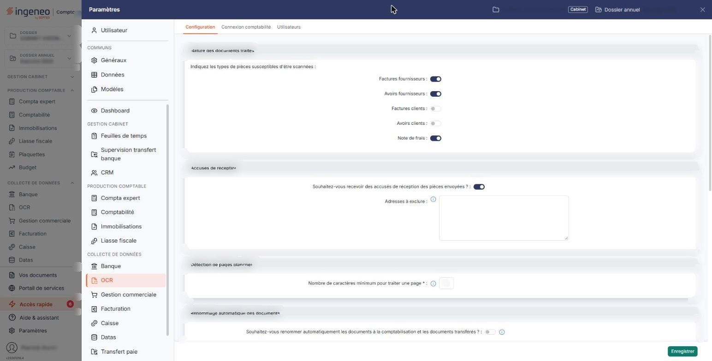
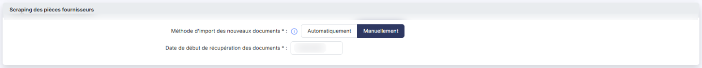
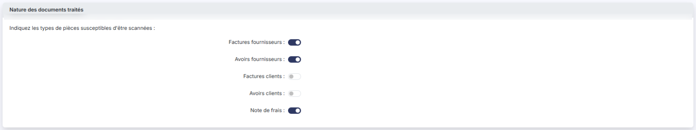
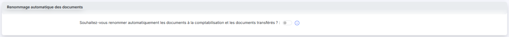
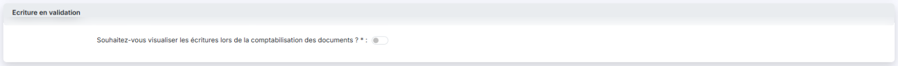
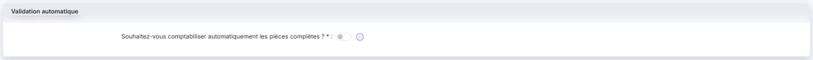
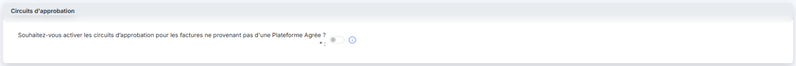

# Configuration — envoi par e-mail et récupération


**Où le trouver :** Panneau **Paramètres** › **OCR** › **Configuration**



**En bref** — Cette page présente les voies d'entrée des documents autres que le dépôt de fichiers : l'envoi par e-mail et la récupération automatique chez les fournisseurs.

* Pour paramétrer les accusés de réception des pièces envoyées par e-mail : « Configuration » (panneau « Paramètres », rubrique « OCR »), rubrique « Accusés de réception ».
* Pour récupérer les factures sur vos comptes fournisseurs : entrée « Connexion fournisseur » du menu « ⋮ » de l'écran de saisie, puis rubrique « Scraping des pièces fournisseurs » de la « Configuration ».


Outre le dépôt de fichiers depuis l'écran de saisie (bouton **\[Ouvrir le dépôt]**), deux autres voies permettent de faire entrer des documents dans le module.

<figure><figcaption>
Écran « Configuration » de la nouvelle interface
</figcaption></figure>

## Envoi de documents par e-mail

<figure><figcaption>
Rubrique « Accusés de réception »
</figcaption></figure>

Les accusés de réception des pièces envoyées se paramètrent dans la « Configuration » (panneau « Paramètres », rubrique « OCR »), rubrique « Accusés de réception ».

## Récupération automatique chez les fournisseurs

<figure><figcaption>
Rubrique « Scraping des pièces fournisseurs »
</figcaption></figure>

Les factures peuvent enfin être récupérées directement sur vos comptes fournisseurs. Ce mécanisme est décrit dans la page de l'écran de saisie, à l'**entrée « Connexion fournisseur » du menu « ⋮ »**, et se paramètre dans la « Configuration » (panneau « Paramètres », rubrique « OCR »), rubrique « Scraping des pièces fournisseurs ».

## Autres vues de l'écran

<figure><figcaption>
Nature des documents traités
</figcaption></figure>

<figure><figcaption>
Détection de pages blanches
</figcaption></figure>

<figure><figcaption>
Renommage automatique des documents
</figcaption></figure>

<figure><figcaption>
Libellé des écritures
</figcaption></figure>

<figure><figcaption>
Archivage des pièces
</figcaption></figure>

<figure><figcaption>
Ecriture en validation
</figcaption></figure>

<figure><figcaption>
Validation automatique
</figcaption></figure>

<figure><figcaption>
Circuits d'approbation
</figcaption></figure>
