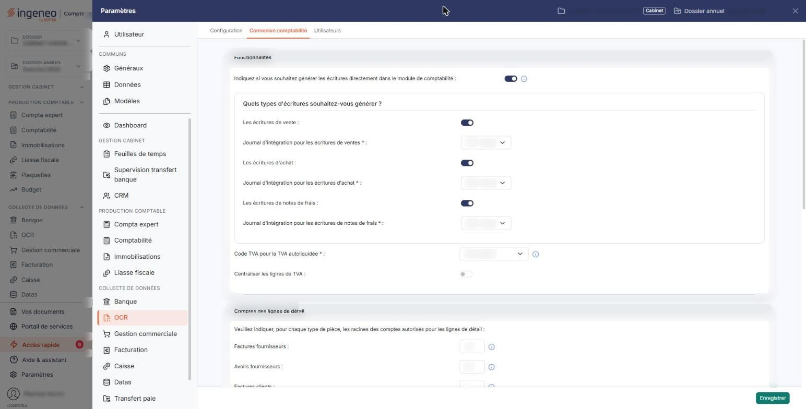
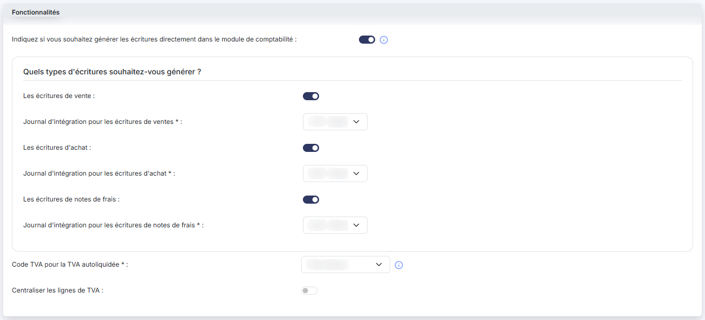
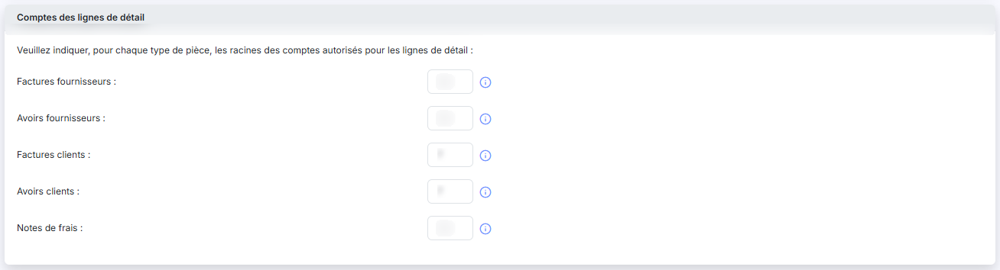
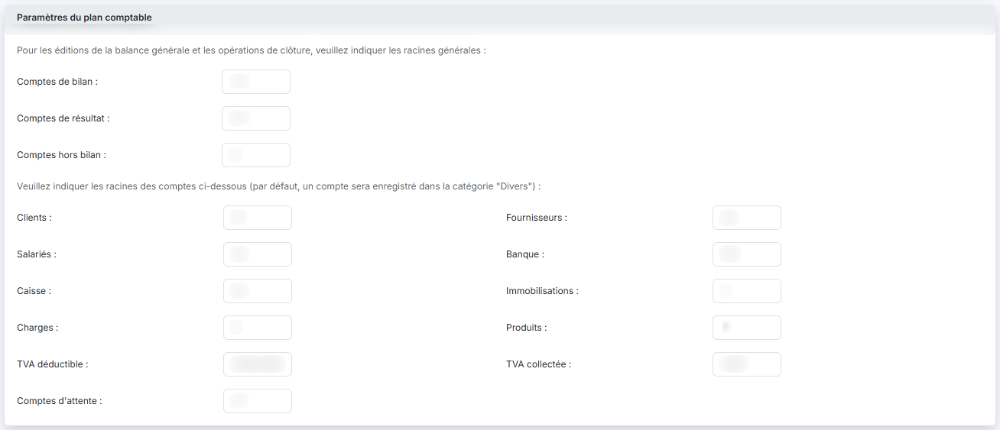
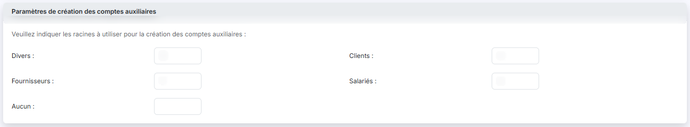

# Connexion comptabilité


**Où le trouver :** Panneau **Paramètres** › **OCR** › **Connexion comptabilité**



**En bref** — Cet écran définit la destination des écritures générées à la comptabilisation des pièces, les journaux d'intégration et les racines de comptes que le logiciel proposera pendant la saisie.

* Pour envoyer les écritures directement en comptabilité : activez « Indiquez si vous souhaitez générer les écritures directement dans le module de comptabilité », puis bouton \[Enregistrer].
* Pour choisir les journaux : renseignez « Journal d'intégration pour les écritures d'achat », de ventes et de notes de frais, puis bouton \[Enregistrer].
* Pour orienter les propositions de comptes : rubrique « Comptes des lignes de détail », saisissez les racines par nature de pièce, puis bouton \[Enregistrer].


Ces paramètres définissent la destination des écritures comptables générées lors de la comptabilisation des pièces, ainsi que les comptes que le logiciel proposera pendant la saisie.

<figure><figcaption>
Écran « Connexion comptabilité » de la nouvelle interface
</figcaption></figure>

Dans la nouvelle interface, cet écran s'ouvre depuis le panneau « Paramètres » : rubrique **OCR** de la barre latérale, puis onglet **Connexion comptabilité**.

L'écran se compose de quatre rubriques : **Fonctionnalités**, **Comptes des lignes de détail**, **Paramètres du plan comptable** et **Paramètres de création des comptes auxiliaires**. Les points a) à e) ci-dessous décrivent la rubrique **Fonctionnalités**.

## Indiquez si vous souhaitez générer les écritures directement dans le module de comptabilité

<figure><figcaption>
Rubrique « Indiquez si vous souhaitez générer les écritures directement dans le module de comptabilité »
</figcaption></figure>

Ce paramètre se règle au moyen d'un interrupteur, suivi d'un pictogramme « Information », et détermine la destination des écritures lors de la comptabilisation d'une pièce océrisée.

Si l'interrupteur est activé, dès qu'une pièce sera validée et qu'une écriture sera générée depuis le module, elle sera automatiquement enregistrée dans le journal idoine du logiciel de comptabilité.

Si l'interrupteur est désactivé, les écritures seront générées dans un fichier distinct, consultable dans le menu « Ecritures », d'où vous pourrez les exporter vers le module Comptabilité ou vers un autre logiciel de comptabilité.

## Quelles écritures générer, et dans quel journal

Trois natures d'écritures sont gérées séparément. Pour chacune, vous indiquez si le logiciel doit la générer, puis dans quel journal elle sera intégrée.

| Champ                               | Ce qu'il faut savoir                                                                                                                                                                   |
| ----------------------------------- | -------------------------------------------------------------------------------------------------------------------------------------------------------------------------------------- |
| **Les écritures de vente**          | Elles correspondent aux **factures et avoirs clients**. Choisissez le journal de ventes qui doit les recevoir, dans la liste **Journal d'intégration pour les écritures de ventes**.   |
| **Les écritures d'achat**           | Elles correspondent aux **factures et avoirs fournisseurs**. Choisissez le journal d'achats qui doit les recevoir, dans la liste **Journal d'intégration pour les écritures d'achat**. |
| **Les écritures de notes de frais** | Choisissez le journal qui doit les recevoir, dans la liste **Journal d'intégration pour les écritures de notes de frais**.                                                             |

Ces trois listes sont **obligatoires** : elles sont suivies d'une astérisque à l'écran.

Si vous désactivez l'interrupteur de l'une de ces trois natures, le logiciel ne générera aucune écriture pour les pièces correspondantes ; la liste du journal de cette nature n'est alors plus affichée à l'écran (constaté pour les écritures de vente).

## Journaux des écritures automatiques

Si vous avez activé la comptabilisation automatique des pièces dans l'écran « Configuration » du module (panneau « Paramètres », rubrique OCR), les écritures sont générées sans qu'un utilisateur les prévisualise.

Ce paramètre se trouve dans la rubrique **Validation automatique** de l'écran « Configuration », sous la question **Souhaitez-vous comptabiliser automatiquement les pièces complètes ?**

Vous pouvez donc désigner ici un **journal distinct** pour ces écritures automatiques — la liste **Journal d'intégration pour les écritures automatiques d'achat** et la liste **Journal d'intégration pour les écritures automatiques de ventes** — afin d'en faciliter la révision.

Si vous n'en indiquez pas, ces écritures partiront dans le même journal que les pièces comptabilisées par un utilisateur.

**Ces deux champs n'apparaissent que si la comptabilisation automatique est activée** : si vous ne les voyez pas, c'est que l'interrupteur correspondant est désactivé dans l'écran « Configuration ».

## Code TVA pour la TVA autoliquidée

Le taux de TVA défini ici permet de générer les écritures liées à la TVA autoliquidée, pour les fournisseurs et les clients qui y sont soumis — notamment lorsque vos fournisseurs sont situés dans l'Union européenne.

Le code de TVA choisi porte également les numéros de comptes à utiliser.

Ce champ est **obligatoire** : il est suivi d'une astérisque à l'écran, et d'un pictogramme « Information ».

## Centraliser les lignes de TVA

Ce paramètre se règle au moyen d'un interrupteur.

## Rubrique « Comptes des lignes de détail »

<figure><figcaption>
Rubrique « Comptes des lignes de détail »
</figcaption></figure>

Ces racines facilitent les propositions que fait le logiciel lors de la saisie d'une pièce : il restreint les comptes proposés à ceux qui commencent par les racines indiquées.

Cinq zones sont à renseigner, une par nature de pièce :

* Factures fournisseurs
* Avoirs fournisseurs
* Factures clients
* Avoirs clients
* Notes de frais

**Comment saisir les racines**

Pour définir une **fourchette**, séparez les deux valeurs par un **tiret** (-).

Pour indiquer **plusieurs valeurs**, séparez-les par des **points-virgules** (;).

## Rubrique « Paramètres du plan comptable »

<figure><figcaption>
Rubrique « Paramètres du plan comptable »
</figcaption></figure>

Cette rubrique indique au logiciel comment classer les comptes généraux du dossier. Elle se remplit en deux temps.

**Les racines générales**, employées pour les éditions de la balance générale et pour les opérations de clôture :

* **Comptes de bilan**
* **Comptes de résultat**
* **Comptes hors bilan**

**Les racines par catégorie de compte.** Un compte qui ne correspond à aucune des racines indiquées est enregistré dans la catégorie « Divers ».

* **Clients** et **Fournisseurs**
* **Salariés**
* **Banque** et **Caisse**
* **Immobilisations**
* **Charges** et **Produits**
* **TVA déductible** et **TVA collectée**
* **Comptes d'attente**

## Rubrique « Paramètres de création des comptes auxiliaires »

<figure><figcaption>
Rubrique « Paramètres de création des comptes auxiliaires »
</figcaption></figure>

Lorsque le logiciel crée un compte auxiliaire pendant le traitement d'une pièce, il lui attribue un numéro construit à partir de la racine indiquée ici, selon la nature du tiers :

* **Divers** et **Clients**
* **Fournisseurs** et **Salariés**
* **Aucun**

La règle de saisie des racines, décrite ci-dessus, vaut pour ces zones comme pour les précédentes.

## Enregistrer

Le bouton bouton **\[Enregistrer]**, en bas de l'écran, valide l'ensemble des quatre rubriques en une fois.

Les rubriques « Paramètres du plan comptable » et « Paramètres de création des comptes auxiliaires » sont enregistrées dans des paramètres communs à plusieurs modules.
