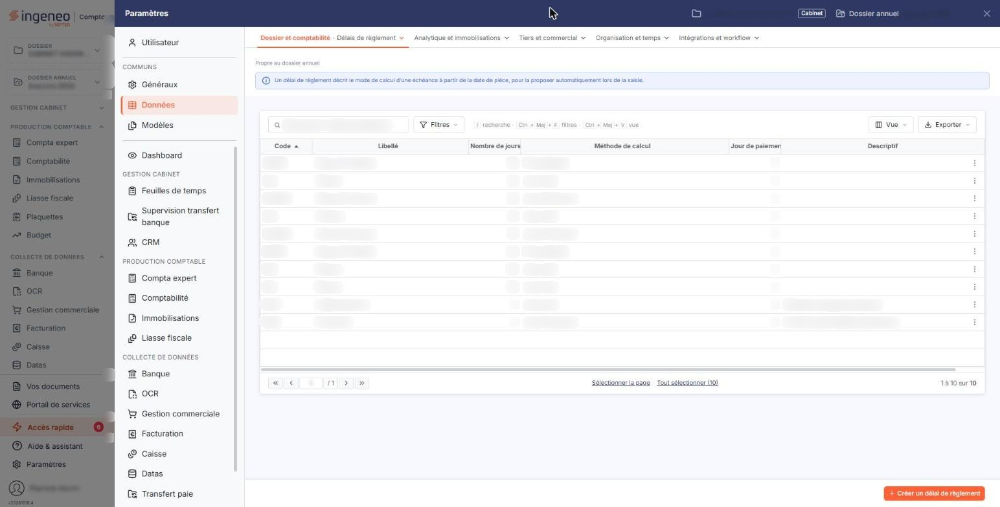
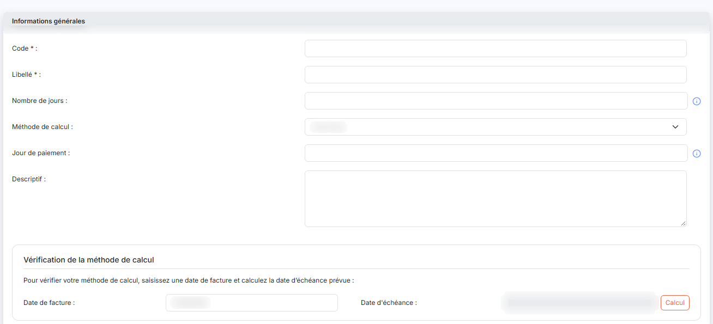

# Délais de règlement


**Où le trouver :** Panneau **Paramètres** › **Données** › **Dossier et comptabilité** › **Délais de règlement**



**En bref** — Cet écran définit les délais de règlement qui servent à calculer les échéances à partir de la date d'une pièce comptable.

* Pour créer un délai : bouton \[Nouveau], renseignez « Code », « Libellé », « Nombre de jours » et « Méthode de calcul », puis bouton \[Enregistrer].
* Pour contrôler vos critères : saisissez une « Date de facture », puis bouton \[Calcul] et lisez la « Date d'échéance » obtenue.


Cette option permet de définir les délais de règlement qui seront utilisés pour calculer les échéances à partir de la date d’une pièce comptable.

<figure><figcaption>
Écran « Délais de règlement » de la nouvelle interface
</figcaption></figure>

Un délai de règlement ne peut pas être supprimé s'il est utilisé par un compte général ou auxiliaire (client, fournisseur, salarié ou divers), un devis, une facture ou une facture d'achat.

La liste des délais de règlement comporte six colonnes : **Code**, **Libellé**, **Nombre de jours**, **Méthode de calcul**, **Jour de paiement** et **Descriptif**. Sur chaque ligne, une case à cocher vous permet de sélectionner le délai, et deux pictogrammes vous permettent de « Modifier » ou de « Supprimer » le délai de règlement. L'en-tête de la liste vous propose les pictogrammes habituels de sélection, de choix des colonnes, de filtre et d'impression. En pied d'écran, le bouton **\[Nouveau]** ouvre le formulaire de création et le bouton **\[Supprimer]** supprime les délais que vous avez cochés. Un bouton **\[Exporter]** est également proposé.

Le formulaire comporte une seule rubrique, « Informations générales », et se termine par les boutons bouton **\[Enregistrer]** et bouton **\[Retour]**.

| Champ                 | Ce qu'il faut savoir                                                                                                                                                                                                                                                                                                                                                                                                                                                                                                                                                                                                                                                                                                                                                                                                                                                                                                                                                                                                                                                                                                                                                                                                                                                                                                                                                                                                                                                                                                                                                                                 |
| --------------------- | ---------------------------------------------------------------------------------------------------------------------------------------------------------------------------------------------------------------------------------------------------------------------------------------------------------------------------------------------------------------------------------------------------------------------------------------------------------------------------------------------------------------------------------------------------------------------------------------------------------------------------------------------------------------------------------------------------------------------------------------------------------------------------------------------------------------------------------------------------------------------------------------------------------------------------------------------------------------------------------------------------------------------------------------------------------------------------------------------------------------------------------------------------------------------------------------------------------------------------------------------------------------------------------------------------------------------------------------------------------------------------------------------------------------------------------------------------------------------------------------------------------------------------------------------------------------------------------------------------- |
| **Code**              | Doit être unique. Le code n'est plus modifiable une fois le délai de règlement enregistré.                                                                                                                                                                                                                                                                                                                                                                                                                                                                                                                                                                                                                                                                                                                                                                                                                                                                                                                                                                                                                                                                                                                                                                                                                                                                                                                                                                                                                                                                                                           |
| **Libellé**           | 
Doit être unique. Les champs suivants permettent de définir la manière dont est calculée le délai de règlement.
                                                                                                                                                                                                                                                                                                                                                                                                                                                                                                                                                                                                                                                                                                                                                                                                                                                                                                                                                                                                                                                                                                                                                                                                                                                                                                                                                                                                                                                                            |
| **Nombre de jours**   | 
Nombre de jours à ajouter au jour de votre pièce comptable et pris en compte par le champ « Méthode de calcul ». Si ce champ est laissé vide ou si « 0 » est saisi, les champs suivants prendront comme base le jour de la pièce comptable. Le champ est accompagné d'un pictogramme « Information » qui rappelle : « Pour une période d'un mois fixe, saisir "30" jours. »
                                                                                                                                                                                                                                                                                                                                                                                                                                                                                                                                                                                                                                                                                                                                                                                                                                                                                                                                                                                                                                                                                                                                                                                                                |
| **Méthode de calcul** | 
Six options sont possibles : • <strong>Jours nets</strong> : ajoute à la date de la pièce le nombre de jours défini dans le champ « Nombre de jours ». Exemple : 15 jours nets pour une pièce du 15/01/N renvoie au 30/01/N. Si le nombre de jours saisi est « 30 », un mois fixe est ajouté à la date de la pièce. Exemple : 30 jours nets pour une pièce du 15/02/N renvoie au 15/03/N. - <strong>Jours fin de mois</strong> : ajoute à la date de la pièce le nombre de jours défini dans le champ « Nombre de jours » et renvoie à la fin du mois du mois obtenu. Exemple : 20 jours fin de mois pour une pièce du 15/03/N renvoie au 30/04/N. - <strong>Fin de décade</strong> : ajoute à la date de la pièce le nombre de jours défini dans le champ « Nombre de jours » et renvoie à la fin de la décade (tranche de 10 jours) dans laquelle se situe le jour obtenu. Exemple : Fin de décade pour une pièce du 01/03/N renvoie au 10/03/N. - <strong>Fin de mois + N jours</strong> : renvoie à la fin du mois du mois et ajoute le nombre de jours défini dans le champ « Nombre de jours ». Exemple : Fin de mois + 20 jours pour une pièce du 15/03/N renvoie au 20/04/N. - <strong>Fin de trimestre</strong> : ajoute à la date de la pièce le nombre de jours défini dans le champ « Nombre de jours », puis renvoie à la fin du trimestre dans lequel se situe le jour obtenu. - <strong>Fin de trimestre + N jours</strong> : renvoie à la fin du trimestre de la date de la pièce, puis ajoute le nombre de jours défini dans le champ « Nombre de jours ».
 |
| **Jour de paiement**  | Renvoie au prochain jour ayant le rang défini dans ce champ à partir du jour obtenu par l’application des critères définis dans « Nombre de jours » et « Méthode de calcul ». Exemple : 20 jours fin de mois le 15 pour une pièce du 15/03/N renvoie : 04/04 (20 jours), puis 30/04 (Fin de mois), et enfin 15/05/N (prochain jour ayant le 15ème rang dans un mois). Le champ est accompagné d'un pictogramme « Information » qui rappelle : « Définit un jour fixe dans le mois. »                                                                                                                                                                                                                                                                                                                                                                                                                                                                                                                                                                                                                                                                                                                                                                                                                                                                                                                                                                                                                                                                                                                 |
| **Descriptif**        | —                                                                                                                                                                                                                                                                                                                                                                                                                                                                                                                                                                                                                                                                                                                                                                                                                                                                                                                                                                                                                                                                                                                                                                                                                                                                                                                                                                                                                                                                                                                                                                                                    |

bouton **\[Calcul]** : vous pouvez contrôler les critères saisis grâce à un exemple de calcul. Pour ce faire, saisissez une date dans le champ « Date de facture » puis cliquez sur \[Calcul].

La date d’échéance sera calculée automatiquement. Le logiciel reporte le résultat dans la zone d'affichage « Date d'échéance », qui n'est pas saisissable.

## Autres vues de l'écran

<figure><figcaption>
Méthode de calcul
</figcaption></figure>
