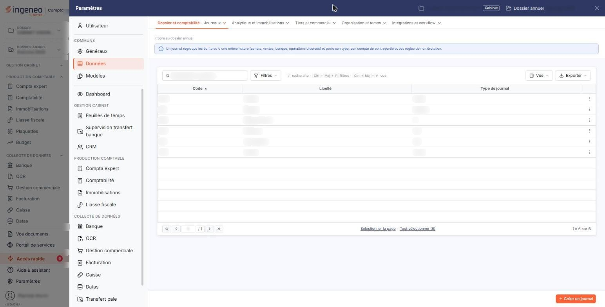
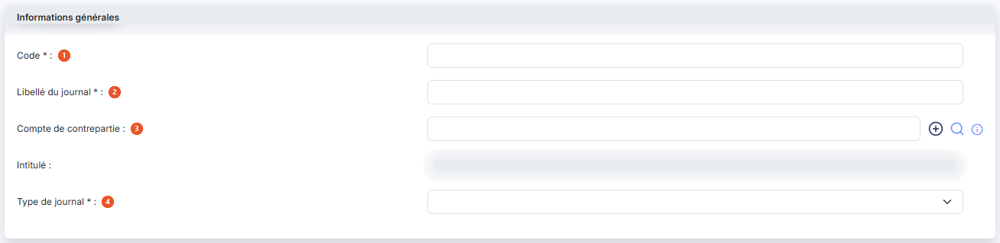
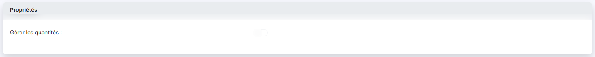

# Journaux


**Où le trouver :** Panneau **Paramètres** › **Données** › **Dossier et comptabilité** › **Journaux**



**En bref** — Cet écran administre les journaux utilisés pour la saisie comptable, chacun identifié par un code, un libellé et un type de journal.

* Pour créer un journal : bouton \[Nouveau], renseignez « Code », « Libellé du journal » et « Type de journal », puis enregistrez.
* Pour supprimer des journaux : cochez-les dans la liste, puis bouton \[Supprimer].


Cette option vous permet d’administrer les journaux utilisés pour la saisie comptable. Vous pouvez créer autant de journaux que nécessaire.

<figure><figcaption>
Écran « Journaux » de la nouvelle interface
</figcaption></figure>

La liste des journaux comporte trois colonnes : **Code**, **Libellé** et **Type de journal**. Chaque ligne porte trois pictogrammes qui permettent respectivement de modifier, de supprimer et de dupliquer le journal. Le bouton **\[Nouveau]** ouvre la fiche d'un nouveau journal et le bouton **\[Supprimer]** supprime les journaux que vous avez cochés dans la liste.

## Rubrique « Informations générales »

<figure><figcaption>
Rubrique « Informations générales »
</figcaption></figure>

| Champ                         | Ce qu'il faut savoir                                                                                                                                                                                                                                                                                                                                                                                                                                                                                                                                                                                                                                                                                                                                                                                              |
| ----------------------------- | ----------------------------------------------------------------------------------------------------------------------------------------------------------------------------------------------------------------------------------------------------------------------------------------------------------------------------------------------------------------------------------------------------------------------------------------------------------------------------------------------------------------------------------------------------------------------------------------------------------------------------------------------------------------------------------------------------------------------------------------------------------------------------------------------------------------- |
| 1. **Code**                   | Chaque journal doit avoir un code unique. Une fois le journal créé, son code n’est plus modifiable.                                                                                                                                                                                                                                                                                                                                                                                                                                                                                                                                                                                                                                                                                                               |
| 2. **Libellé du journal**     | Chaque journal doit avoir un libellé unique.                                                                                                                                                                                                                                                                                                                                                                                                                                                                                                                                                                                                                                                                                                                                                                      |
| 3. **Compte de contrepartie** | 
Le compte de contrepartie permet de définir le compte qui sera utilisé automatiquement pour solder une écriture dans ce journal. Le compte de contrepartie est facultatif. Par exemple, pour un journal de banque, vous pouvez définir le compte de racine 512000 pour saisir rapidement les contreparties des lignes de votre relevé bancaire. En saisie, l’icône « Solde » présente sur la ligne active appellera ce compte si le numéro de compte n’est pas encore renseigné. Le champ est accompagné d'un pictogramme « Plus » qui permet de créer le compte, d'un pictogramme « Loupe » qui ouvre la recherche dans le plan comptable, et d'une infobulle. Le champ <strong>Intitulé</strong> placé en dessous est une zone d'affichage : le logiciel y reporte l'intitulé du compte choisi.
 |
| 4. **Type de journal**        | Le type d’un journal permet d’indiquer le type d’opérations qui y sera saisi. Les valeurs proposées sont « Achat », « Vente », « OD », « Banque », « Caisse », « Reprise de balance », « Divers » et « A-nouveaux ».                                                                                                                                                                                                                                                                                                                                                                                                                                                                                                                                                                                              |

Sur un journal de type « Banque », le logiciel n'autorise pas la modification du type ni celle du libellé du journal.

## Autres vues de l'écran

<figure><figcaption>
Propriétés
</figcaption></figure>
