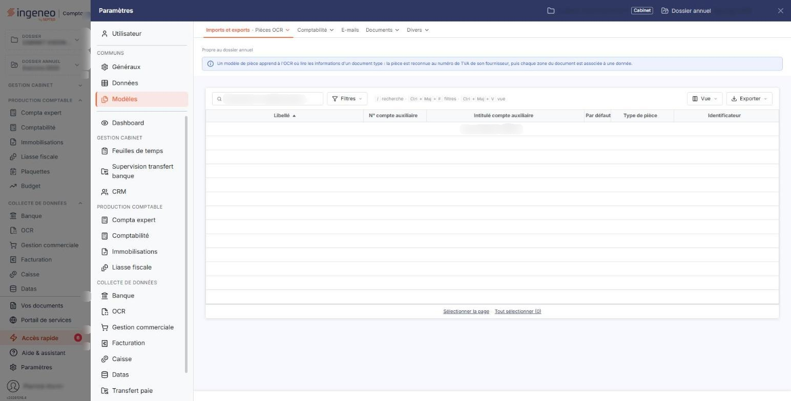

# Modèles de pièces


**Où le trouver :** Panneau **Paramètres**



**En bref** — Les modèles de pièces mémorisent la position des champs sur les pièces d'un tiers pour faciliter la lecture de ses pièces suivantes ; cet écran en présente la liste.

* Pour créer un modèle : depuis le traitement d'un document, bouton \[Enregistrer le modèle].
* Pour supprimer des modèles : cochez-les dans la liste, puis bouton \[Supprimer].


Cet écran se trouve dans le panneau Paramètres : onglet **Modèles**, rubrique **Imports et exports**, entrée **« Pièces OCR »**.

<figure><figcaption>
Écran « Modèles de pièces » de la nouvelle interface
</figcaption></figure>

Les modèles de pièces permettent de mémoriser la position des différents champs sur la pièce d'un tiers, afin de faciliter l'interprétation des données lors de la réception d'une nouvelle pièce du même tiers.

Un modèle est rattaché à un **compte auxiliaire**, et peut l'être en outre à un numéro de TVA intracommunautaire. Si un tiers émet des pièces de mises en page différentes, vous pouvez mémoriser plusieurs modèles pour lui.

La grille présente la liste des modèles disponibles pour le dossier, avec pour chacun son **Libellé**, son **N° compte auxiliaire**, l'**Intitulé compte auxiliaire**, l'indication **Par défaut**, le **Type de pièce** et l'**Identificateur**. L'en-tête de la liste vous propose les pictogrammes habituels de sélection, de personnalisation des colonnes, de filtre et d'impression.

En barre du bas de l'écran, le bouton **\[Supprimer]** supprime les modèles que vous avez cochés ; le bouton **\[Exporter]** s'y trouve aussi.

**Cet écran ne comporte pas de bouton de création.** Un modèle de pièce ne se crée pas depuis la liste : il se crée depuis le traitement d'un document, par le bouton bouton **\[Enregistrer le modèle]**.
