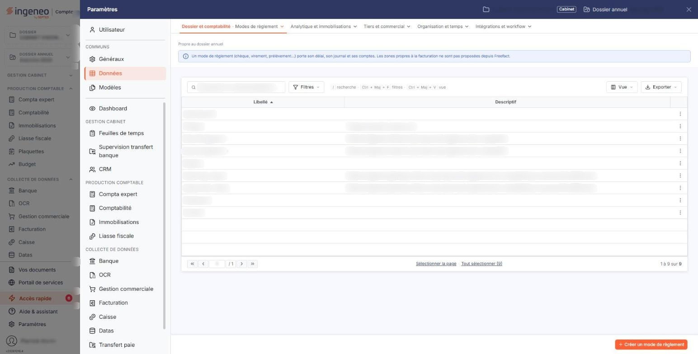
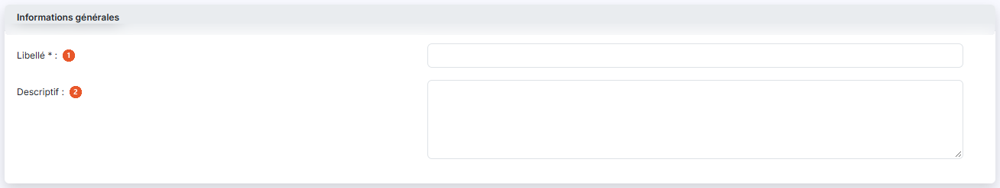
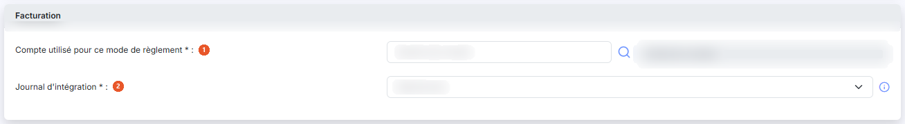
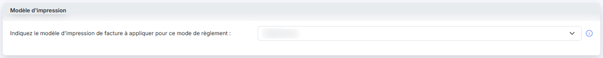
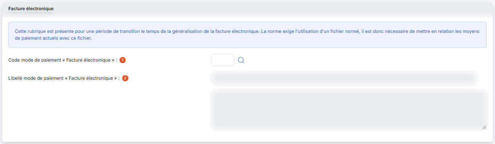

# Modes de règlement


**Où le trouver :** Panneau **Paramètres** › **Données** › **Dossier et comptabilité** › **Modes de règlement**



**En bref** — Cet écran définit les modes de règlement (espèces, chèques, etc.) qui pourront être associés aux pièces comptables et commerciales.

* Pour créer un mode de règlement : bouton \[Nouveau], saisissez le « Libellé », puis bouton \[Enregistrer].
* Pour recopier des modes vers d'autres sociétés gérées : cochez-les dans la liste, puis bouton \[Exporter].


Cette option permet de définir les modes de règlement (espèces, chèques, etc.), qui pourront être associés aux pièces comptables et commerciales.

<figure><figcaption>
Écran « Modes de règlement » de la nouvelle interface
</figcaption></figure>

Un mode de règlement ne peut pas être supprimé s'il est utilisé dans au moins une fiche client ou fournisseur, un compte auxiliaire, une pièce commerciale, un règlement, un remboursement, ou par le paramétrage de la saisie de caisse. Le mode de règlement « Espèces » n'est jamais supprimable, car il est indispensable à la gestion de la caisse ; son libellé n'est d'ailleurs pas modifiable. Le logiciel reconnaît ce mode à son libellé exact « Espèces » : un mode créé sous un autre libellé n'est pas reconnu comme tel.

Lorsque vous demandez la suppression de plusieurs modes de règlement à la fois, le refus porte sur l'ensemble de la sélection : il suffit qu'un seul des modes cochés ne soit pas supprimable pour qu'aucun ne le soit.

La liste des modes de règlement comporte deux colonnes : **Libellé** et **Descriptif**. Sur chaque ligne, deux pictogrammes vous permettent de « Modifier » ou de « Supprimer » le mode de règlement. Sous la liste, le bouton **\[Nouveau]** ouvre le formulaire de création, le bouton **\[Supprimer]** supprime les modes que vous avez cochés, et le bouton **\[Exporter]** recopie les modes cochés vers d'autres sociétés gérées.

Le formulaire se termine par les boutons bouton **\[Enregistrer]** et bouton **\[Retour]**.

## Rubrique « Informations générales »

<figure><figcaption>
Rubrique « Informations générales »
</figcaption></figure>

| Champ             | Ce qu'il faut savoir |
| ----------------- | -------------------- |
| 1. **Libellé**    | Doit être unique.    |
| 2. **Descriptif** | Champ facultatif.    |

## Rubrique « Facturation »

<figure><figcaption>
Rubrique « Facturation »
</figcaption></figure>

Les rubriques « Facturation » et « Facture électronique » ne sont affichées que si vous avez accès au module « Facturation » ou au module « Gestion commerciale » ; elles sont alors à renseigner : les deux champs ci-dessous sont obligatoires.

| Champ                                           | Ce qu'il faut savoir                                                                                                                                                                                                                                                                                                        |
| ----------------------------------------------- | --------------------------------------------------------------------------------------------------------------------------------------------------------------------------------------------------------------------------------------------------------------------------------------------------------------------------- |
| 1. **Compte utilisé pour ce mode de règlement** | C'est le compte dans lequel les écritures de règlement seront générées à partir du module facturation pour ce mode de règlement. Le champ est accompagné d'un pictogramme « Loupe » qui ouvre la recherche dans le plan comptable, et d'une zone d'affichage dans laquelle le logiciel reporte l'intitulé du compte choisi. |
| 2. **Journal d'intégration**                    | C'est le journal dans lequel les écritures de règlement seront générées à partir du module Facturation pour ce mode de règlement. Le logiciel propose les journaux du dossier annuel en cours, précédés de leur code.                                                                                                       |

## Rubrique « Modèle d'impression »

<figure><figcaption>
Rubrique « Modèle d'impression »
</figcaption></figure>

Indiquez le modèle d’impression de facture à appliquer pour ce mode de règlement : cette fonctionnalité permet d'associer un modèle d'impression au mode de règlement. Ainsi lors de la création d'une facture, l'attribution du mode de règlement permettra de proposer ce modèle d'impression par défaut.

Pour les clients en prélèvement automatique, par exemple, vous pourrez affecter un modèle qui contient toutes les informations nécessaires et spécifiques à ce type de paiement.

Si vous avez aussi indiqué un modèle d'impression de facture par défaut dans la fiche client, c'est le modèle d'impression du mode de règlement qui s'appliquera en priorité.

## Rubrique « Facture électronique »

<figure><figcaption>
Rubrique « Facture électronique »
</figcaption></figure>

Le logiciel affiche en tête de rubrique le texte suivant : « Cette rubrique est présente pour une période de transition le temps de la généralisation de la facture électronique. La norme exige l'utilisation d'un fichier normé, il est donc nécessaire de mettre en relation les moyens de paiement actuels avec ce fichier. »

| Champ                                                    | Ce qu'il faut savoir                                                                                                                                                                |
| -------------------------------------------------------- | ----------------------------------------------------------------------------------------------------------------------------------------------------------------------------------- |
| 1. **Code mode de paiement « Facture électronique »**    | Indiquez le code du moyen de paiement normé qui correspond à ce mode de règlement. Le pictogramme « Loupe » placé à droite du champ ouvre la recherche parmi les codes disponibles. |
| 2. **Libellé mode de paiement « Facture électronique »** | Zone d'affichage, non modifiable. Le logiciel y reporte le libellé correspondant au code choisi, complété en dessous par une seconde zone d'affichage qui en donne la suite.        |
