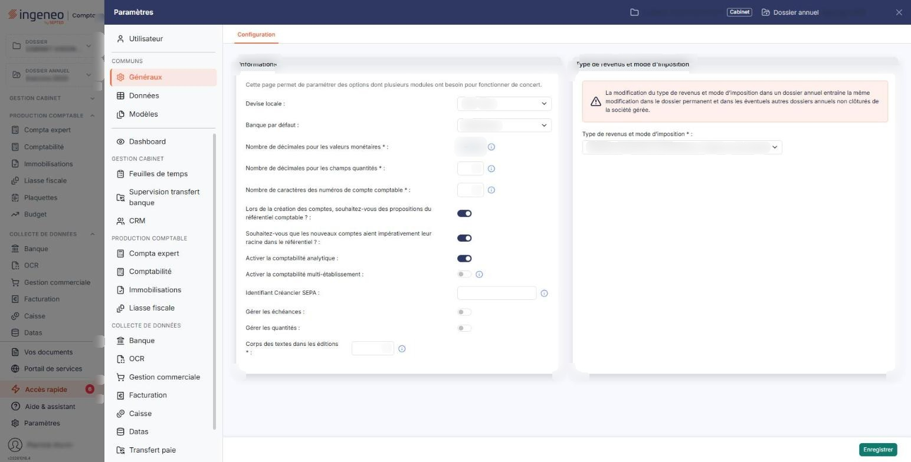
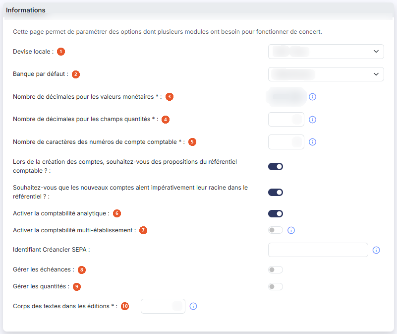
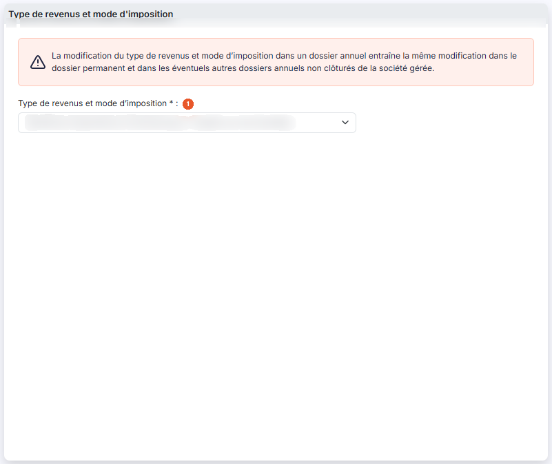

# Multimodules


**Où le trouver :** Panneau **Paramètres** › **Généraux** › **Configuration**



**En bref** — Cet écran regroupe les paramètres utilisés par plusieurs modules : décimales, longueur des comptes, référentiel comptable, échéances, analytique, quantités, devise, banque et régime d'imposition.

* Pour utiliser des unités dans les écritures : activez « Gérer les quantités », puis bouton \[Enregistrer].
* Pour indiquer le régime de la société gérée : choisissez le « Type de revenus et mode d'imposition » après avoir lu l'avertissement affiché, puis bouton \[Enregistrer].


La page « Multimodules » est ainsi nommée car elle concerne des paramètres qui sont utilisés par plusieurs modules du logiciel.

<figure><figcaption>
Écran « Multimodules » de la nouvelle interface
</figcaption></figure>

## Rubrique « Paramètres - Informations relevant de plusieurs modules »

<figure><figcaption>
Rubrique « Informations relevant de plusieurs modules »
</figcaption></figure>

| Champ                                                                             | Ce qu'il faut savoir                                                                                                                                                                                                                                                                                                                                                                                                                                                                                                                                                                                                                                                                                                                                                                                                                                                                                                                                                                                                                                                                                                                                                                                                                                                                                                                                                                                                                                                                                                                                                                                                                                                                                               |
| --------------------------------------------------------------------------------- | ------------------------------------------------------------------------------------------------------------------------------------------------------------------------------------------------------------------------------------------------------------------------------------------------------------------------------------------------------------------------------------------------------------------------------------------------------------------------------------------------------------------------------------------------------------------------------------------------------------------------------------------------------------------------------------------------------------------------------------------------------------------------------------------------------------------------------------------------------------------------------------------------------------------------------------------------------------------------------------------------------------------------------------------------------------------------------------------------------------------------------------------------------------------------------------------------------------------------------------------------------------------------------------------------------------------------------------------------------------------------------------------------------------------------------------------------------------------------------------------------------------------------------------------------------------------------------------------------------------------------------------------------------------------------------------------------------------------ |
| 1. **Devise locale**                                                              | La devise locale du dossier.                                                                                                                                                                                                                                                                                                                                                                                                                                                                                                                                                                                                                                                                                                                                                                                                                                                                                                                                                                                                                                                                                                                                                                                                                                                                                                                                                                                                                                                                                                                                                                                                                                                                                       |
| 2. **Banque par défaut**                                                          | Indiquez, parmi les banques déclarées pour la société gérée, celle qui sera proposée par défaut à chaque fois que nécessaire dans le logiciel. Les banques ne se créent pas depuis ce module.                                                                                                                                                                                                                                                                                                                                                                                                                                                                                                                                                                                                                                                                                                                                                                                                                                                                                                                                                                                                                                                                                                                                                                                                                                                                                                                                                                                                                                                                                                                      |
| 3. **Nombre de décimales pour les valeurs monétaires**                            | 
Ce paramètre détermine avec combien de décimales seront saisies et affichées toutes les valeurs monétaires dans tous vos modules Ingeneo Compta. Il peut prendre les valeurs 0, 1, 2, 3 et 4. Le logiciel affiche ce champ en lecture seule : vous ne pouvez pas le modifier vous-même. Pour le modifier, veuillez prendre contact avec le service technique.
                                                                                                                                                                                                                                                                                                                                                                                                                                                                                                                                                                                                                                                                                                                                                                                                                                                                                                                                                                                                                                                                                                                                                                                                                                                                                                                                            |
| 4. **Nombre de décimales pour les champs quantités**                              | Ce paramètre détermine avec combien de décimales seront saisis et affichés tous les champs « Quantité » dans les pièces commerciales et dans les écritures comptables. Il peut prendre les valeurs 0 à 4.                                                                                                                                                                                                                                                                                                                                                                                                                                                                                                                                                                                                                                                                                                                                                                                                                                                                                                                                                                                                                                                                                                                                                                                                                                                                                                                                                                                                                                                                                                          |
| 5. **Nombre de caractères des numéros de compte comptable**                       | 
Il s'agit du nombre de caractères que devront comporter tous les comptes de votre plan comptable et donc tous ceux utilisés également dans le logiciel de facturation pour le lien avec la comptabilité. Ce nombre peut varier de 6 à 12. Si vous modifiez ce paramètre en l'augmentant, tous les numéros de comptes existants seront comblés avec des 0 jusqu'à la longueur indiquée. A contrario, si vous réduisez ce chiffre, le logiciel vérifiera que les chiffres qui seront tronqués sur tous les numéros de comptes ne sont que des 0. Si ce n'est pas le cas, la modification sera impossible. Afin de conserver les possibilités de comparaison, la modification est effectuée sur le dossier annuel en cours et sur les deux dossiers annuels précédents. <strong>Lors de la création des comptes, souhaitez-vous des propositions du référentiel comptable ? :</strong> si vous activez cette option, lors de la création d'un compte dans le plan comptable général, le logiciel vous fera des propositions, en fonction des premiers caractères que vous saisirez, fondées sur le référentiel comptable de l'ANC. Reportez-vous à l'aide du plan comptable pour plus d'information. Vous pouvez visualiser et administrer le référentiel comptable dans le module « Administration », menu « Divers », option « Référentiel comptable ». En outre, en activant cette option, le logiciel affiche la question suivante. <strong>Souhaitez-vous que les nouveaux comptes aient impérativement leur racine dans le référentiel ? :</strong> si l'interrupteur est activé, la création d'un compte dont la racine ne figure pas dans le référentiel comptable est interdite.
 |
| 6. **Activer la comptabilité analytique**                                         | Activé / désactivé.                                                                                                                                                                                                                                                                                                                                                                                                                                                                                                                                                                                                                                                                                                                                                                                                                                                                                                                                                                                                                                                                                                                                                                                                                                                                                                                                                                                                                                                                                                                                                                                                                                                                                                |
| 7. **Activer la comptabilité multi-établissement**                                | Activé / désactivé. L'infobulle qui accompagne cette question à l'écran précise : « En activant cette option, vous devrez affecter les écritures à un établissement. Les établissements doivent être créés dans le module « Dossier permanent », menu « Social », option « Etablissements ». »                                                                                                                                                                                                                                                                                                                                                                                                                                                                                                                                                                                                                                                                                                                                                                                                                                                                                                                                                                                                                                                                                                                                                                                                                                                                                                                                                                                                                     |
| 8. **Gérer les échéances**                                                        | Activé / désactivé. Lorsqu'elle est activée, l'écran affiche la question sur le renseignement automatique des échéances.                                                                                                                                                                                                                                                                                                                                                                                                                                                                                                                                                                                                                                                                                                                                                                                                                                                                                                                                                                                                                                                                                                                                                                                                                                                                                                                                                                                                                                                                                                                                                                                           |
| 9. **Gérer les quantités**                                                        | Activé / désactivé.                                                                                                                                                                                                                                                                                                                                                                                                                                                                                                                                                                                                                                                                                                                                                                                                                                                                                                                                                                                                                                                                                                                                                                                                                                                                                                                                                                                                                                                                                                                                                                                                                                                                                                |
| 10. **Corps des textes dans les éditions**                                        | Indiquez la taille de police du corps des textes dans vos éditions. Sa valeur doit être comprise entre 8 et 18.                                                                                                                                                                                                                                                                                                                                                                                                                                                                                                                                                                                                                                                                                                                                                                                                                                                                                                                                                                                                                                                                                                                                                                                                                                                                                                                                                                                                                                                                                                                                                                                                    |
| **Renseigner automatiquement les échéances pour les fournisseurs et les clients** | 
Cette option n'est accessible que si vous avez activé la gestion des échéances. Lorsque l'interrupteur est activé, le logiciel affiche les deux champs suivants.
                                                                                                                                                                                                                                                                                                                                                                                                                                                                                                                                                                                                                                                                                                                                                                                                                                                                                                                                                                                                                                                                                                                                                                                                                                                                                                                                                                                                                                                                                                                                         |
| **Délai de règlement par défaut des fournisseurs**                                | Délai de règlement des fournisseurs.                                                                                                                                                                                                                                                                                                                                                                                                                                                                                                                                                                                                                                                                                                                                                                                                                                                                                                                                                                                                                                                                                                                                                                                                                                                                                                                                                                                                                                                                                                                                                                                                                                                                               |
| **Délai de règlement par défaut des clients**                                     | Délai de règlement des clients.                                                                                                                                                                                                                                                                                                                                                                                                                                                                                                                                                                                                                                                                                                                                                                                                                                                                                                                                                                                                                                                                                                                                                                                                                                                                                                                                                                                                                                                                                                                                                                                                                                                                                    |

## Rubrique « Type de revenus et mode d'imposition »

<figure><figcaption>
Rubrique « Type de revenus et mode d'imposition »
</figcaption></figure>

Le logiciel affiche en tête de rubrique l'avertissement suivant : « La modification du type de revenus et mode d'imposition dans un dossier annuel entraîne la même modification dans le dossier permanent et dans les éventuels autres dossiers annuels non clôturés de la société gérée. »

**Type de revenus et mode d'imposition** : obligatoire. Ce sélecteur permet d'indiquer à quel régime est soumise la société gérée. Cette information est capitale dans plusieurs modules.


Attention, la modification de cette information peut entraîner de nombreuses conséquences dans les paramétrages des numéros de comptes notamment pour la déclaration de TVA.


bouton **\[Enregistrer]**

Enregistre vos paramètres. C'est le seul bouton de l'écran.
