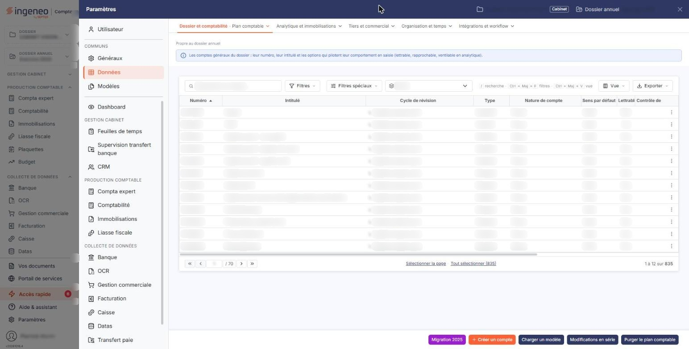
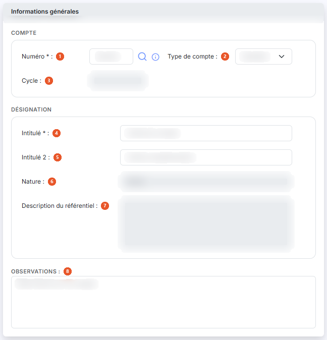
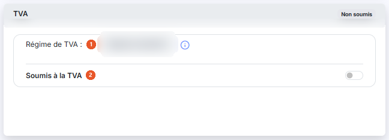
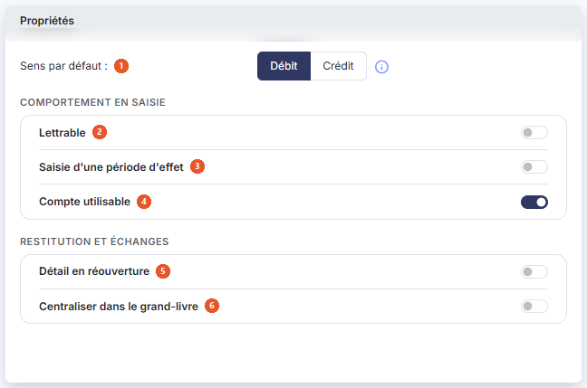
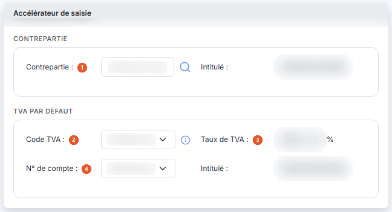
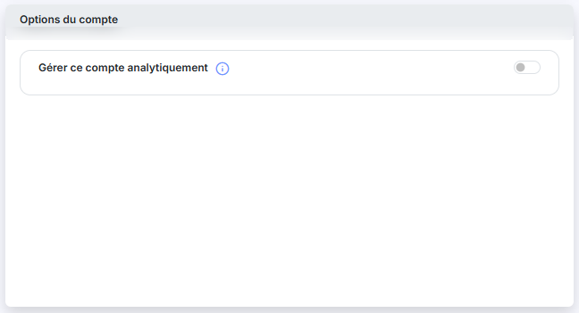

# Plan comptable


**Où le trouver :** Panneau **Paramètres** › **Données** › **Dossier et comptabilité** › **Plan comptable**



**En bref** — Cet écran administre les comptes généraux du plan comptable : création, modification, chargement d'un modèle, import, export et modifications en série.

* Pour partir d'un plan comptable type : bouton \[Charger un modèle], choisissez-le dans la liste, puis bouton \[Valider].
* Pour reprendre les comptes d'un autre logiciel ou de l'exercice n-1 : bouton \[Importer].
* Pour appliquer les mêmes réglages à plusieurs comptes : bouton \[Modifications en série].


Cette option permet d'administrer les comptes généraux du plan comptable.

<figure><figcaption>
Écran « Plan comptable » de la nouvelle interface
</figcaption></figure>


Notez que vous avez la possibilité de charger un modèle de plan comptable parmi les modèles fournis par Ingeneo Compta ou ceux éventuellement créés par vous-même. Si vous avez déjà créé des comptes, ils seront conservés lors du chargement du modèle.


Vous pouvez filtrer l'affichage des comptes de votre plan comptable en saisissant un numéro de compte, en choisissant un cycle de révision, et en affichant au choix tous les comptes, les seuls comptes mouvementés ou les seuls comptes non mouvementés. Pour appliquer vos critères, cliquez sur le bouton **\[Filtrer]**.

La grille présente, pour chaque compte, les colonnes suivantes : **Numéro**, **Intitulé**, **Cycle de révision**, **Type**, **Nature de compte**, **Sens par défaut**, **Lettrable**, **Contrôle de cycle**, **Analytique**, **Période d'effet**, **Code devise**, **Saisie en devise**, **Solde n-1**, **Solde n-2** et **Ecart n-1 vs n-2**. Chaque ligne porte trois pictogrammes qui permettent respectivement de modifier, de supprimer et de dupliquer le compte.

La suppression d’un compte n'est possible qu'à la condition qu’aucune écriture n’ait été passée sur l’exercice pour le compte concerné.

A chaque modification d'un compte, le nom de l'utilisateur ainsi que la date de la modification sont mémorisés dans le fichier plan comptable. Ces informations sont visualisables en sélectionnant ces champs dans la personnalisation de la grille. Elles sont également affichées dans la fiche du compte, rubrique « Informations générales », par les zones **Créé le**, **Par**, **Modifié le** et **Par**.

## Rubrique « Informations générales »

<figure><figcaption>
Rubrique « Informations générales »
</figcaption></figure>

| Champ                             | Ce qu'il faut savoir                                                                                                                                                                                                                                                                                                                                                                                                                                                                                                                                                                                                                                                                                                                                                                                                                      |
| --------------------------------- | ----------------------------------------------------------------------------------------------------------------------------------------------------------------------------------------------------------------------------------------------------------------------------------------------------------------------------------------------------------------------------------------------------------------------------------------------------------------------------------------------------------------------------------------------------------------------------------------------------------------------------------------------------------------------------------------------------------------------------------------------------------------------------------------------------------------------------------------- |
| 1. **Numéro**                     | 
Le numéro de compte doit être unique et n’est plus modifiable après création du compte. Si dans la page « Multimodules » vous avez indiqué que vous souhaitiez des propositions du référentiel comptable, deux options d'aide s'offrent à vous : soit vous tapez les premières lettres du numéro de compte ou d'un intitulé que vous recherchez et le logiciel vous fera des propositions en fonction de ce qu'il aura trouvé dans le référentiel, soit vous cliquez sur le pictogramme « Loupe » à droite du compte pour visualiser tout le référentiel comptable et y effectuer des recherches. Si, toujours dans la page « Multimodules », vous avez indiqué que les nouveaux comptes devaient avoir leur racine dans le référentiel comptable, la vérification sera effectuée au moment de l'enregistrement de la fiche.
 |
| 2. **Type de compte**             | Un compte peut être collectif ou standard. Il n’est pas possible de modifier le type d'un compte si des écritures ont été passées sur le compte.                                                                                                                                                                                                                                                                                                                                                                                                                                                                                                                                                                                                                                                                                          |
| 3. **Cycle**                      | Si les cycles de révision ont bien été paramétrés pour votre comptabilité, le compte que vous avez créé est automatiquement associé à un cycle.                                                                                                                                                                                                                                                                                                                                                                                                                                                                                                                                                                                                                                                                                           |
| 4. **Intitulé**                   | Ce champ pourra être automatiquement repris dans les libellés d'écritures et est modifiable à tout moment.                                                                                                                                                                                                                                                                                                                                                                                                                                                                                                                                                                                                                                                                                                                                |
| 5. **Intitulé 2**                 | Ce champ est facultatif et permet, par exemple, de faire figurer l'intitulé du compte dans une autre langue.                                                                                                                                                                                                                                                                                                                                                                                                                                                                                                                                                                                                                                                                                                                              |
| 6. **Nature**                     | La nature du compte est automatiquement attribuée en fonction des racines définies dans la page « Connexion comptabilité », rubrique « Paramètres du plan comptable », pour les catégories suivantes : Clients, Fournisseurs, Salariés, Banque, Caisse, Immobilisations, Charges, Produits, TVA déductible, TVA collectée et Comptes d'attente. Un compte dont la racine ne correspond à aucune de ces catégories est enregistré dans la catégorie « Divers ». Ce champ n'est pas modifiable.                                                                                                                                                                                                                                                                                                                                             |
| 7. **Description du référentiel** | Zone d'affichage, non modifiable, renseignée par le logiciel à partir du référentiel comptable. Elle n'apparaît qu'à la création du compte.                                                                                                                                                                                                                                                                                                                                                                                                                                                                                                                                                                                                                                                                                               |
| 8. **Observations**               | Zone de texte libre.                                                                                                                                                                                                                                                                                                                                                                                                                                                                                                                                                                                                                                                                                                                                                                                                                      |
| **Compte collectif**              | Un compte collectif regroupe des comptes auxiliaires qui lui sont rattachés et doivent obligatoirement être renseignés lors de la saisie.                                                                                                                                                                                                                                                                                                                                                                                                                                                                                                                                                                                                                                                                                                 |
| **Compte standard**               | Un compte standard admet la saisie sans compte auxiliaire.                                                                                                                                                                                                                                                                                                                                                                                                                                                                                                                                                                                                                                                                                                                                                                                |

## Rubrique « TVA »

<figure><figcaption>
Rubrique « TVA »
</figcaption></figure>

Si la société gérée n'est pas soumise à la TVA il n'y aura pas d'information à renseigner ici. Dans le cas contraire, le logiciel indique le régime de TVA en cours sur le dossier ; les informations à saisir varient ensuite en fonction de la nature du compte et sont déterminantes pour une bonne automatisation de la déclaration de TVA.

| Champ                  | Ce qu'il faut savoir                                                                                                                                                                                                                         |
| ---------------------- | -------------------------------------------------------------------------------------------------------------------------------------------------------------------------------------------------------------------------------------------- |
| 1. **Régime de TVA**   | Zone d'affichage, non modifiable. Elle reprend le régime en cours sur le dossier.                                                                                                                                                            |
| 2. **Soumis à la TVA** | Indiquez si le compte est soumis à la TVA. Si vous répondez « Oui », le logiciel affiche trois champs supplémentaires dans cette rubrique.                                                                                                   |
| **Code TVA**           | Choisissez le code de TVA à appliquer au compte parmi ceux définis dans la page « Codes TVA ».                                                                                                                                               |
| **Taux de TVA**        | Exprimé en pourcentage, le logiciel le renseigne à partir du code de TVA choisi.                                                                                                                                                             |
| **N° de compte**       | Choisissez le compte de TVA à mouvementer ; le logiciel ne propose que les comptes de TVA du plan comptable, suivis de leur nature entre parenthèses. Le champ **Intitulé** qui le suit est une zone d'affichage renseignée par le logiciel. |

## Rubrique « Propriétés »

<figure><figcaption>
Rubrique « Propriétés »
</figcaption></figure>

| Champ                                         | Ce qu'il faut savoir                                                                                                                                                                                                                                                                                                                                                                                                                                                                     |
| --------------------------------------------- | ---------------------------------------------------------------------------------------------------------------------------------------------------------------------------------------------------------------------------------------------------------------------------------------------------------------------------------------------------------------------------------------------------------------------------------------------------------------------------------------- |
| 1. **Sens par défaut**                        | Indique si lors de la saisie le curseur sera positionné par défaut sur un montant au débit ou un montant au crédit.                                                                                                                                                                                                                                                                                                                                                                      |
| 2. **Lettrable**                              | Le compte peut faire l’objet d’un traitement de lettrage. Une fois un traitement de lettrage effectué, cette option n’est plus modifiable.                                                                                                                                                                                                                                                                                                                                               |
| 3. **Saisie d'une période d'effet**           | Si cette option est activée, vous pourrez (sans que cela soit obligatoire) saisir une date de début et une date de fin pour chaque ligne d'écriture imputée à ce compte. C'est particulièrement utile pour générer automatiquement les cut-off et les écritures de régularisation (dans le module Comptabilité expert uniquement). Le fait de désactiver cette option sur un compte n'entraîne pas de modifications des écritures où des périodes auraient été saisies.                  |
| 4. **Compte utilisable**                      | Cette option vous permet de rendre inutilisable un compte au cours de l'exercice alors même que vous ne pouvez le détruire si des écritures lui ont été imputées.                                                                                                                                                                                                                                                                                                                        |
| 5. **Détail en réouverture**                  | 
Pour les comptes de bilan, cette option définit si lors de la génération des à-nouveaux, toutes les lignes d’écritures composant le solde de clôture sont reprises ou uniquement le solde à la clôture. Un compte lettrable est obligatoirement détaillé en réouverture c'est pourquoi cette option n'est plus affichée si le lettrage est activé. Pour les comptes de type « Banque » le détail en réouverture est automatiquement appliqué et l'option n'est pas modifiable.
 |
| 6. **Centraliser dans le grand-livre**        | Si cette option est activée, lors de l’édition du grand-livre, c'est le solde des écritures passées dans chaque journal qui s’affiche au lieu du détail de toutes les lignes.                                                                                                                                                                                                                                                                                                            |
| **Envoi systématique en demande info client** | Ce champ n'apparaît qu'à la modification d'un compte existant.                                                                                                                                                                                                                                                                                                                                                                                                                           |

## Rubrique « Accélérateur de saisie »

<figure><figcaption>
Rubrique « Accélérateur de saisie »
</figcaption></figure>

Cette fonctionnalité est disponible dans la saisie en journal si elle a été activée pour le journal considéré. Elle est particulièrement utile pour les écritures récurrentes.

Vous avez la possibilité de définir un accélérateur de saisie qui générera automatiquement une écriture lorsque le compte de votre formulaire sera saisi sur la première ligne d’un mouvement.

| Champ               | Ce qu'il faut savoir                                                                                                             |
| ------------------- | -------------------------------------------------------------------------------------------------------------------------------- |
| 1. **Contrepartie** | Définit le compte utilisé pour générer l’écriture.                                                                               |
| 2. **Code TVA**     | Si un code et un taux sont renseignés, l’écriture générée comprend une ligne de TVA dont le montant est calculé automatiquement. |
| 3. **Taux de TVA**  | Exprimé en pourcentage.                                                                                                          |
| 4. **N° de compte** | Choisissez parmi les comptes de TVA celui qui devra être repris dans l'écriture.                                                 |

Les champs **Intitulé** qui suivent la contrepartie et le numéro de compte sont des zones d'affichage : le logiciel y reporte l'intitulé du compte choisi.

## Rubrique « Devises »

| Champ                                | Ce qu'il faut savoir                                                                                                                                                                                                                                                                       |
| ------------------------------------ | ------------------------------------------------------------------------------------------------------------------------------------------------------------------------------------------------------------------------------------------------------------------------------------------ |
| **Autoriser la saisie en devises**   | 
Si cette option est activée, vous pourrez saisir, dans ce compte, des écritures dans d'autres devises que la devise locale indiquée dans la page « Multimodules ». Pour saisir des écritures en devises, il faut que cette même option soit activée dans les journaux concernés.
 |
| **Devise par défaut pour ce compte** | Cette option n'est affichée que si vous avez autorisé la saisie en devises. Choisissez dans le sélecteur la devise qui sera proposée par défaut lors de la saisie d'une écriture sur ce compte. La devise pourra être modifiée lors de la saisie de chaque écriture.                       |

## Rubrique « Soldes »

Cette rubrique n'apparaît qu'à la modification d'un compte existant. Elle ne comporte que des zones d'affichage, que vous ne pouvez pas modifier : **Solde à date**, **Solde n-1**, **Mouvementé en n-1**, **Ecart n vs n-1**, **Solde n-2** et **Ecart n-1 vs n-2**.

Elle vous permet de situer le compte d'un exercice à l'autre sans quitter la fiche.

Les valeurs **Solde n-1**, **Solde n-2**, **Ecart n vs n-1** et **Ecart n-1 vs n-2** sont calculées et mises à jour par le logiciel au moment où vous entrez dans la fiche du compte.

## Bouton \[Charger un modèle]

<figure><figcaption>
Bouton [Charger un modèle]
</figcaption></figure>

Ce bouton permet de charger un modèle de plan comptable parmi ceux qui figurent dans le module « Administration ». Sélectionnez-en un dans la liste et cliquez sur le bouton Bouton \[Valider]. Si le plan comptable dans lequel vous chargez un modèle contient déjà des comptes, seuls les comptes n'existant pas encore dans le plan comptable seront créés.

Si les numéros de comptes du modèle sont plus courts que ceux de votre plan comptable, ils seront automatiquement comblés avec des 0.


Notez que le logiciel vous propose uniquement les modèles de plans comptables dont le nombre de caractères du numéro de compte est inférieur ou égal à celui paramétré pour le plan comptable de la société gérée dans laquelle vous vous trouvez.


## Bouton \[Importer]

<figure><figcaption>
Bouton [Importer]
</figcaption></figure>

Ce bouton permet d'importer un plan comptable à partir d'un fichier issu d'un autre logiciel ou depuis l'exercice n-1 s'il existe un dossier annuel n-1 pour le dossier annuel en cours.

**Import depuis un fichier**

Sélectionnez le modèle d'import parmi ceux proposés par défaut par Ingeneo Compta ou que vous avez créé dans la page « Modèles d'import » et indiquez où se trouve le fichier que vous souhaitez importer.

Si vous obtenez un message d'erreur, c'est que la structure du fichier que vous tentez d'importer ne correspond pas à celle qui a été définie dans le modèle. Vous devez donc revoir tous les paramètres.

**Import depuis n-1**

Si le dossier annuel est relié avec un dossier annuel correspondant à n-1, vous avez la possibilité d'importer les comptes de cet exercice.

Le logiciel importera tous les comptes présents dans n-1 et absent de l'exercice en cours avec les mêmes caractéristiques que celles qu'ils avaient en n-1.

## Bouton \[Exporter]

<figure><figcaption>
Bouton [Exporter]
</figcaption></figure>

Ce bouton permet d'exporter votre plan comptable dans un fichier. Sélectionnez le modèle d'export parmi ceux proposés par défaut par Ingeneo Compta ou que vous avez créé dans la page « Modèles d'export ». Le fichier généré peut ensuite être enregistré à votre convenance.

## Bouton \[Modifications en série]

<figure><figcaption>
Bouton [Modifications en série]
</figcaption></figure>

Ce bouton permet d'opérer simultanément les mêmes modifications à une sélection de comptes.

* **Rubrique « Comptes à modifier »**\
  Vous devez tout d'abord indiquer à quelle sélection de comptes vont devoir s'appliquer les modifications envisagées.\
  Pour ce faire, vous pouvez indiquer un cycle de révision (si vous les avez paramétrés), une fourchette de comptes ou une série de comptes et de racines de comptes.\
  Les modifications seront appliquées à la liste la plus restrictive (en d'autres termes, pour être concerné, le compte devra respecter chacune des conditions).
* **Rubrique « Paramètres à modifier dans les comptes »**\
  Vous disposez d'une série de paramètres, présents dans la fiche de chaque compte, pour lesquels vous pouvez indiquer de ne pas les modifier, de les positionner sur « Oui » ou de les positionner sur « Non ». Vos choix seront affectés à tous les comptes de la sélection. En fonction de vos choix, pour certains paramètres, des valeurs complémentaires peuvent être demandées.\
  Reportez-vous à l'aide ci-dessus pour plus d'informations sur le fonctionnement de tous les paramètres.

## Bouton \[Réaffectation]

Ce bouton permet de réaffecter toutes les écritures d'un compte général à un autre compte général ou à un compte auxiliaire.

## Bouton \[Purger le plan comptable]

<figure><figcaption>
Bouton [Purger le plan comptable]
</figcaption></figure>

Cette option permet de supprimer tous les comptes pour, par exemple, charger un autre modèle de plan comptable.

Seuls les comptes non mouvementés dans l'exercice en cours et non utilisés dans les paramétrages sont supprimés.

## Autres vues de l'écran

<figure><figcaption>
Options du compte
</figcaption></figure>
