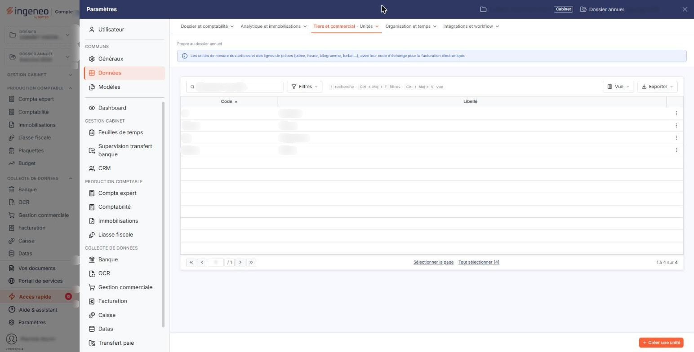
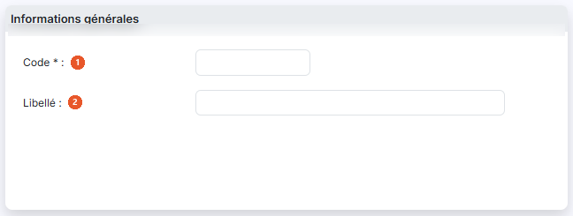
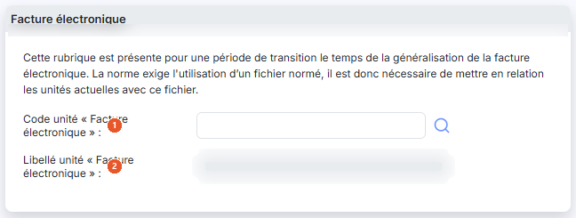

# Unités


**Où le trouver :** Panneau **Paramètres** › **Données** › **Tiers et commercial** › **Unités**



**En bref** — Cet écran gère les unités utilisées avec les quantités dans les écritures, lorsque l'interrupteur « Gérer les quantités » est activé dans « Multimodules ».

* Pour créer une unité : bouton \[Nouveau], saisissez le « Code », puis bouton \[Enregistrer].
* Pour la rattacher à la facture électronique : renseignez le « Code unité « Facture électronique » », à l'aide de la loupe si besoin, puis bouton \[Enregistrer].


Cette option permet de gérer les unités qui seront utilisées conjointement avec les quantités dans les écritures, si vous avez activé l'interrupteur **Gérer les quantités** dans le menu « Paramètres », sous-option « Multimodules ».

<figure><figcaption>
Écran « Unités » de la nouvelle interface
</figcaption></figure>

Une unité n'est pas supprimable si elle est utilisée dans au moins une fiche article ou au moins un compte général ou auxiliaire.

L'écran affiche la liste des unités existantes sur deux colonnes : **Code** et **Libellé**. Les comportements communs à toutes les listes (barre d'outils de l'en-tête : sélection, choix des colonnes, filtre, impression) sont décrits dans la page « Les listes ». Chaque ligne porte trois pictogrammes : « Crayon », dont l'infobulle indique « Modifier », pour ouvrir la fiche de l'unité ; « Croix », infobulle « Supprimer » ; et « Feuille avec un plus », infobulle « Dupliquer », qui ouvre un formulaire de création prérempli avec les valeurs de l'unité d'origine, son code étant précédé de « Copie de ».

bouton **\[Nouveau]**

Ouvre le formulaire de création d'une unité.

bouton **\[Supprimer]**

Supprime les unités que vous avez cochées dans la liste. Si l'une d'elles est utilisée, le logiciel affiche le message « Il n'est pas possible de supprimer cette unité car elle est utilisée dans des articles, des comptes généraux ou des comptes auxiliaires. » et interrompt la suppression en cours.

## Rubrique « Informations générales »

<figure><figcaption>
Rubrique « Informations générales »
</figcaption></figure>

| Champ          | Ce qu'il faut savoir                                                                                                                                    |
| -------------- | ------------------------------------------------------------------------------------------------------------------------------------------------------- |
| 1. **Code**    | Vous ne le saisissez qu'à la création : une fois l'unité enregistrée, le logiciel affiche ce champ en lecture seule et vous ne pouvez plus le modifier. |
| 2. **Libellé** | —                                                                                                                                                       |

## Rubrique « Facture électronique »

<figure><figcaption>
Rubrique « Facture électronique »
</figcaption></figure>

Le logiciel rappelle en tête de rubrique que « cette rubrique est présente pour une période de transition le temps de la généralisation de la facture électronique. La norme exige l'utilisation d'un fichier normé, il est donc nécessaire de mettre en relation les unités actuelles avec ce fichier. »

| Champ                                         | Ce qu'il faut savoir                                                                                      |
| --------------------------------------------- | --------------------------------------------------------------------------------------------------------- |
| 1. **Code unité « Facture électronique »**    | Saisissez le code normé correspondant à votre unité, ou recherchez-le à l'aide du pictogramme « Loupe ».  |
| 2. **Libellé unité « Facture électronique »** | Zone d'affichage, que vous ne pouvez pas modifier. Le logiciel y reporte le libellé du code normé choisi. |

bouton **\[Enregistrer]**

Enregistre l'unité et vous ramène à la liste.

bouton **\[Retour]**

Revient à la liste sans enregistrer.

## Autres vues de l'écran

<figure><figcaption>
Bouton [Nouveau]
</figcaption></figure>
