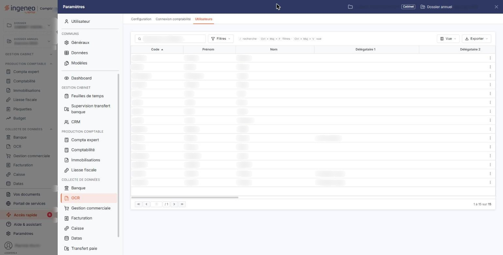
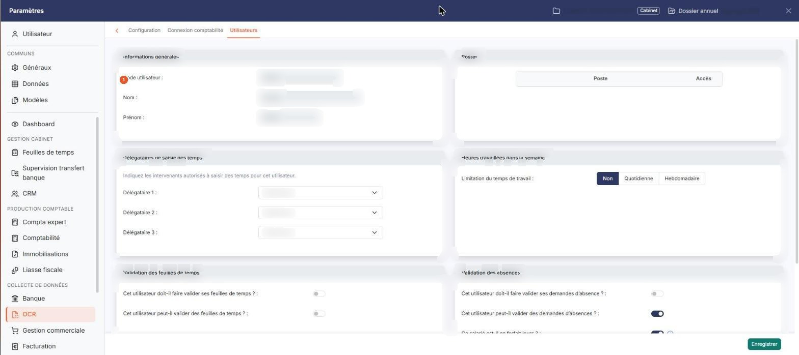
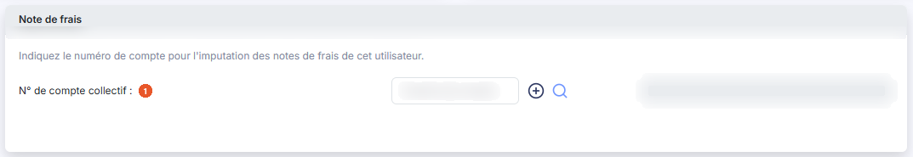

# Utilisateurs


**Où le trouver :** Panneau **Paramètres** › **OCR** › **Utilisateurs**



**En bref** — Cet écran permet d'indiquer, pour chaque utilisateur, les comptes sur lesquels seront imputées ses notes de frais.

* Pour paramétrer les notes de frais d'un utilisateur : pictogramme « Modifier » de sa ligne, rubrique « Note de frais », renseignez le « N° de compte collectif », puis bouton \[Enregistrer].
* Si le compte renseigné est un compte collectif : complétez aussi le « N° de compte auxiliaire », devenu obligatoire, avant d'enregistrer.


Cette page permet de renseigner, pour chaque utilisateur ayant accès au module, les informations dont le logiciel a besoin pour traiter ses pièces.

<figure><figcaption>
Écran « Utilisateurs » de la nouvelle interface
</figcaption></figure>

Dans la nouvelle interface, cet écran s'ouvre depuis le panneau « Paramètres » : rubrique **OCR** de la barre latérale, puis onglet **Utilisateurs**.

Vous ne pouvez ni créer ni supprimer d'utilisateur depuis cet écran : ces opérations se font dans le module « Mon compte ». L'écran ne comporte d'ailleurs aucun bouton sous la liste.

La liste affiche les utilisateurs du cabinet. Chaque ligne porte, à droite, un seul pictogramme, « Modifier » (un crayon), qui ouvre la fiche de l'utilisateur.

Elle comporte seize colonnes : **Code**, **Prénom**, **Nom**, **Délégataire 1**, **Délégataire 2**, **Délégataire 3**, **Doit faire valider ses absences**, **Peut valider des absences**, **Valideur d'absences 1**, **Valideur d'absences 2**, **Valideur d'absences 3**, **Valideur FDT 1**, **Valideur FDT 2**, **Valideur FDT 3**, **Forfait jours** et **Limitation du temps de travail**. Aucune ne concerne le module : comme la fiche, la liste est partagée avec les feuilles de temps. Un ascenseur horizontal permet d'atteindre les dernières colonnes.

Cette fiche est commune à plusieurs modules : outre la rubrique « Note de frais » décrite ci-dessous, qui est celle qui vous concerne, elle présente les rubriques « Informations générales », « Postes », « Délégataires de saisie des temps », « Heures travaillées dans la semaine », « Validation des feuilles de temps » et « Validation des absences », qui relèvent des feuilles de temps.

## Rubrique « Note de frais »

<figure><figcaption>
Rubrique « Note de frais »
</figcaption></figure>

<figure><figcaption>
Rubrique « Note de frais »
</figcaption></figure>

<figure><figcaption>
Rubrique « Chevron « Retour » »
</figcaption></figure>

Le logiciel annonce en tête de rubrique : « Indiquez le numéro de compte pour l'imputation des notes de frais de cet utilisateur. ». Vous indiquez ici les comptes sur lesquels seront imputées les notes de frais de cet utilisateur.

| Champ                         | Ce qu'il faut savoir                                                                                                                                                                                                          |
| ----------------------------- | ----------------------------------------------------------------------------------------------------------------------------------------------------------------------------------------------------------------------------- |
| 1. **N° de compte collectif** | Saisissez le numéro directement, recherchez-le à l'aide du pictogramme « Loupe » (dont l'infobulle indique le raccourci Ctrl + Alt + R), ou créez le compte à l'aide du pictogramme « Créer ». Son intitulé s'affiche à côté. |
| **N° de compte auxiliaire**   | Même principe. Son intitulé s'affiche également. Ce champ n'apparaît que dans le cas décrit ci-dessous, et il est alors obligatoire : le logiciel le marque d'une astérisque.                                                 |

**Comment les deux comptes s'articulent**

Le compte auxiliaire n'est accessible que si le compte général renseigné est un **compte collectif**.

Si vous avez renseigné un compte général collectif, le **compte auxiliaire devient obligatoire**.

bouton **\[Enregistrer]**

Enregistre la fiche.

**Chevron « Retour »**

Le bouton **\[Retour]** n'est plus affiché : le chevron « Retour », à gauche de la barre d'onglets du panneau, revient à la liste.
