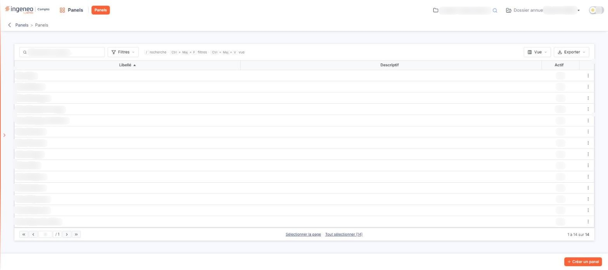
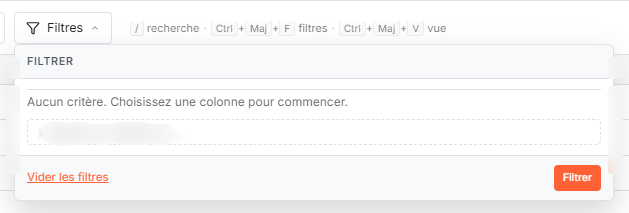
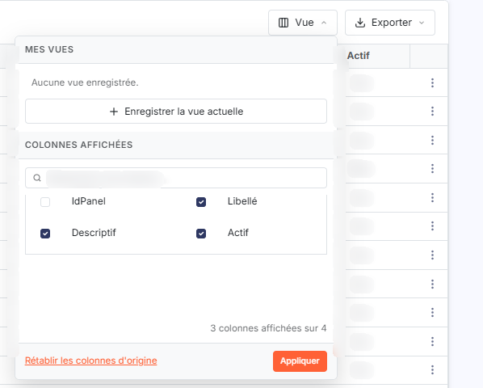
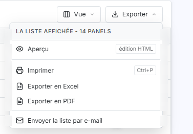
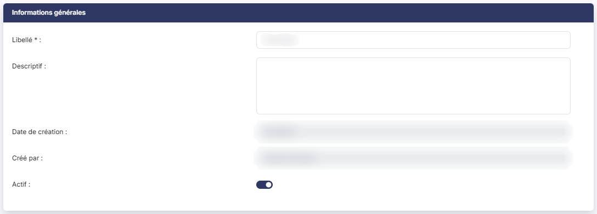
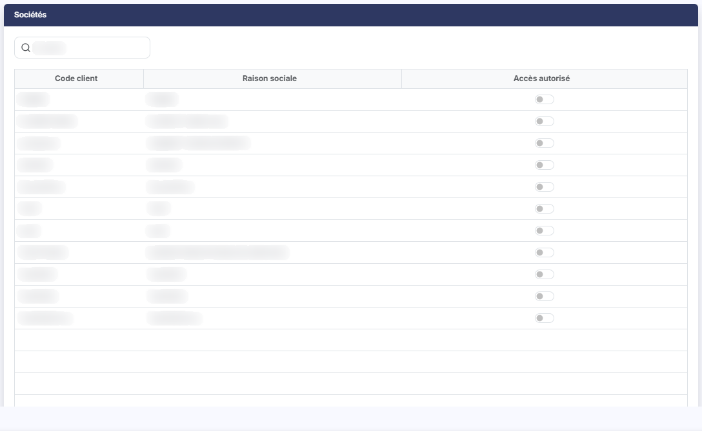
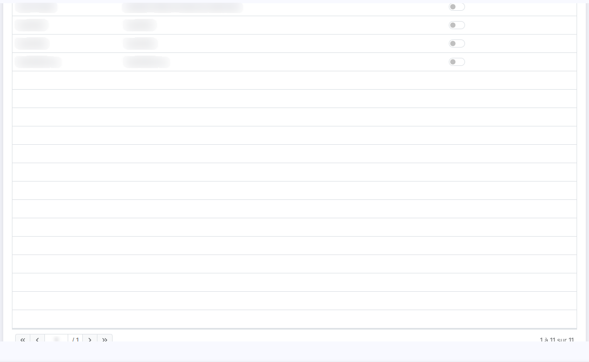
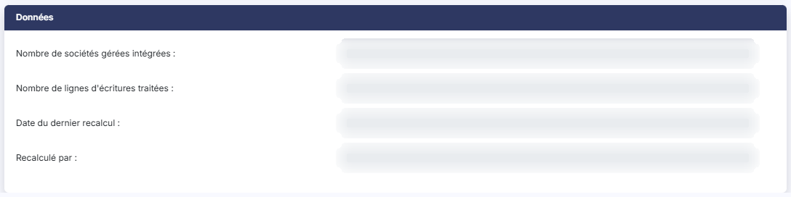

# Panels


**Où le trouver :** Menu **Panels**



**En bref** — Cet écran permet de constituer des panels, c'est-à-dire des regroupements de sociétés gérées : vous créez un panel, lui donnez un libellé, puis désignez les sociétés qui en font partie.

* Pour créer un panel : bouton \[Créer un panel], saisissez le Libellé, activez l'interrupteur Accès autorisé des sociétés voulues, puis bouton \[Enregistrer].
* Pour modifier ou supprimer un panel : menu « ⋮ » de sa ligne, puis « Modifier » ou « Supprimer ».
* Pour actualiser les données d'un panel existant : ouvrez sa fiche, bouton \[Recalcul], puis confirmez.


## La liste des panels

<figure><figcaption>
Écran « Panels » de la nouvelle interface
</figcaption></figure>

<figure><figcaption>
Bouton [Créer un panel]
</figcaption></figure>

<figure><figcaption>
Bouton [Filtres]
</figcaption></figure>

<figure><figcaption>
Bouton [Vue]
</figcaption></figure>

<figure><figcaption>
Bouton [Exporter]
</figcaption></figure>

La liste présente tous les panels existants, sur une seule page tant qu'ils ne sont pas trop nombreux. Au-dessus de la grille, de gauche à droite, vous trouvez le champ **Rechercher un panel…**, le **bouton \[Filtres]**, le **bouton \[Vue]** et le **bouton \[Exporter]**.

La grille comporte trois colonnes, toutes triables, sans case à cocher en tête de ligne : **Libellé** (la liste est triée par libellé croissant à l'ouverture), **Descriptif** et **Actif** (« Oui » ou « Non »). La dernière colonne n'a pas d'en-tête : elle porte le menu « ⋮ » de la ligne. Une quatrième colonne, **IdPanel**, existe mais n'est pas affichée : vous pouvez la faire apparaître par le bouton \[Vue].

En bas de grille, vous trouvez la pagination, les liens « Sélectionner la page » et « Tout sélectionner (14) » — le nombre entre parenthèses est celui des panels de la liste — ainsi que le compteur « 1 à 14 sur 14 ».

**Menu « ⋮ » de la ligne**

Il propose deux commandes, dans cet ordre : « Modifier », qui ouvre la fiche du panel, et « Supprimer », qui supprime le panel.

bouton **\[Filtres]**

Il ouvre un menu intitulé « Filtrer ». Tant qu'aucun critère n'est posé, le menu indique « Aucun critère. Choisissez une colonne pour commencer. ». La liste « + Ajouter un critère sur… » propose les colonnes **Libellé**, **Descriptif** et **Actif**. Le lien « Vider les filtres » retire les critères, et le bouton \[Filtrer] applique ceux que vous avez posés.

bouton **\[Vue]**

Il ouvre un menu en deux parties. « Mes vues » liste vos vues enregistrées (« Aucune vue enregistrée. » tant que vous n'en avez pas) et propose le bouton « + Enregistrer la vue actuelle ». « Colonnes affichées » comporte un champ « Rechercher une colonne… » et une case par colonne : **IdPanel**, **Libellé**, **Descriptif** et **Actif**, avec un compteur du type « 3 colonnes affichées sur 4 ». Le lien « Rétablir les colonnes d'origine » revient à l'affichage initial, et le bouton \[Appliquer] valide votre choix.

bouton **\[Exporter]**

Il ouvre un menu intitulé « La liste affichée » suivi du nombre de panels (« 14 panels »). Il propose, dans cet ordre : « Aperçu » (édition HTML), « Imprimer » (raccourci Ctrl+P), « Exporter en Excel », « Exporter en PDF », puis, après un séparateur, « Envoyer la liste par e-mail ».

bouton **\[Créer un panel]**

Ce bouton orange, en bas à droite de l'écran, est toujours visible. Il ouvre la fiche de création d'un panel.

## La fiche d'un panel

<figure><figcaption>
Rubrique « Rubrique « Informations générales » »
</figcaption></figure>

<figure><figcaption>
Rubrique « Rubrique « Sociétés » »
</figcaption></figure>

<figure><figcaption>
Rubrique « Rubrique « Sociétés » »
</figcaption></figure>

<figure><figcaption>
Rubrique « Rubrique « Données » »
</figcaption></figure>

La fiche s'ouvre par la commande « Modifier » du menu de la ligne, ou par le bouton \[Créer un panel]. C'est une page unique, sans onglet, qui comporte trois rubriques, l'une d'elles n'apparaissant qu'une fois le panel créé. Le curseur est placé d'emblée dans le champ Libellé. Pour quitter la fiche sans enregistrer, cliquez sur la flèche « Revenir en arrière », à gauche du fil d'Ariane : la fiche ne comporte ni bouton \[Annuler] ni bouton \[Fermer].

**Rubrique « Informations générales »**

| Champ                | Ce qu'il faut savoir                                                                                                                                                       |
| -------------------- | -------------------------------------------------------------------------------------------------------------------------------------------------------------------------- |
| **Libellé**          | Nom du panel, obligatoire (astérisque), 30 caractères au plus.                                                                                                             |
| **Descriptif**       | Zone de texte sur plusieurs lignes, facultative, 1 024 caractères au plus.                                                                                                 |
| **Date de création** | **Créé par :** ces deux champs, grisés, se renseignent d'eux-mêmes ; vous ne les modifiez pas. Ils n'apparaissent que sur la fiche d'un panel existant, pas à la création. |
| **Actif**            | Interrupteur. À la création, il est désactivé : activez l'interrupteur pour que le panel soit actif. Dans la liste, la colonne **Actif** reprend cette valeur.             |

**Rubrique « Sociétés »**

Elle présente les sociétés gérées de votre cabinet — par exemple « FLOREETSENS » (FLORE ET SENS SAS) — avec trois colonnes triables : **Code client**, **Raison sociale** et **Accès autorisé**. Le champ de recherche « Société », en haut de la rubrique, permet de retrouver une société. Pour inclure une société dans le panel, activez son interrupteur **Accès autorisé** ; tous les interrupteurs sont désactivés sur une fiche de création. La liste est la même à la création et à la modification. Elle comporte sa propre pagination et un compteur (« 1 à 11 sur 11 »), sans les liens « Sélectionner la page » et « Tout sélectionner ».

**Rubrique « Données »**

Cette rubrique n'apparaît que sur la fiche d'un panel existant. Elle comporte quatre champs grisés, que vous ne saisissez pas : **Nombre de sociétés gérées intégrées :**, **Nombre de lignes d'écritures traitées :**, **Date du dernier recalcul :** et **Recalculé par :**. C'est le bouton \[Recalcul] qui les renseigne.

## Les actions de la fiche

bouton **\[Enregistrer]**

Ce bouton vert, dans la barre du bas, enregistre le panel avec ses sociétés, puis vous ramène à la liste. Il est présent à la création comme à la modification, mais il n'est affiché que si vos droits vous permettent d'enregistrer un panel.

bouton **\[Recalcul]**

Ce bouton bleu nuit se trouve dans la barre du bas, à côté du bouton \[Enregistrer], sur la fiche d'un panel existant seulement ; il n'existe pas à la création. Il n'est affiché que si vos droits vous permettent de recalculer un panel.

Le logiciel vous demande d'abord de confirmer, en vous prévenant que le recalcul peut prendre plusieurs minutes. Une fois confirmé, il affiche sa progression, puis renseigne les quatre champs de la rubrique « Données » : le nombre de sociétés intégrées, le nombre de lignes d'écritures traitées, la date du recalcul et le nom de la personne qui l'a lancé.
