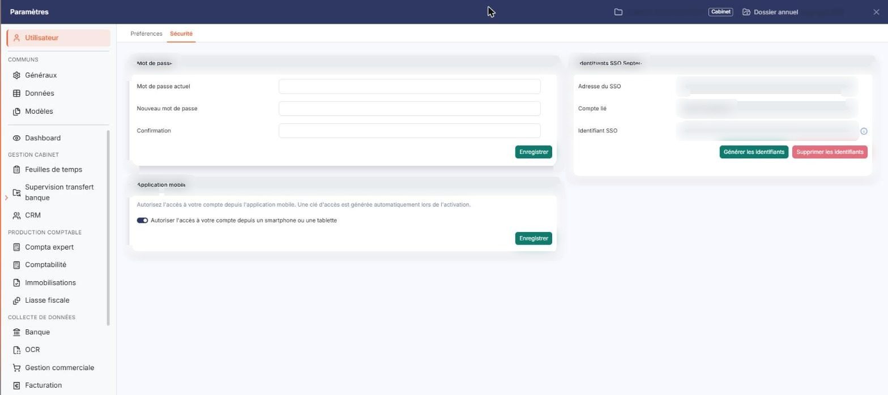
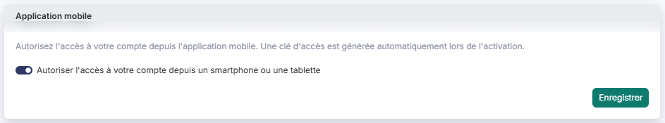

# Application mobile


**Où le trouver :** Panneau **Paramètres** › **Utilisateur** › **Sécurité**



**En bref** — Cet écran permet d'autoriser, ou de refuser, l'accès à votre compte utilisateur depuis un smartphone ou une tablette, via l'application mobile.

* Pour autoriser l'application mobile : activez « Autoriser l'accès à votre compte depuis un smartphone ou une tablette », puis bouton \[Enregistrer].
* Pour la refuser : désactivez cet interrupteur, puis bouton \[Enregistrer].


Votre logiciel web est également accessible depuis une application mobile. Cet écran vous permet d'autoriser, ou de refuser, l'accès à votre compte utilisateur depuis un smartphone ou une tablette.

<figure><figcaption>
Écran « Application mobile » de la nouvelle interface
</figcaption></figure>

Il s'ouvre par Paramètres (en bas de la barre latérale) > Utilisateur > Sécurité, où il constitue la carte « Application mobile », la deuxième des trois cartes de l'écran.

## Rubrique « Application mobile »

<figure><figcaption>
Rubrique « Rubrique « Application mobile » »
</figcaption></figure>

C'est le seul choix de cette rubrique.

## Autoriser l'accès à votre compte depuis un smartphone ou une tablette :

Activez l'interrupteur pour permettre la connexion à votre compte depuis l'application mobile, désactivez-le pour l'interdire. Votre choix ne prend effet qu'après avoir cliqué sur **\[Enregistrer]**.

bouton **\[Enregistrer]**

Ce bouton est propre à la carte « Application mobile ». Le logiciel enregistre votre choix et affiche le message « Vos modifications ont bien été enregistrées. ».

Selon le choix enregistré, le logiciel met en place ou retire l'autorisation technique qui permet à l'application mobile de se connecter à votre compte :

Ce bouton n'apparaît que si le droit d'accès correspondant vous a été accordé. S'il est absent, rapprochez-vous de l'administrateur de votre abonnement.

L'application mobile porte le nom de votre logiciel ; elle se télécharge depuis les magasins d'applications Apple et Google.
