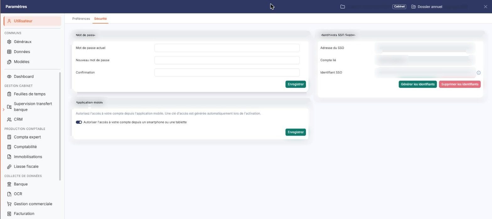
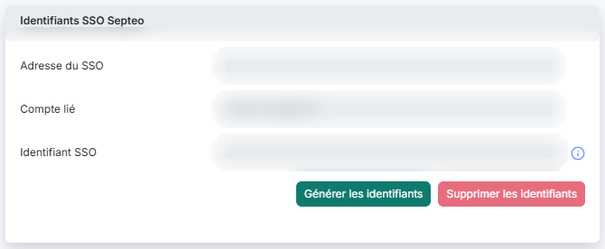

# Identifiants API


**Où le trouver :** Panneau **Paramètres** › **Utilisateur** › **Sécurité**



**En bref** — Cet écran permet de rattacher votre compte utilisateur au fournisseur d'identité de votre abonnement, pour vous connecter avec ce compte plutôt qu'avec votre mot de passe.

* Pour rattacher votre compte : bouton \[Générer les identifiants], puis authentifiez-vous auprès du fournisseur d'identité.
* Pour supprimer le rattachement : bouton \[Supprimer les identifiants].


Cet écran vous permet de rattacher votre compte utilisateur au fournisseur d'identité de votre abonnement, afin de vous connecter au logiciel avec ce compte plutôt qu'avec votre mot de passe. Vous n'y saisissez rien : les identifiants sont obtenus par le logiciel auprès du fournisseur, puis affichés ici.

<figure><figcaption>
Écran « Identifiants API » de la nouvelle interface
</figcaption></figure>

Il s'ouvre par Paramètres (en bas de la barre latérale) > Utilisateur > Sécurité, où il constitue la carte « Identifiants SSO Septeo », la troisième et dernière des trois cartes de l'écran.

## Rubrique « Identifiants SSO Septeo »

<figure><figcaption>
Rubrique « Rubrique « Identifiants SSO Septeo » »
</figcaption></figure>

Les trois champs de cette rubrique sont en **lecture seule** : ils ne sont pas saisissables et restent vides tant que vous n'avez pas généré vos identifiants.

## Adresse du SSO :

Le fournisseur d'identité auprès duquel votre compte a été rattaché.

## Compte lié :

Le compte auquel votre compte utilisateur est lié. Tant qu'aucun compte n'est lié, le champ affiche l'indication « Aucun compte lié ».

## Identifiant SSO :

L'identifiant qui vous désigne chez ce fournisseur.

Les deux boutons de cette rubrique sont placés dans la carte « Identifiants SSO Septeo », qui n'a pas de bouton \[Enregistrer]. Ils n'apparaissent que si le droit d'accès correspondant vous a été accordé ; s'ils sont absents, rapprochez-vous de l'administrateur de votre abonnement.

bouton **\[Générer les identifiants]**

Ce bouton est actif tant qu'aucun identifiant n'est enregistré.

bouton **\[Supprimer les identifiants]**

Ce bouton reste grisé tant qu'aucun identifiant n'est enregistré, c'est-à-dire tant que les champs sont vides.
