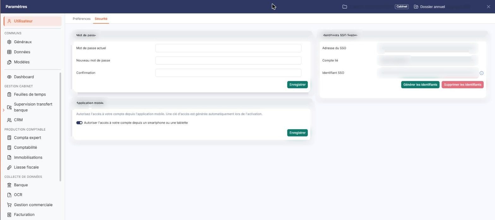
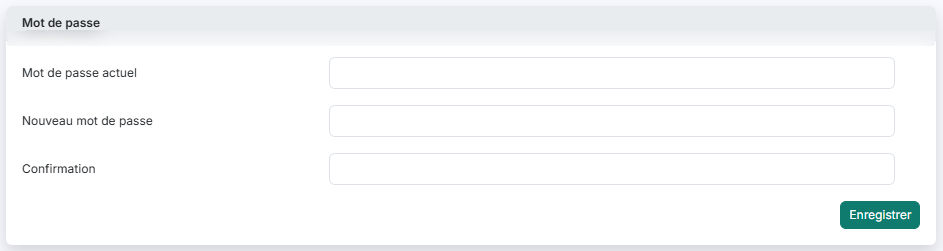

# Mot de passe


**Où le trouver :** Panneau **Paramètres** › **Utilisateur** › **Sécurité**



**En bref** — Cet écran permet de changer le mot de passe avec lequel vous vous connectez au logiciel. Il est conseillé de le changer régulièrement.

* Pour changer votre mot de passe : saisissez le « Mot de passe actuel », le « Nouveau mot de passe » (6 à 20 caractères) et la « Confirmation », puis bouton \[Enregistrer].
* Si le logiciel refuse votre saisie : lisez le message sous le champ concerné, corrigez, puis bouton \[Enregistrer].


Cet écran vous permet de changer le mot de passe avec lequel vous vous connectez au logiciel. Il est conseillé de le changer régulièrement.

<figure><figcaption>
Écran « Mot de passe » de la nouvelle interface
</figcaption></figure>

Il s'ouvre par Paramètres (en bas de la barre latérale) > Utilisateur > Sécurité, où il constitue la carte « Mot de passe », la première des trois cartes de l'écran.

Votre mot de passe est enregistré sous une forme chiffrée : il n'est lisible par personne, pas même par un administrateur. Un administrateur habilité peut en revanche vous envoyer un lien de réinitialisation pour en choisir un nouveau : il ne saisit pas lui-même votre mot de passe.

## Rubrique « Mot de passe »

<figure><figcaption>
Rubrique « Rubrique « Mot de passe » »
</figcaption></figure>

Les trois champs sont obligatoires, vides à l'ouverture de l'écran, et votre saisie y est masquée. Chacun accepte 20 caractères au maximum.

## Mot de passe actuel :

Indiquez le mot de passe avec lequel vous vous connectez aujourd'hui. Ce champ prend le curseur dès l'ouverture de l'écran.

## Nouveau mot de passe :

Indiquez le mot de passe que vous souhaitez utiliser désormais. Il doit comporter **entre 6 et 20 caractères** et être différent de votre mot de passe actuel. Ces deux règles ne sont rappelées nulle part à l'écran : le logiciel ne vous les signale qu'au moment où il refuse votre saisie.

## Confirmation :

Indiquez à nouveau le nouveau mot de passe, à l'identique.

bouton **\[Enregistrer]**

Ce bouton est propre à la carte « Mot de passe » ; les autres cartes de l'écran ont chacune le leur. Le logiciel contrôle votre saisie puis enregistre votre nouveau mot de passe. Un message de confirmation « Votre nouveau mot de passe a bien été enregistré » vous l'indique. Le nouveau mot de passe est actif immédiatement : vous l'utiliserez à votre prochaine connexion.

Ce bouton n'apparaît que si le droit d'accès correspondant vous a été accordé. S'il est absent, rapprochez-vous de l'administrateur de votre abonnement.

## Messages de contrôle

Si un champ ne respecte pas une règle, le logiciel affiche un message sous le champ concerné et n'enregistre rien. Par exemple :

Corrigez la saisie signalée puis cliquez de nouveau sur **\[Enregistrer]**.
