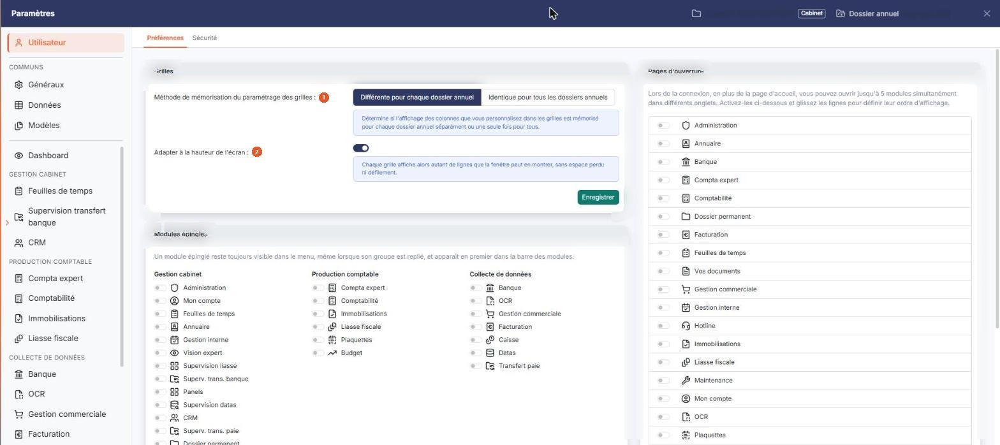
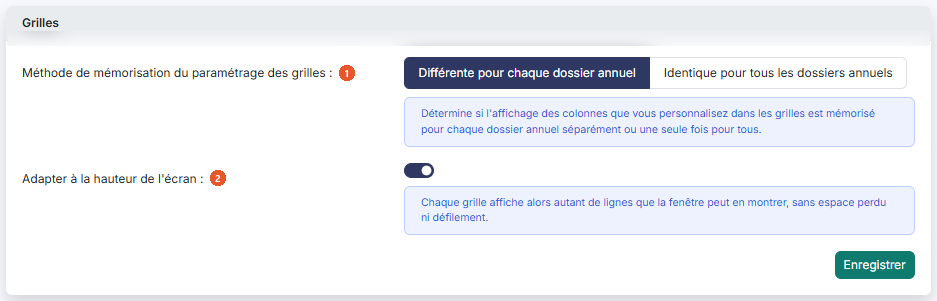
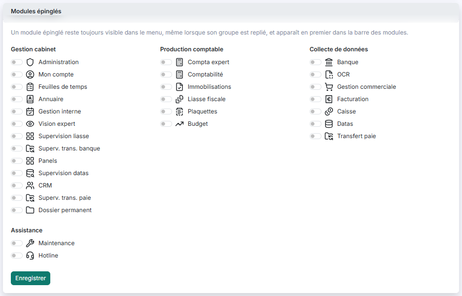
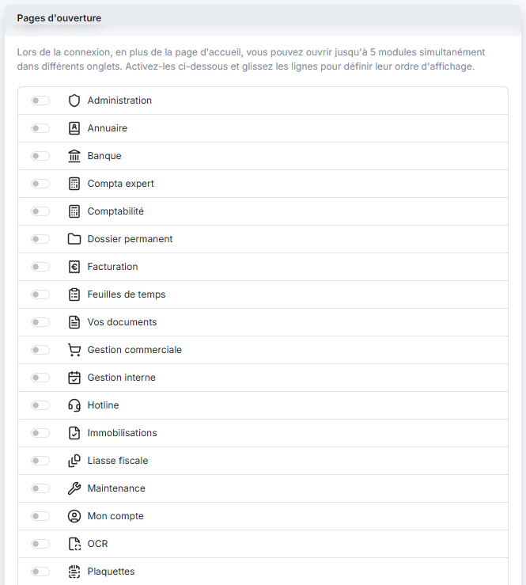
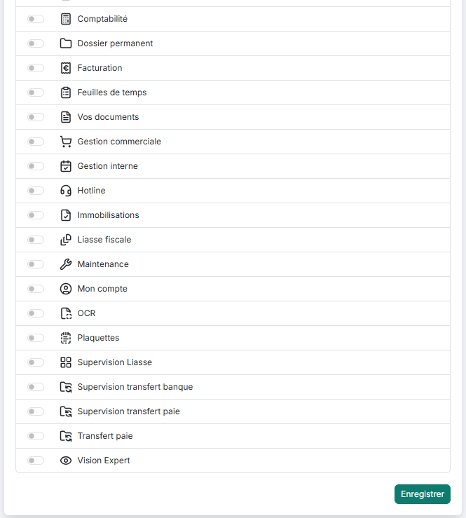
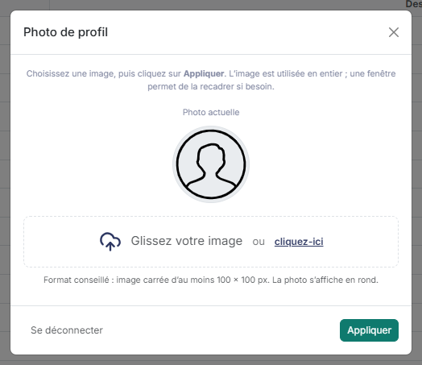

# Préférences


**Où le trouver :** Panneau **Paramètres** › **Utilisateur** › **Préférences**



**En bref** — Cette page permet de personnaliser votre interface : présentation des grilles, modules épinglés et pages ouvertes à la connexion. Vos choix ne concernent que votre code utilisateur.

* Pour fixer le nombre de lignes des grilles : désactivez « Adapter à la hauteur de l'écran », indiquez le « Nombre de lignes visibles dans les grilles » (de 10 à 200), puis bouton \[Enregistrer] de la rubrique.
* Pour choisir les modules ouverts à la connexion : activez l'interrupteur de chaque module (cinq au plus) dans « Pages d'ouverture », faites glisser les lignes pour les ordonner, puis bouton \[Enregistrer].
* Pour changer votre photo : cliquez sur votre nom d'utilisateur en bas de la barre latérale, puis bouton \[Appliquer] dans la fenêtre « Photo de profil ».


## Grilles

<figure><figcaption>
Écran « Thèmes » de la nouvelle interface
</figcaption></figure>

<figure><figcaption>
Rubrique « Grilles »
</figcaption></figure>

Cette rubrique gouverne la présentation des grilles, c'est-à-dire des listes dans lesquelles le logiciel vous présente vos données.

| Champ                                                     | Ce qu'il faut savoir                                                                                                                                                                                                                                                                                                                                                                                                                                                                                                                                                                                                                                                                                                                                                                                                                                                                                                                           |
| --------------------------------------------------------- | ---------------------------------------------------------------------------------------------------------------------------------------------------------------------------------------------------------------------------------------------------------------------------------------------------------------------------------------------------------------------------------------------------------------------------------------------------------------------------------------------------------------------------------------------------------------------------------------------------------------------------------------------------------------------------------------------------------------------------------------------------------------------------------------------------------------------------------------------------------------------------------------------------------------------------------------------- |
| 1. **Méthode de mémorisation du paramétrage des grilles** | 
Choisissez, entre les deux boutons « Différente pour chaque dossier annuel » et « Identique pour tous les dossiers annuels », celui qui vous convient ; le bouton retenu s'affiche en bleu marine plein. Ce choix détermine la portée des paramétrages que vous faites dans les grilles — choix des champs, largeurs, disposition : soit ils restent propres à la seule société et au seul dossier annuel dans lesquels vous les effectuez, soit ils valent quels que soient la société et le dossier annuel dans lesquels vous vous trouvez. Dès que vous sélectionnez l'un des deux choix, le logiciel ouvre une fenêtre qui vous rappelle la conséquence de l'option retenue. bouton <strong>[Confirmer]</strong> et bouton <strong>[Annuler]</strong> Ces deux boutons referment la fenêtre de rappel ; ni l'un ni l'autre n'enregistre quoi que ce soit, seul le bouton [Enregistrer] de la rubrique enregistre votre choix.
 |
| 2. **Adapter à la hauteur de l'écran**                    | Interrupteur. Lorsqu'il est activé, chaque grille affiche autant de lignes que la fenêtre peut en montrer, sans espace perdu ni défilement.                                                                                                                                                                                                                                                                                                                                                                                                                                                                                                                                                                                                                                                                                                                                                                                                    |
| **Nombre de lignes visibles dans les grilles**            | Ce champ n'apparaît que si vous avez désactivé l'interrupteur « Adapter à la hauteur de l'écran ». Indiquez alors le nombre de lignes que vous souhaitez voir affichées quel que soit votre écran. Ce champ est obligatoire et la valeur doit être comprise entre 10 et 200. Selon le nombre choisi et la taille de votre écran, un ascenseur peut être nécessaire pour parcourir la grille.                                                                                                                                                                                                                                                                                                                                                                                                                                                                                                                                                   |

## Modules épinglés

<figure><figcaption>
Rubrique « Modules épinglés »
</figcaption></figure>

Les modules sont répartis en quatre groupes : Gestion cabinet, Production comptable, Collecte de données et Assistance. Chaque module est présenté avec un interrupteur et son nom.

Le texte affiché en tête de la rubrique précise : « Un module épinglé reste toujours visible dans le menu, même lorsque son groupe est replié, et apparaît en premier dans la barre des modules. »

Cette rubrique a son propre bouton \[Enregistrer].

## Pages d'ouverture

<figure><figcaption>
Rubrique « Pages d'ouverture »
</figcaption></figure>

<figure><figcaption>
Rubrique « Pages d'ouverture »
</figcaption></figure>

Lors de la connexion, en plus de la page d'accueil, vous avez la possibilité d'ouvrir jusqu'à 5 modules simultanément dans différents onglets du navigateur.

La liste présente une ligne par module : un interrupteur, suivi du nom du module. Activez l'interrupteur de chacun des modules à ouvrir, puis choisissez leur ordre d'affichage en faisant glisser les lignes de haut en bas ou de bas en haut. La liste présentée ne dépend pas des modules auxquels votre abonné a souscrit : elle dépend du type de votre abonné — cabinet d'expertise comptable ou entreprise — et de votre type d'utilisateur. Un module peut donc y figurer sans que vous y ayez accès.

Cliquez sur \[Enregistrer] pour enregistrer votre sélection et son ordre.

## Image du profil

<figure><figcaption>
Rubrique « Image du profil »
</figcaption></figure>

L'image du profil ne se règle plus dans cet écran : elle se règle dans la fenêtre « Photo de profil », que vous ouvrez en cliquant sur votre nom d'utilisateur, en bas de la barre latérale.

La fenêtre comporte deux zones, « Photo actuelle » et « Nouvelle image ». Son texte d'aide précise : « Choisissez une image, puis cliquez sur Appliquer. L'image est utilisée en entier ; une fenêtre permet de la recadrer si besoin. » Une zone de dépôt, « Glissez votre image ou cliquez-ici », permet de choisir l'image, et la mention « Format conseillé : image carrée d'au moins 100 × 100 px. La photo s'affiche en rond. » est affichée dans la fenêtre.

bouton **\[Appliquer]**

Ce bouton se trouve dans la fenêtre « Photo de profil ».

bouton **\[Retirer la photo]**

Ce bouton est masqué tant que votre image est l'image par défaut.

La fenêtre porte aussi un bouton \[Se déconnecter] ; elle se ferme par la croix « Fermer ».
