# L'éditeur de plaquette


**Où le trouver :** Module **Plaquettes**


Cet écran est l'éditeur de plaquette : c'est là que vous créez une plaquette, que vous composez son contenu, que vous contrôlez son aperçu et que vous lancez son édition. Le lien « Plaquettes » du module ouvre directement l'éditeur sur la plaquette en cours ; dans l'éditeur, le module n'affiche pas de barre de menus.

<figure>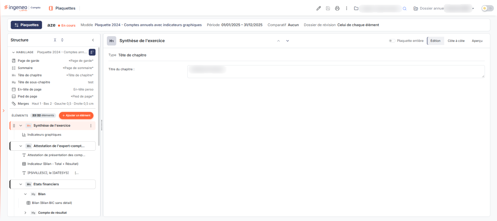<figcaption>
Écran « Plaquettes » de la nouvelle interface
</figcaption></figure>

Pour un même dossier annuel, vous pouvez créer plusieurs plaquettes. Chacune est créée à partir d'un modèle de plaquette, ou « vide », et porte le libellé, la période et les données que vous lui donnez. Lorsqu'elle est créée à partir d'un modèle, la plaquette reçoit une copie des éléments du modèle et de ses réglages d'habillage (pages et marges), et garde la référence du modèle dont elle est issue.

L'écran se compose du bandeau d'en-tête, du volet « Structure » à gauche, qui liste l'habillage et les éléments de la plaquette, et du panneau de l'élément sélectionné à droite. Les autres fonctions s'ouvrent dans des tiroirs qui glissent depuis le côté ; chacun porte une poignée sur son bord : « Glisser pour agrandir ou réduire · double-clic pour revenir à la taille par défaut ».

## Le bandeau d'en-tête

De gauche à droite, le bandeau présente :

bouton **\[Plaquettes]** : son infobulle est « Ouvrir une autre plaquette ou en créer une ». Il ouvre le tiroir « Plaquettes et modèles » (rubrique b).

| Champ         | Ce qu'il faut savoir                                                                                                                                                        |
| ------------- | --------------------------------------------------------------------------------------------------------------------------------------------------------------------------- |
| **Le titre**  | Le libellé de la plaquette. Il n'est pas modifiable dans le bandeau ; il se change par le pictogramme « Paramètres » (rubrique d).                                          |
| **Le statut** | Une pastille à côté du titre, « En cours » tant que la plaquette n'est pas validée.                                                                                         |
| **Modèle**    | Le modèle de la plaquette, présenté comme un lien (infobulle « Modifier ce modèle de plaquette ») qui ouvre la fiche de ce modèle (voir la page « Modèles de plaquettes »). |

**Période**, **Comparatif** et **Dossier de révision** : ces trois informations sont en lecture seule dans le bandeau ; elles se modifient par le pictogramme « Paramètres ». Le comparatif vaut « Aucun » si aucun exercice de comparaison n'est choisi. Le dossier de révision vaut « Celui de chaque élément » lorsque vous avez laissé « Aucun » dans les paramètres.

**Le compteur d'alertes**, de la forme « n alerte » : il est masqué lorsque la plaquette n'a aucune alerte.

À droite du bandeau, vous trouvez les pictogrammes de l'en-tête de page :

* « Paramètres » : il ouvre le tiroir « Paramètres de la plaquette » (rubrique d) ;
* « Sauvegarder » : il est grisé tant que rien n'est modifié dans la plaquette, et s'active dès qu'un élément diffère de son état enregistré ;
* « Lancer l'édition » : il lance l'édition de la plaquette (rubrique g) ;
* « Plus d'actions » (trois points verticaux) : il ouvre le menu décrit à la rubrique h.

Le bandeau porte aussi les sélecteurs de société et de dossier annuel, ainsi que le pictogramme « Passer au mode sombre » : ils sont communs à tous les modules et ne sont pas décrits ici. La plaquette affichée est celle du dossier annuel que vous avez choisi dans le sélecteur.

## Le tiroir « Plaquettes et modèles »

<figure>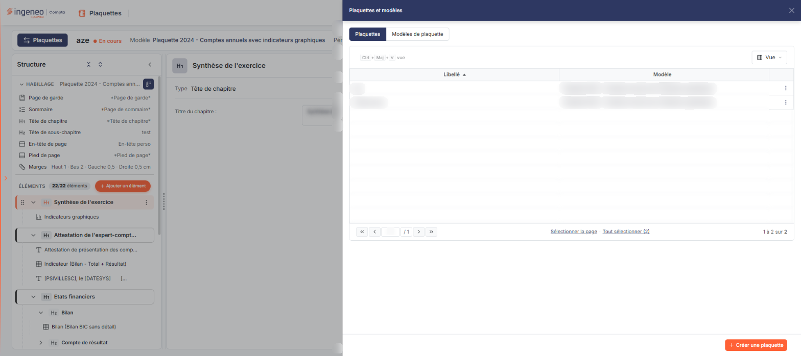<figcaption>
Rubrique « Le tiroir « Plaquettes et modèles » »
</figcaption></figure>

<figure>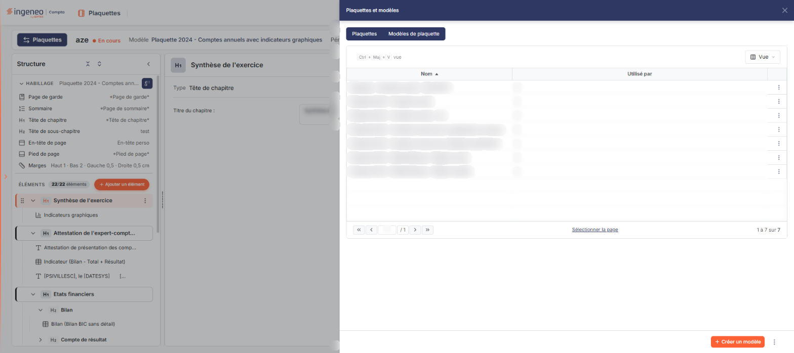<figcaption>
Rubrique « Le tiroir « Plaquettes et modèles » »
</figcaption></figure>

Le bouton **\[Plaquettes]** ouvre ce tiroir. Il présente deux onglets, sous forme de boutons exclusifs : **Plaquettes**, affiché à l'ouverture, et **Modèles de plaquette**. Ce second onglet est décrit dans la page « Modèles de plaquettes ».

**L'onglet « Plaquettes »** liste les plaquettes du dossier annuel. La grille présente par défaut :

* **Libellé** : le libellé de la plaquette, colonne triable (triée par ordre croissant à l'ouverture) et redimensionnable ;
* **Modèle** : le modèle sur lequel la plaquette a été créée, colonne triable et redimensionnable ;
* une colonne de commandes : le menu « Autres actions » (trois points) de chaque ligne propose **Modifier**, **Dupliquer** et **Supprimer**.

Le bouton **\[Vue]** (raccourci affiché : Ctrl+Maj+V) ouvre un menu en deux parties. « MES VUES » permet d'enregistrer la présentation actuelle de la liste : le bouton « Enregistrer la vue actuelle » demande un « Nom de la vue », puis bouton **\[Enregistrer]** ou bouton **\[Annuler]** ; une croix « Supprimer cette vue » apparaît sur chaque vue enregistrée. « COLONNES AFFICHÉES » liste les colonnes que vous pouvez afficher (avec un champ « Rechercher une colonne ») : outre Libellé et Modèle, ce sont la page de garde, la page de sommaire, la page de tête de chapitre, l'en-tête, le pied de page, la date de début, la date de fin, la date de création, « Créée par », la date de validation et « Validée par ». Le lien « Rétablir les colonnes d'origine » revient à l'affichage initial et bouton **\[Appliquer]** applique votre choix. Il n'existe pas de colonne pour la page de tête de sous-chapitre.

En bas de la liste, les liens « Sélectionner la page » et « Tout sélectionner » cochent les lignes de la page ou de toute la liste, et la pagination indique par exemple « 1 à 1 sur 1 ». L'onglet ne présente ni zone de recherche ni filtre ; la zone des pastilles de filtre, avec son bouton « Tout effacer », reste masquée tant qu'aucun filtre n'est posé.

Le pied du tiroir porte, à gauche, bouton **\[Supprimer la sélection]** (en rouge), qui n'apparaît que lorsque des plaquettes sont sélectionnées, et, à droite, bouton **\[Créer une plaquette]** (le bouton principal). Le tiroir se ferme par la croix de son en-tête.

## La création d'une plaquette

<figure>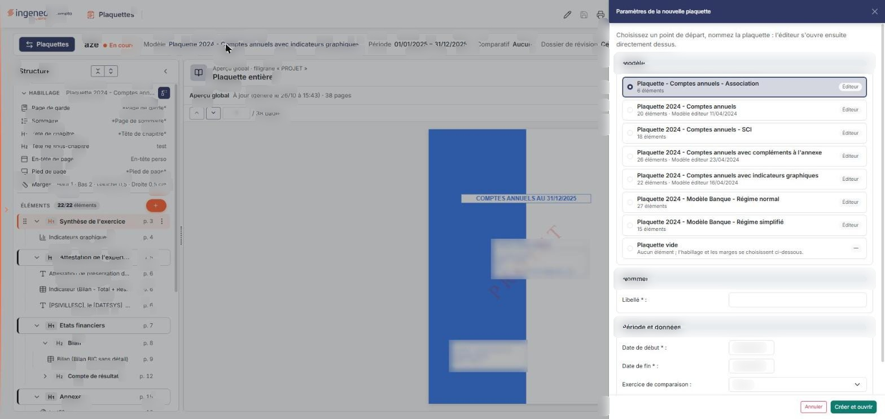<figcaption>
Rubrique « La création d'une plaquette »
</figcaption></figure>

Le bouton **\[Créer une plaquette]** ouvre le tiroir « Paramètres de la nouvelle plaquette », qui précise : « Choisissez un point de départ, nommez la plaquette : l'éditeur s'ouvre ensuite directement dessus. »

**Modèle** : un choix exclusif parmi les modèles de plaquette, chacun accompagné du nombre de ses éléments (et, pour les modèles fournis par l'éditeur, de l'étiquette « Éditeur », suivie de sa date pour certains d'entre eux), puis le choix « Plaquette vide » (« Aucun élément ; l'habillage et les marges se choisissent ci-dessous. »). Un modèle est présélectionné à l'ouverture.

Les autres champs sont ceux des paramètres d'une plaquette, décrits à la rubrique suivante : **Libellé**, **Date de début**, **Date de fin**, **Exercice de comparaison** et **Dossier de révision**. À la création, le libellé est vide et les dates reprennent la période de l'exercice affiché (par exemple 01/01/2025 – 31/12/2025).

Si vous choisissez « Plaquette vide », dix champs supplémentaires apparaissent sous « Dossier de révision », pour choisir directement l'habillage : **Modèle d'impression de la page de garde**, **du sommaire**, **des têtes de chapitre**, **des têtes de sous-chapitre**, **des en-têtes de page** et **des pieds de page**, qui proposent chacun « Aucun » (« Aucune » pour la page de garde) et les pages disponibles ; puis les quatre marges **Haut**, **Bas**, **Gauche** et **Droite**, en centimètres, initialisées à 0,5.

bouton **\[Annuler]** referme le tiroir sans rien créer. bouton **\[Créer et ouvrir]** crée la plaquette et ouvre l'éditeur sur elle.

## Les paramètres de la plaquette

<figure>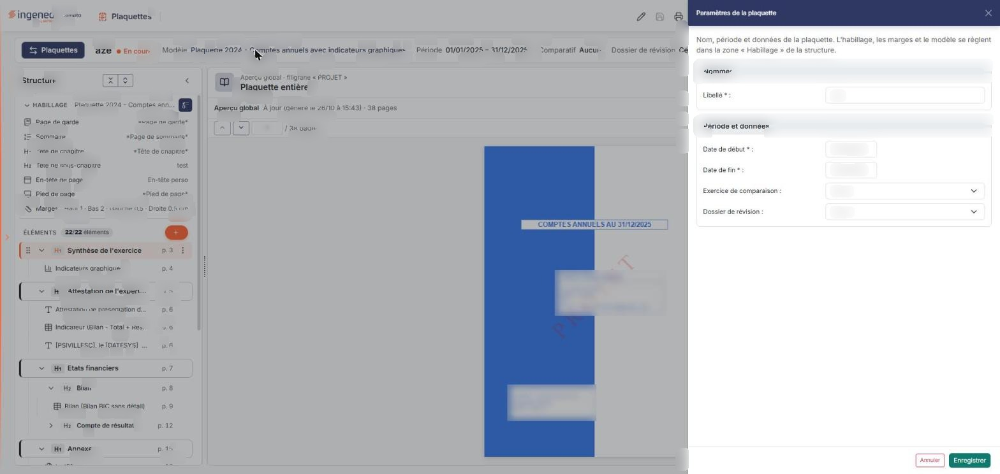<figcaption>
Rubrique « Les paramètres de la plaquette »
</figcaption></figure>

Le pictogramme « Paramètres » ouvre le tiroir « Paramètres de la plaquette », qui rappelle : « Nom, période et données de la plaquette. L'habillage, les marges et le modèle se règlent dans la zone « Habillage » de la structure. »

| Champ                       | Ce qu'il faut savoir                                                                                                                                                                                                                                                                                                                                   |
| --------------------------- | ------------------------------------------------------------------------------------------------------------------------------------------------------------------------------------------------------------------------------------------------------------------------------------------------------------------------------------------------------ |
| **Libellé**                 | (marqué d'un astérisque), le nom de la plaquette.                                                                                                                                                                                                                                                                                                      |
| **Date de début**           | **Date de fin :** obligatoires, au format jj/mm/aaaa. Elles délimitent la période de la plaquette.                                                                                                                                                                                                                                                     |
| **Exercice de comparaison** | La liste propose « Aucun », « n-1 (générique) », « n-2 (générique) » et les exercices du dossier (par exemple « Exercice 2023 »). Dès que vous choisissez autre chose que « Aucun », deux champs apparaissent, **Date de début de comparaison :** et **Date de fin de comparaison :**, préremplis ; ils restent masqués tant que « Aucun » est choisi. |
| **Dossier de révision**     | La liste propose « Aucun » et les dossiers de révision existants. Avec « Aucun », le bandeau affiche « Celui de chaque élément ».                                                                                                                                                                                                                      |

bouton **\[Annuler]** referme le tiroir. bouton **\[Enregistrer]** enregistre les paramètres.

## Le volet « Structure »

<figure>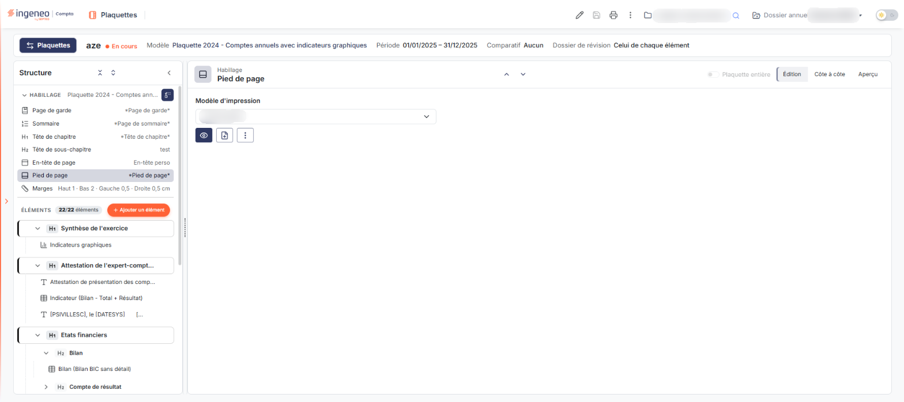<figcaption>
Rubrique « Le volet « Structure » »
</figcaption></figure>

<figure>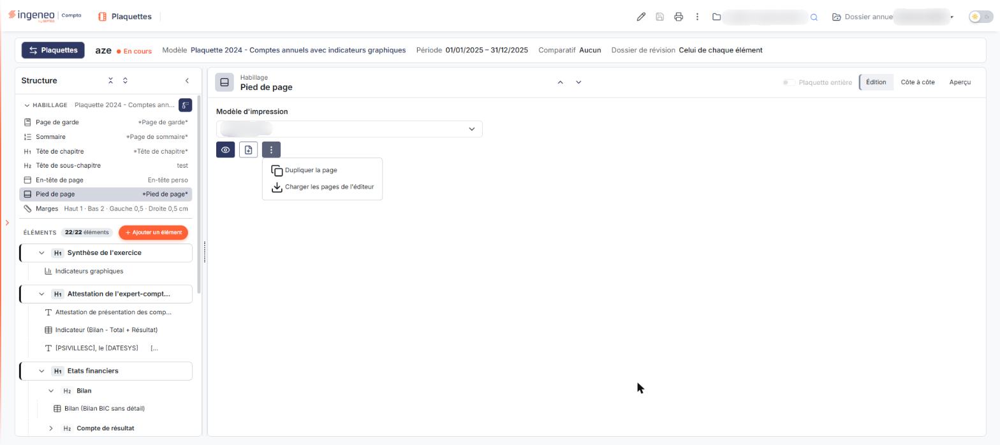<figcaption>
Rubrique « Le volet « Structure » »
</figcaption></figure>

L'en-tête du volet porte le titre « Structure » et deux boutons groupés, « Replier toutes les rubriques » et « Déplier toutes les rubriques », ainsi qu'un bouton « Replier la structure » (chevron) qui réduit le volet. Un bouton rouge « Supprimer » suivi d'un nombre est prévu dans cet en-tête ; il reste masqué tant que vous n'avez pas sélectionné plusieurs éléments à la fois (Ctrl ou Maj + clic).

Le volet contient deux rubriques repliables : « HABILLAGE » puis « ÉLÉMENTS ».

**La rubrique « HABILLAGE ».** La ligne de titre rappelle le modèle de la plaquette (infobulle « Modèle de plaquette : … ») et porte le pictogramme « Changer de modèle de plaquette ». Sept lignes suivent, chacune présentant son libellé et sa valeur actuelle ; un clic sur une ligne ouvre son panneau à droite :

1. **Page de garde** ;
2. **Sommaire** ;
3. **Tête de chapitre** ;
4. **Tête de sous-chapitre** ;
5. **En-tête de page** ;
6. **Pied de page** ;
7. **Marges**, dont la valeur résume les quatre marges (par exemple « Haut 1 · Bas 2 · Gauche 0,5 · Droite 0,5 cm »).

Une valeur écrite entre astérisques (par exemple « _Page de garde_ ») désigne une page fournie par l'éditeur, qui ne se modifie pas : vous pouvez seulement la consulter. Les autres sont des pages personnalisées, que vous pouvez modifier.

Le panneau d'une ligne d'habillage, sauf « Marges », propose la liste **Modèle d'impression** (par exemple « Aucun » et les pages disponibles de ce type), et des pictogrammes : « Consulter la page » (page fournie par l'éditeur) ou « Modifier la page » (page personnalisée), « Nouvelle page », et un menu « Autres actions » qui propose « Dupliquer la page » et « Charger les pages de l'éditeur » et, pour une page personnalisée, « Supprimer la page » (en rouge). Ces pages se gèrent dans le tiroir « Pages de document », décrit dans la page « Modèles de page ». Pour ces lignes, l'interrupteur « Plaquette entière » est désactivé et le panneau s'ouvre par défaut en mode « Édition ».

Le panneau « Marges » porte l'aide « Marges de toutes les pages de la plaquette, en centimètres (de 0 à 3 cm). » et les quatre champs **Haut :**, **Gauche :**, **Droite :** et **Bas :**. Il précise que la marge haute doit couvrir l'en-tête de page (par exemple « 1 cm ») et la marge basse le pied de page (par exemple « 2 cm »). Pour « Marges », les modes « Côte à côte » et « Aperçu » sont désactivés.

Le pictogramme « Changer de modèle de plaquette » ouvre un panneau « Modèle actuel » qui avertit : « Changer de modèle remplace les n éléments actuels, l'habillage et les marges (un modèle sans élément ne remplace que l'habillage et les marges) ; un récapitulatif chiffré est demandé avant de le faire. » Vous choisissez un modèle dans la liste (nombre d'éléments et étiquette « Éditeur » affichés), puis vous cliquez sur bouton **\[Changer de modèle…]** (en rouge, désactivé tant que rien n'est choisi). Une fenêtre de confirmation « Changer de modèle de plaquette » annonce alors que les éléments actuels seront supprimés et remplacés par ceux du modèle, que l'habillage et les marges du modèle seront repris, et que « cette opération ne peut pas être annulée ». bouton **\[Annuler]** y renonce, bouton **\[Confirmer]** la lance.

**La rubrique « ÉLÉMENTS ».** Son intitulé est suivi d'une pastille « n/n éléments » : le premier nombre est celui des éléments qui seront édités, le second le nombre total d'éléments. Le bouton **\[Ajouter un élément]**, précédé d'un « + », ouvre le tiroir « Ajouter un élément » (rubrique f). Il n'y a ni champ de recherche ni filtre.

L'arbre qui suit liste les éléments dans l'ordre de la plaquette. Chaque ligne porte une poignée à gauche, pour déplacer l'élément par glisser-déposer, le pictogramme du type d'élément, son nom (tronqué par « … » s'il est long) et, au survol ou à la sélection, un menu « Actions de l'élément » (trois points). Les chapitres et sous-chapitres portent un chevron pour replier ce qu'ils contiennent. Le nom d'un état financier s'affiche sous la forme « Type (modèle d'édition) » ; par exemple « Bilan (Bilan BIC sans détail) ». Lorsque l'interrupteur « Plaquette entière » est activé (rubrique f), chaque ligne affiche aussi son numéro de page, « p. N ».

Sous l'arbre, bouton **\[Ajouter un élément à la fin]** ouvre le même tiroir « Ajouter un élément ».

Le menu « Actions de l'élément » est le même pour tous les types d'élément :

* **Masquer cet élément** : l'élément est marqué comme non édité ; il apparaît barré dans l'arbre et son libellé de menu devient « Afficher cet élément ». Le compteur « n/n éléments » diminue d'un.
* **Insérer au-dessus** : ouvre le tiroir « Ajouter un élément » pour insérer le nouvel élément au-dessus de celui-ci.
* **Dupliquer** : duplique l'élément.
* **Copier vers une autre plaquette** : ouvre la fenêtre « Copier vers une autre plaquette », qui rappelle l'élément concerné. Si aucune autre plaquette du dossier annuel ne peut le recevoir, elle l'indique : « Aucune autre plaquette de ce dossier annuel ne peut recevoir l'élément : les plaquettes validées ne sont pas proposées. » bouton **\[Annuler]** la ferme, bouton **\[Copier]** lance la copie.
* **Supprimer** : (en rouge) supprime l'élément.

## Le panneau d'un élément et le tiroir « Ajouter un élément »

<figure><figcaption>
Rubrique « Le panneau d'un élément et le tiroir « Ajouter un élément » »
</figcaption></figure>

<figure>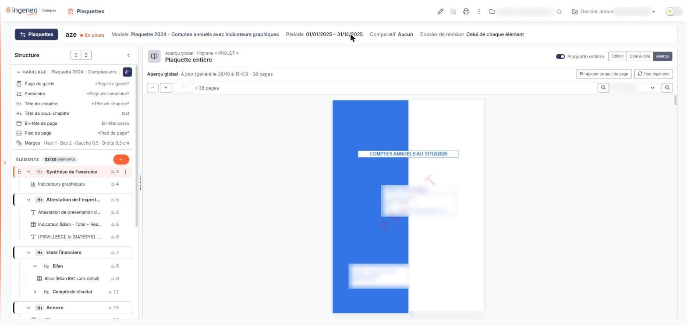<figcaption>
Rubrique « Le panneau d'un élément et le tiroir « Ajouter un élément » »
</figcaption></figure>

<figure>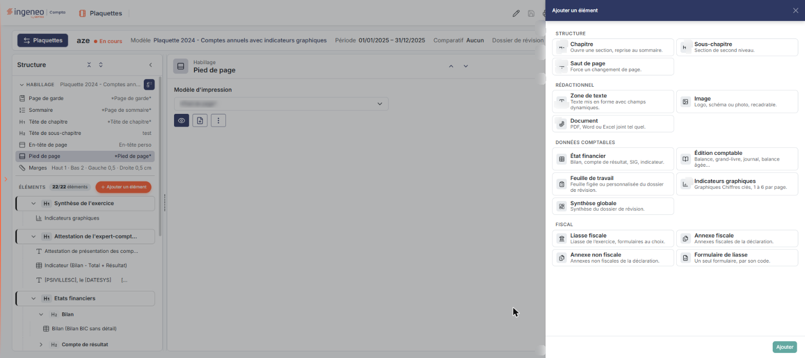<figcaption>
Rubrique « Le panneau d'un élément et le tiroir « Ajouter un élément » »
</figcaption></figure>

**Le tiroir « Ajouter un élément ».** Il propose les types d'élément en choix exclusifs, regroupés en quatre familles et un seul choix à la fois ; choisir un type ne fait apparaître aucun champ supplémentaire. La croix de son en-tête le ferme ; bouton **\[Ajouter]**, en pied du tiroir, ajoute l'élément à la plaquette.

STRUCTURE : **Chapitre** (« Ouvre une section, reprise au sommaire. »), **Sous-chapitre** (« Section de second niveau. »), **Saut de page** (« Force un changement de page. »).

RÉDACTIONNEL : **Zone de texte** (« Texte mis en forme avec champs dynamiques. »), **Image** (« Logo, schéma ou photo, recadrable. »), **Document** (« PDF, Word ou Excel joint tel quel. »).

DONNÉES COMPTABLES : **État financier** (« Bilan, compte de résultat, SIG, indicateur. »), **Édition comptable** (« Balance, grand-livre, journal, balance âgée… »), **Feuille de travail** (« Feuille figée ou personnalisée du dossier de révision. »), **Indicateurs graphiques** (« Graphiques Chiffres clés, 1 à 6 par page. »), **Synthèse globale** (« Synthèse du dossier de révision. »).

FISCAL : **Liasse fiscale** (« Liasse de l'exercice, formulaires au choix. »), **Annexe fiscale** (« Annexes fiscales de la déclaration. »), **Annexe non fiscale** (« Annexes non fiscales de la déclaration. »), **Formulaire de liasse** (« Un seul formulaire, par son code. »).

Le nom du catalogue n'est pas toujours celui que le panneau affiche ensuite dans le champ « Type » : un élément ajouté par « Annexe fiscale » s'affiche avec le type « Annexe de liasse », et un élément ajouté par « Liasse fiscale » avec le type « Liasse ».

**Le panneau de l'élément.** Un clic sur une ligne de l'arbre affiche l'élément à droite. Tous les panneaux ont le même squelette :

* en haut, le chemin de l'élément (par exemple « Synthèse de l'exercice › … »), puis son titre, et les boutons « Élément précédent (Ctrl ↑) » et « Élément suivant (Ctrl ↓) » (sur une ligne d'habillage, leurs infobulles sont « Précédent (Ctrl ↑) » et « Suivant (Ctrl ↓) ») ; le premier est désactivé sur le premier élément ;
* l'interrupteur **Plaquette entière** : désactivé, l'aperçu ne montre que l'élément ; activé, il devient « Aperçu global » et montre toute la plaquette, avec son état de mise à jour et son nombre de pages (par exemple « À jour · 38 pages »). Dans ce cas, les numéros de page « p. N » apparaissent dans l'arbre et deux boutons s'ajoutent : « Ajouter un saut de page » et « Tout régénérer », dont l'infobulle précise : « Repart de zéro : toute la plaquette est reconvertie, comme au premier aperçu. Utile si des données ont été modifiées dans un autre onglet ou si l'aperçu vous semble incorrect. » ;
* trois modes d'affichage, en boutons exclusifs : **Édition** (les champs de l'élément), **Côte à côte** (champs et aperçu) et **Aperçu** (l'aperçu seul). Un élément comme une ligne d'habillage s'ouvre par défaut en mode Édition, et l'écran se rouvre dans le dernier mode que vous avez choisi ;
* en mode Édition, le type de l'élément, en lecture seule (« Type … »), puis ses champs, décrits ci-dessous ;
* dans l'aperçu : le titre « Aperçu » et son état (par exemple « À jour · 1 page ») ; un bouton **\[Ajouter un saut de page]** (infobulle « Couper le contenu d'un élément à l'endroit choisi dans l'aperçu. »), qui met l'aperçu en mode de pose (« Pose des sauts de page : survolez une page de l'aperçu, puis cliquez sur Saut de page ici. La croix d'un saut déjà posé le retire. Les sauts de page ne s'appliquent qu'à l'édition PDF. ») jusqu'à bouton **\[Terminer]** ; la navigation entre pages (« Page précédente », « Page suivante », et un champ numérique « n / N page ») ; « Dézoomer », « Zoomer » et la liste « Largeur de la zone » (de « Page entière » à « 300 % ») ; le filigrane « PROJET » apparaît sur l'aperçu d'une plaquette qui n'est pas validée.

Le pictogramme « Sauvegarder » de l'en-tête ne s'active que si l'élément affiché diffère de son état enregistré.

**Les champs selon le type d'élément.**

| Champ                      | Ce qu'il faut savoir                                                                                                                                                                                                                                                                                                                                                                                                                                                                                                                                                                                                                                                                                                                                                                                                                                                                                                                                                                                                                                                                                                                                                                                                                                                                                                                                                                                                                                                                                                                                                                                                                                                   |
| -------------------------- | ---------------------------------------------------------------------------------------------------------------------------------------------------------------------------------------------------------------------------------------------------------------------------------------------------------------------------------------------------------------------------------------------------------------------------------------------------------------------------------------------------------------------------------------------------------------------------------------------------------------------------------------------------------------------------------------------------------------------------------------------------------------------------------------------------------------------------------------------------------------------------------------------------------------------------------------------------------------------------------------------------------------------------------------------------------------------------------------------------------------------------------------------------------------------------------------------------------------------------------------------------------------------------------------------------------------------------------------------------------------------------------------------------------------------------------------------------------------------------------------------------------------------------------------------------------------------------------------------------------------------------------------------------------------------- |
| **Tête de chapitre**       | **Titre du chapitre :**, une zone de texte. **Tête de sous-chapitre** : **Titre du sous-chapitre :**, une zone de texte.                                                                                                                                                                                                                                                                                                                                                                                                                                                                                                                                                                                                                                                                                                                                                                                                                                                                                                                                                                                                                                                                                                                                                                                                                                                                                                                                                                                                                                                                                                                                               |
| **Zone de texte**          | 
Un éditeur de texte enrichi. Sa barre d'outils propose notamment le format de paragraphe, la police, la taille et l'interligne, annuler et rétablir, gras, italique, souligné et barré, les couleurs du texte et du fond, les listes, les retraits, l'alignement et la justification, les liens, l'insertion d'un tableau ou d'une ligne horizontale, un caractère spécial, le code source HTML et le plein écran. Le bouton <strong>[Insérer un champ]</strong> ouvre un panneau de champs dynamiques, qui s'écrivent entre crochets dans le texte (par exemple le champ « DATESYS », la date système, écrit entre crochets) et sont remplacés à l'édition par les données du dossier. Le groupe « Champs génériques » est ouvert (date système, heure système) ; les groupes « Dossier annuel », « Société gérée », « Cabinet », « Liasse fiscale », « Dossier de révision / Feuilles de travail » et « Plaquette » se déplient d'un clic. <strong>État financier</strong> (le type s'affiche « Etat financier ») : <strong>Type de modèle :</strong> (Bilan, Compte de résultat, Indicateur ou SIG) ; <strong>Modèle d'édition :</strong> obligatoire, la liste « Sélectionnez » propose les modèles du type choisi (les modèles de l'éditeur sont écrits entre astérisques) ; <strong>Paramètres d'édition :</strong> facultatif, la liste propose les paramétrages mémorisés pour ce type, et un pictogramme « Ouvrir les paramètres d'édition » ouvre leur édition. L'aide précise que, sans paramètre choisi, l'édition est effectuée avec les paramètres par défaut, comme depuis la page d'édition de l'état financier dans le module Comptabilité.
 |
| **Annexe de liasse**       | **Type de déclaration :** (liste de codes de déclaration, par exemple « 2031-BI-RN-IR » ou « 2065-BI-RN-IS ») ; **Choix de la liasse fiscale :** obligatoire, la liste propose les liasses du dossier ; **Formulaires à exclure :** une zone de texte. **Liasse** : les mêmes trois champs.                                                                                                                                                                                                                                                                                                                                                                                                                                                                                                                                                                                                                                                                                                                                                                                                                                                                                                                                                                                                                                                                                                                                                                                                                                                                                                                                                                            |
| **Indicateurs graphiques** | **Titre :** ; **Orientation :** Portrait ou Paysage ; **Nombre d'indicateurs :** Un seul, Deux, Trois, Quatre ou Six (il n'y a pas de choix « Cinq ») ; puis autant de champs **Indicateur 1 :**, **Indicateur 2 :**… que le nombre choisi (un champ pour « Un seul », six pour « Six »). Chaque champ est une zone de recherche qui se complète par la saisie de quelques caractères ou par la loupe.                                                                                                                                                                                                                                                                                                                                                                                                                                                                                                                                                                                                                                                                                                                                                                                                                                                                                                                                                                                                                                                                                                                                                                                                                                                                 |

Les types Saut de page, Image, Document, Édition comptable, Feuille de travail, Synthèse globale, Annexe non fiscale, Formulaire de liasse et Annexe fiscale existent dans le catalogue d'ajout ci-dessus ; leurs champs ne sont pas décrits ici.

## Lancer l'édition

<figure>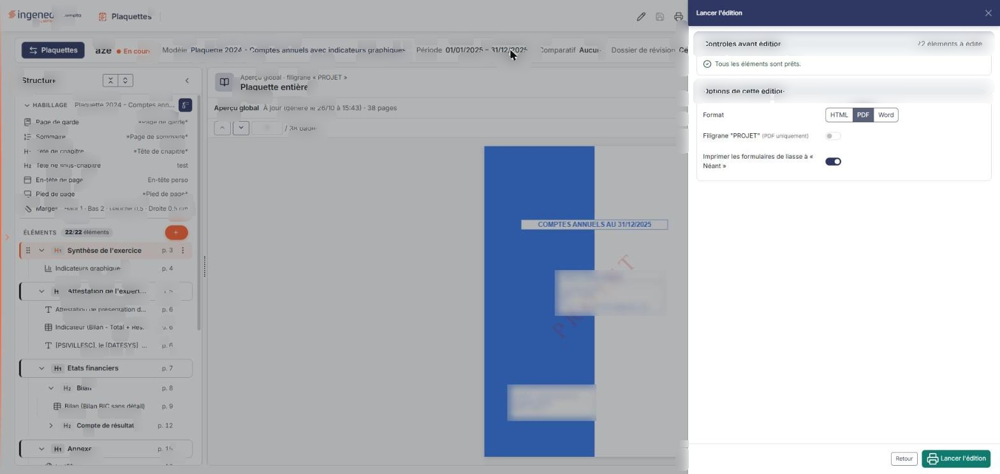<figcaption>
Rubrique « Lancer l'édition »
</figcaption></figure>

Le pictogramme « Lancer l'édition » ouvre un tiroir d'édition depuis lequel vous lancez la génération de la plaquette. Le tiroir « Lancer l'édition » présente deux blocs. **Contrôles avant édition :** il rappelle le nombre d'éléments à éditer (par exemple « 22 éléments à éditer ») et, lorsque rien n'est à signaler, le message « Tous les éléments sont prêts. ». **Options de cette édition :** le **Format**, en boutons exclusifs **HTML**, **PDF** (choisi à l'ouverture) et **Word** ; l'interrupteur **Filigrane « PROJET »** (« PDF uniquement »), désactivé à l'ouverture ; l'interrupteur **Imprimer les formulaires de liasse à « Néant »**, activé à l'ouverture. Le pied porte bouton **\[Retour]** et bouton **\[Lancer l'édition]**.

Lorsque l'interrupteur « Plaquette entière » est activé, l'aperçu global permet de contrôler la plaquette complète avant l'édition.

## Le menu « Plus d'actions »

<figure>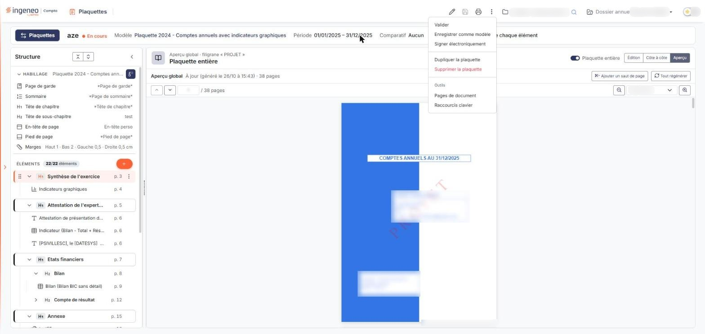<figcaption>
Rubrique « Le menu « Plus d'actions » »
</figcaption></figure>

Ce menu (trois points verticaux, en haut à droite) propose, dans l'ordre :

| Champ                        | Ce qu'il faut savoir                                                                                                                                                                                                                                                                                                                                                                                                                                                                                                                                                                                                                                                                                                                      |
| ---------------------------- | ----------------------------------------------------------------------------------------------------------------------------------------------------------------------------------------------------------------------------------------------------------------------------------------------------------------------------------------------------------------------------------------------------------------------------------------------------------------------------------------------------------------------------------------------------------------------------------------------------------------------------------------------------------------------------------------------------------------------------------------- |
| **Valider**                  | Cette entrée existe ; ses effets ne sont pas décrits dans cette page.                                                                                                                                                                                                                                                                                                                                                                                                                                                                                                                                                                                                                                                                     |
| **Enregistrer comme modèle** | Ouvre la fenêtre « Enregistrer comme modèle de plaquette » : « Veuillez indiquer ci-dessous le libellé du modèle de plaquette à créer à partir de la plaquette en cours : ». Elle comporte **Libellé du modèle :** (obligatoire) et **Descriptif :** (zone de texte facultative) ; bouton **\[Enregistrer]** crée le modèle et bouton **\[Annuler]** referme la fenêtre. Si la plaquette porte des modifications non sauvegardées, le logiciel n'ouvre pas cette fenêtre mais une confirmation « Enregistrer comme modèle » : « Des modifications de la plaquette ne sont pas sauvegardées. Elles doivent l'être avant de poursuivre : voulez-vous les sauvegarder maintenant ? », avec bouton **\[Annuler]** et bouton **\[Confirmer]**. |
| **Signer électroniquement**  | Cette entrée vous fait quitter le logiciel : la page est redirigée, sans fenêtre intermédiaire, vers le service d'authentification « OEC Authentification Comptexpert » de l'Ordre des experts-comptables.                                                                                                                                                                                                                                                                                                                                                                                                                                                                                                                                |
| **Dupliquer la plaquette**   | Attention, cette commande s'exécute immédiatement, sans demande de confirmation ni de nom : le logiciel crée une plaquette « Copie de » suivie du nom de la plaquette, avec tous ses éléments, et ouvre l'éditeur sur cette copie. Pour la supprimer, utilisez le menu « Autres actions » de sa ligne dans le tiroir « Plaquettes et modèles ».                                                                                                                                                                                                                                                                                                                                                                                           |
| **Supprimer la plaquette**   | 
(en rouge) supprime la plaquette ; cette entrée existe, ses effets ne sont pas décrits dans cette page. Sous l'intitulé « Outils » :
                                                                                                                                                                                                                                                                                                                                                                                                                                                                                                                                                                                            |
| **Pages de document**        | Ouvre le tiroir de gestion des pages utilisées pour l'habillage (voir la page « Modèles de page »).                                                                                                                                                                                                                                                                                                                                                                                                                                                                                                                                                                                                                                       |
| **Raccourcis clavier**       | Ouvre un tiroir qui rappelle : élément précédent / suivant (Ctrl ↑ ↓), ajouter un élément (Ctrl Alt N), masquer ou afficher l'élément (Espace), sélection multiple (Ctrl / Maj + clic), supprimer l'élément ou la sélection (Suppr) et zoom avant / arrière de l'aperçu (Ctrl + molette). bouton **\[Fermer]** le referme.                                                                                                                                                                                                                                                                                                                                                                                                                |
