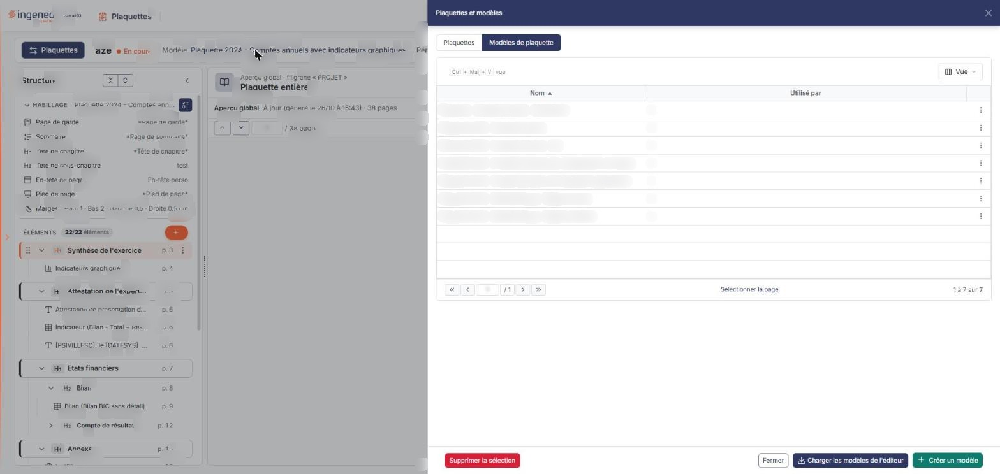
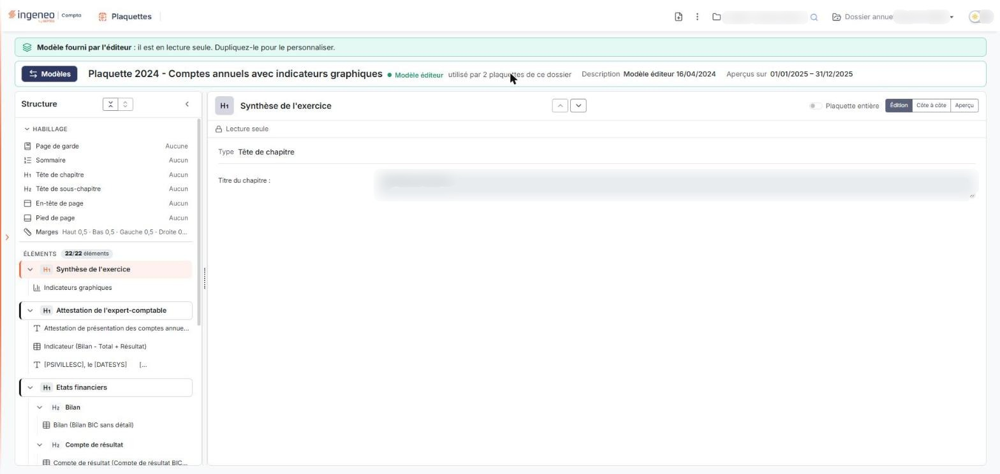

# Modèles de plaquettes


**Où le trouver :** Éditeur de plaquette › bouton **\[Plaquettes]** › onglet **Modèles de plaquette**


Un modèle de plaquette décrit la composition d'une plaquette : les pages d'habillage à utiliser (page de garde, sommaire, têtes de chapitre et de sous-chapitre, en-tête, pied de page), les marges et les éléments à enchaîner. Une plaquette se crée à partir d'un modèle ; vous pouvez aussi enregistrer une plaquette comme modèle (menu « Plus d'actions » de l'éditeur).

Les modèles de plaquette se gèrent dans l'éditeur de plaquette : bouton « Plaquettes » du bandeau, tiroir « Plaquettes et modèles », onglet « Modèles de plaquette ».

## La liste des modèles

<figure><figcaption>
Rubrique « La liste des modèles »
</figcaption></figure>

Le tiroir « Plaquettes et modèles » s'ouvre sur l'onglet « Plaquettes » ; choisissez l'onglet **Modèles de plaquette** (le second des deux boutons exclusifs en haut du tiroir). Le tiroir se redimensionne par sa poignée : « Glisser pour agrandir ou réduire · double-clic pour revenir à la taille par défaut ».

**La grille** présente par défaut :

* **Nom** : le nom du modèle, colonne triable (triée par ordre croissant à l'ouverture) et redimensionnable ;
* **Utilisé par** : le nombre de plaquettes de ce dossier annuel qui utilisent le modèle, colonne non triable ;
* une colonne de commandes, avec le menu « Autres actions » de chaque ligne.

Les modèles livrés avec le logiciel portent par exemple les noms « Plaquette 2024 - Comptes annuels », « Plaquette 2024 - Comptes annuels - SCI » ou « Plaquette 2024 - Modèle Banque - Régime normal ».

Le menu « Autres actions » d'un modèle fourni par l'éditeur ne propose que **Dupliquer** : ni « Modifier » ni « Supprimer ». Un clic sur une ligne ouvre la fiche du modèle (rubrique b).

Le bouton **\[Vue]** (raccourci affiché : Ctrl+Maj+V) ouvre un menu. « COLONNES AFFICHÉES » propose, avec un champ « Rechercher une colonne » et un compteur (« 1 colonne affichée sur 8 »), les colonnes suivantes : Nom, Modèle éditeur, Dernière modification, Page de garde, Page de sommaire, Page de tête de chapitre, En-tête et Pied de page. Il n'existe pas de colonne pour la page de tête de sous-chapitre. Le lien « Rétablir les colonnes d'origine » revient à l'affichage initial ; bouton **\[Appliquer]** applique votre choix. Un bouton « Tout effacer » existe pour les pastilles de filtre, masqué tant qu'aucun filtre n'est posé.

En bas de la grille, la pagination (par exemple « 1 à 7 sur 7 ») s'accompagne de « Sélectionner la page ».

Le pied du tiroir porte, à gauche, bouton **\[Supprimer la sélection]** (en rouge), qui n'apparaît que lorsque des modèles sont sélectionnés ; à droite, bouton **\[Créer un modèle]** (le bouton principal), suivi du menu « Autres actions » (trois points verticaux), qui propose **Charger les modèles de l'éditeur**. Le tiroir se ferme par la croix de son en-tête.

## La fiche d'un modèle

<figure><figcaption>
Rubrique « La fiche d'un modèle »
</figcaption></figure>

La fiche d'un modèle s'ouvre par un clic sur sa ligne, ou depuis le lien « Modèle » du bandeau d'une plaquette. Elle reprend la disposition de l'éditeur de plaquette (voir la page « Plaquettes ») : volet « Structure » à gauche, panneau de l'élément à droite.

**Le bandeau.** À la place du bouton « Plaquettes », le bandeau porte le bouton **\[Modèles]**, qui revient à la liste. À droite, un pictogramme « Créer une plaquette avec ce modèle », le menu « Plus d'actions » et les sélecteurs de société et de dossier annuel.

Pour un modèle fourni par l'éditeur, un bandeau vert précise : « **Modèle fourni par l'éditeur** : il est en lecture seule. Dupliquez-le pour le personnaliser. » La fiche n'a alors ni bouton ni pictogramme d'enregistrement.

**La barre d'identité** affiche le libellé du modèle, la pastille « Modèle éditeur », le nombre de plaquettes du dossier qui l'utilisent (ou « aucune plaquette de ce dossier ne l'utilise »), sa « Description » et la mention « Aperçus sur », suivie d'une période.

**Le menu « Plus d'actions »** propose **Dupliquer le modèle**, puis, sous l'intitulé « Outils », **Pages de document** (voir la page « Modèles de page ») et **Raccourcis clavier**.

**Le volet « Structure »** porte les mêmes boutons de repli que dans l'éditeur (« Replier toutes les rubriques », « Déplier toutes les rubriques », « Replier la structure ») et une poignée « Redimensionner le panneau Structure ». La rubrique « HABILLAGE » présente le modèle d'impression de la page de garde, du sommaire, des têtes de chapitre, des têtes de sous-chapitre, de l'en-tête de page et du pied de page (« Aucune » ou « Aucun » si le modèle n'en utilise pas), puis les « Marges ». La rubrique « ÉLÉMENTS » indique le nombre d'éléments (par exemple « 20/20 éléments ») et présente l'arbre des chapitres, sous-chapitres et éléments, avec les boutons « Replier le chapitre » et « Replier le sous-chapitre ». Contrairement à une plaquette, elle n'a pas de bouton **\[+]** pour ajouter un élément.

**Le panneau de l'élément** permet de parcourir les éléments (boutons « Élément précédent » et « Élément suivant »), d'activer l'interrupteur « Plaquette entière » et de choisir entre les modes « Édition », « Côte à côte » et « Aperçu », comme dans une plaquette. La mention « Lecture seule » s'affiche et les champs sont grisés : par exemple, pour une tête de chapitre, le type et le « Titre du chapitre : » ne sont pas modifiables.

Pour obtenir un modèle que vous pouvez adapter, utilisez **Dupliquer** dans le menu de la ligne ou **Dupliquer le modèle** dans la fiche.
