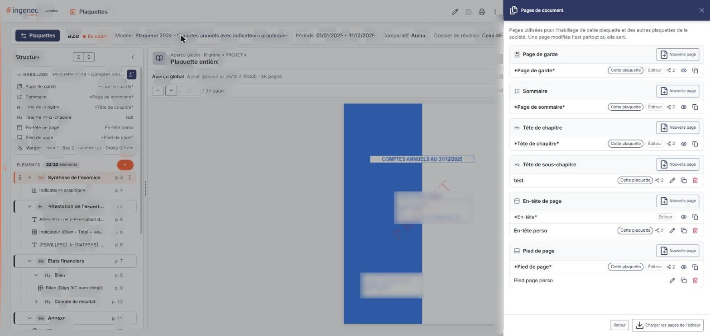
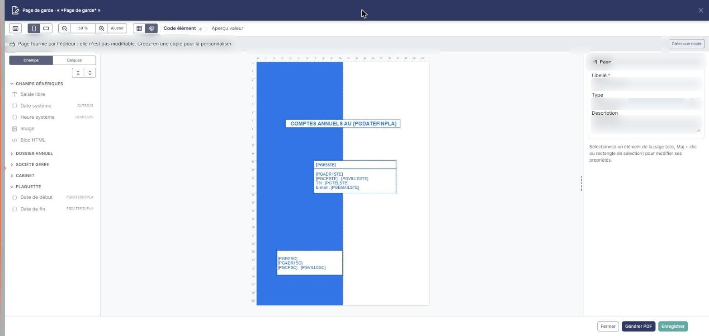

# Pages de document


**Où le trouver :** Éditeur de plaquette › menu **Plus d'actions** › **Pages de document**


Une page de document décrit la mise en forme d'un élément imprimé : page de garde, sommaire, tête de chapitre, tête de sous-chapitre, en-tête ou pied de page d'une plaquette, mais aussi pièce de vente ou d'achat et lettre de mission. Vous y dessinez la page et vous y placez les champs que le logiciel remplace, à l'édition, par les données du dossier.

Pour une plaquette, ces pages se gèrent à deux endroits, qui ne montrent pas les mêmes pages :

* le tiroir « Pages de document » de l'éditeur de plaquette (rubrique b), qui présente les six types de page d'une plaquette ;
* le panneau « Paramètres » (rubrique a), qui est un écran commun à tout le logiciel et dont le segment « Lettre de mission » ne présente que des pages des types de la lettre de mission (page de garde, sommaire, tête de chapitre, en-tête de page, pied de page). Ce sont des pages distinctes de celles du tiroir de l'éditeur.

Dans les deux cas, la page s'ouvre dans le même concepteur de page (rubrique c).

## Le panneau « Paramètres » ▸ « Modèles » ▸ « Documents » ▸ « Pages de document »

Vous y accédez par la navigation de gauche : « Paramètres », rubrique « Modèles », puis « Documents » ; ce menu propose trois entrées : « Pages de document », « Lettres de mission » et « États financiers ». Ce panneau est global : vous l'ouvrez de la même façon depuis chaque module. L'écran est signalé « Propre à la société » et porte ce bandeau : « Une page décrit la mise en forme d'un élément imprimé : page de garde, sommaire, tête de chapitre, en-tête, pied ou corps d'une pièce. Les plaquettes et les lettres de mission se composent de ces pages. »

Deux boutons exclusifs séparent les pages en deux familles : **Pièces de vente et d'achat** (affiché à l'ouverture) et **Lettre de mission**.

Au-dessus de la grille :

* le champ « Rechercher une page de document… » (raccourci : « / ») ;
* le bouton **\[Filtres]** ;
* la liste **Type de modèle**, qui restreint l'affichage à un type de page. Elle propose des types de pièces : par exemple « Avoir », « Devis », « Facture » ou « Lettre de relance » ; elle ne propose aucun type de page de plaquette (page de garde, sommaire, tête de chapitre…) ;
* trois boutons exclusifs **Tous**, **Éditeur** et **Cabinet**, pour n'afficher que les pages de l'éditeur ou celles du cabinet ;
* le bouton **\[Vue]** (raccourci Ctrl+Maj+V) : « MES VUES » pour enregistrer une présentation (« Enregistrer la vue actuelle »), puis le choix des colonnes (Libellé, Description et Type de modèle sont affichées par défaut ; Modèle éditeur, Document cabinet, Modèle facture électronique, Dernière modification, Créé le, Créé par et Hauteur en cm sont disponibles), « Rétablir les colonnes d'origine » et bouton **\[Appliquer]** ;
* le bouton **\[Exporter]**.

Le segment « Pièces de vente et d'achat » liste les pages des pièces et courriers (bon de commande, facture, avoir, devis, lettre de relance, mandat de prélèvement SEPA…). Le segment « Lettre de mission » ne liste que des pages des types de la lettre de mission, distinctes de celles du tiroir de l'éditeur de plaquette : par exemple « En-tête de page plaquette », « Page de garde plaquette » et « Pied de page plaquette », de type « En-tête de page », « Page de garde » et « Pied de page ». Dans ce panneau, il n'existe pas de page de type sommaire, tête de chapitre ou tête de sous-chapitre : ces types ne se gèrent que dans le tiroir de l'éditeur (rubrique b).

Chaque ligne porte un menu « Autres actions » (trois points). Pour une page du cabinet, il propose **Modifier**, **Dupliquer** et **Supprimer**. La pagination s'accompagne de « Sélectionner la page » (Ctrl+A) et « Tout sélectionner » (Ctrl+Maj+A).

Le pied de l'écran porte bouton **\[Créer une page de document]** (raccourci Ctrl+Inser) et un menu en trois points qui propose « Imprimer la liste des champs ».

## Le tiroir « Pages de document » de l'éditeur de plaquette

<figure><figcaption>
Rubrique « Le tiroir « Pages de document » de l'éditeur de plaquette »
</figcaption></figure>

Dans l'éditeur, ouvrez le menu « Plus d'actions », puis, sous l'intitulé « Outils », « Pages de document » (ce menu existe sur une plaquette comme sur un modèle de plaquette). Vous y arrivez aussi depuis une ligne d'« HABILLAGE » du volet « Structure », par les pictogrammes « Consulter la page », « Modifier la page » et « Nouvelle page ».

Le tiroir explique : « Pages utilisées pour l'habillage de cette plaquette et des autres plaquettes de la société. Une page modifiée l'est partout où elle sert. » (sur un modèle : « …de ce modèle et des autres plaquettes… »).

Six groupes se suivent, chacun avec son bouton **\[Nouvelle page]** : **Page de garde**, **Sommaire**, **Tête de chapitre**, **Tête de sous-chapitre**, **En-tête de page** et **Pied de page**. Sous chaque groupe, la liste des pages disponibles.

Chaque ligne présente :

* le libellé de la page ; les pages fournies par l'éditeur sont écrites entre astérisques et portent l'étiquette « Éditeur » ;
* l'étiquette « Cette plaquette » (sur une plaquette) pour la page que la plaquette utilise ;
* un compteur d'utilisation ; son infobulle donne le détail, par exemple « 2 plaquettes et 0 modèle de ce dossier annuel » ;
* des pictogrammes : « Consulter la page » (page de l'éditeur) ou « Modifier la page » (page personnalisée), « Dupliquer la page », et « Supprimer la page » (en rouge, pages personnalisées seulement).

Le pied du tiroir porte bouton **\[Retour]** et bouton **\[Charger les pages de l'éditeur]**. Le tiroir se redimensionne par sa poignée.

## Le concepteur de page

<figure><figcaption>
Rubrique « Le concepteur de page »
</figcaption></figure>

Le concepteur s'ouvre sur la page choisie ; son titre rappelle le type et le nom de la page (par exemple « Page de garde · « _Page de garde_ » »). Il s'ouvre en consultation pour une page de l'éditeur et en modification pour une page personnalisée.

Selon la page, un bandeau précise son état :

* page de l'éditeur : « Page fournie par l'éditeur : elle n'est pas modifiable. Créez-en une copie pour la personnaliser. », avec bouton **\[Créer une copie]** ;

**La barre d'outils** propose : « Raccourcis clavier » ; **Portrait** / **Paysage** ; « Zoom arrière (Ctrl + -) », le niveau de zoom, « Zoom avant (Ctrl + +) » et « Ajuster à la fenêtre (Ctrl + 0) » ; « Afficher la grille » ; « Magnétisme (grille et autres éléments) » ; l'interrupteur « Code élément » ; l'interrupteur « Aperçu valeur ». Pour une page modifiable, elle ajoute « Annuler (Ctrl + Z) » et « Rétablir (Ctrl + Y) », les alignements (à gauche, centré horizontalement, à droite, en haut, centré verticalement, en bas), « Répartir horizontalement » et « Répartir verticalement » (à partir de trois éléments), « Même largeur » et « Même hauteur que le premier sélectionné », et « Centrer dans la page ».

**Le volet de gauche** a deux onglets. **Champs** : sur une page modifiable, le volet indique « Cliquez sur un champ pour l'ajouter, ou glissez-le sur la page. » (cette phrase n'apparaît pas en consultation). Une page modifiable propose en plus un champ de recherche et des boutons pour replier ou déplier toutes les rubriques. Les champs sont rangés en rubriques : CHAMPS GÉNÉRIQUES (par exemple « Saisie libre », « Date système », « Heure système », « Image », « Bloc HTML »), DONNÉES GÉNÉRALES (propres au type de page : par exemple le titre du sous-chapitre pour une tête de sous-chapitre), DOSSIER ANNUEL, SOCIÉTÉ GÉRÉE, CABINET et PLAQUETTE (par exemple les dates de début et de fin de la plaquette). Chaque champ est suivi de son code entre crochets. **Calques** : la liste des éléments posés sur la page.

**La zone centrale** montre la page à l'échelle, avec ses règles graduées et ses éléments, par exemple des zones « Saisie libre » dont le texte contient des champs entre crochets.

**Le volet de droite**, rubrique « Page » : **Libellé** (obligatoire), **Type** (Page de garde, En-tête de page, Page de sommaire, Page tête de chapitre, Page tête de sous-chapitre ou Pied de page) et **Description**. Le type est grisé, avec le message « Le type ne peut pas changer : la page contient des champs propres à son type. », lorsque la page porte déjà des champs propres à son type. Quand vous sélectionnez un élément de la page, le volet présente ses réglages : « Position et taille (cm) » (gauche, haut, largeur, hauteur), « Déplacer » (par pas de 0,1 cm ou de 1 cm), « Texte » (police, taille, couleur, gras, italique, souligné, alignement), « Texte saisi » (avec « Insérer un champ… »), « Cadre et fond » (bords, trait, couleur, fond, « Transparent »), « Présence » (interrupteurs « Première page », « Pages intermédiaires » et « Dernière page »), et les boutons « Dupliquer » et « Supprimer » de l'élément. Ils sont grisés en consultation.

**Le pied** porte bouton **\[Fermer]**, bouton **\[Générer PDF]** et bouton **\[Enregistrer]**, grisé tant que rien n'est modifié.
