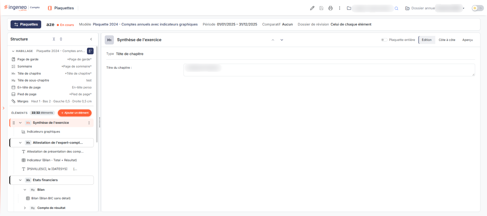

# Présentation du module


**Où le trouver :** Module **Plaquettes** : son entrée ouvre directement l'éditeur de plaquette


Le module « Plaquettes » permet de produire des documents personnalisés — les plaquettes de comptes annuels — à partir des données contenues dans les autres modules du logiciel. Une plaquette assemble des pages mises en forme (page de garde, sommaire, têtes de chapitre…), des textes que vous rédigez avec des champs dynamiques, et des éléments tirés de vos données : états financiers, éditions comptables, feuilles de travail du dossier de révision, graphiques de la rubrique « Chiffres clés », liasse fiscale et annexes.

<figure><figcaption>
Écran « Plaquettes » de la nouvelle interface
</figcaption></figure>

Le logiciel livre des modèles de plaquette, signalés par l'étiquette « Éditeur », que vous pouvez utiliser tels quels pour créer une plaquette ou dupliquer pour créer vos propres modèles.

## Une seule fenêtre de travail : l'éditeur

Dans l'éditeur, le module n'affiche pas de barre de menus : l'en-tête ne porte que le nom du module et les sélecteurs de société et de dossier annuel. Tout s'y fait depuis une même fenêtre :

* le bandeau d'en-tête, qui rappelle le libellé, le statut, le modèle, la période, le comparatif et le dossier de révision de la plaquette, et porte les pictogrammes « Paramètres », « Sauvegarder », « Lancer l'édition » et « Plus d'actions » ;
* le volet « Structure », à gauche, qui liste l'« HABILLAGE » (page de garde, sommaire, têtes de chapitre et de sous-chapitre, en-tête, pied de page, marges) et les « ÉLÉMENTS » de la plaquette ;
* le panneau de l'élément sélectionné, à droite, avec ses champs et son aperçu ;
* des tiroirs qui s'ouvrent sur le côté : « Plaquettes et modèles » (bouton « Plaquettes » du bandeau), « Paramètres de la plaquette », « Ajouter un élément », « Pages de document » et « Raccourcis clavier ».

Toutes ces fonctions sont décrites dans la page « Plaquettes ».

## La marche à suivre

1. **Créer ou ouvrir une plaquette.** Le bouton **\[Plaquettes]** du bandeau ouvre le tiroir « Plaquettes et modèles », où vous ouvrez une plaquette existante ou en créez une nouvelle sur un modèle, ou « vide ».
2. **Régler l'habillage et les marges.** Dans la rubrique « HABILLAGE » du volet « Structure », vous choisissez les pages utilisées pour la page de garde, le sommaire, les têtes de chapitre et de sous-chapitre, l'en-tête et le pied de page, et vous réglez les marges.
3. **Composer les éléments.** Dans la rubrique « ÉLÉMENTS », vous ajoutez, ordonnez et complétez les chapitres, textes, états financiers, indicateurs, liasses et autres éléments.
4. **Contrôler l'aperçu.** Chaque élément a son aperçu ; l'interrupteur « Plaquette entière » affiche celui de toute la plaquette.
5. **Lancer l'édition** par le pictogramme « Lancer l'édition » du bandeau.

## Les modèles et les paramétrages associés

Une plaquette s'appuie sur trois familles de modèles :

**Les modèles de plaquette** décrivent la composition d'ensemble : quelles pages d'habillage utiliser et quels éléments enchaîner. Ils se gèrent dans l'éditeur, dans l'onglet « Modèles de plaquette » du tiroir « Plaquettes et modèles » (voir la page « Modèles de plaquettes »).

**Les modèles de page** décrivent l'aspect d'une page : page de garde, sommaire, tête de chapitre, tête de sous-chapitre, en-tête, pied de page. Ils se gèrent dans le tiroir « Pages de document » de l'éditeur (voir la page « Modèles de page »).

**Les modèles d'états financiers** décrivent les bilans, comptes de résultat, soldes intermédiaires de gestion et indicateurs que vous insérez dans une plaquette. Ils se gèrent dans le panneau « Paramètres », sous « Modèles », puis « Documents » ▸ « États financiers » (voir la page « États financiers »).

Les modèles d'e-mails se trouvent, dans le même panneau « Paramètres », sous « Modèles », dans l'onglet « E-mails ».
