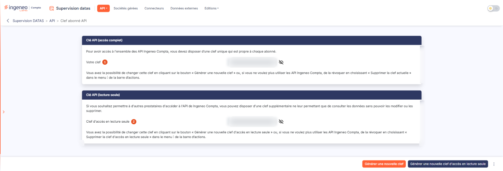
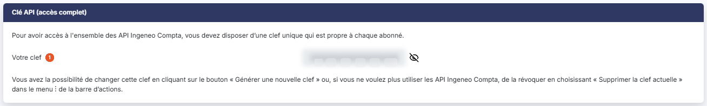
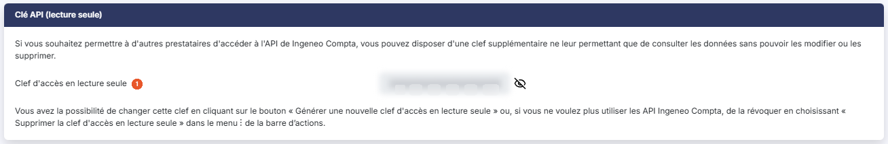

# Clef abonné API


**Où le trouver :** Menu **API › Clef abonné API**



**En bref** — Cet écran vous permet d'obtenir et de révoquer les clefs propres à votre abonnement qui donnent accès aux API Ingeneo Compta : une clef d'accès complet et une clef d'accès en lecture seule.

* Pour produire ou changer la clef d'accès complet : bouton \[Générer une nouvelle clef], puis confirmez ; la clef précédente est révoquée.
* Pour donner un simple droit de consultation à un prestataire : bouton \[Générer une nouvelle clef d'accès en lecture seule], puis relevez la clef avec le pictogramme « Œil ».
* Pour révoquer une clef : pictogramme « Autres actions » (trois points verticaux), puis « Supprimer la clef actuelle » ou « Supprimer la clef d'accès en lecture seule ».


Cette option vous permet d'obtenir et de révoquer les clefs qui donnent accès aux API Ingeneo Compta. Elle en propose deux, présentées l'une au-dessous de l'autre dans deux rubriques : une clef d'accès complet et une clef d'accès en lecture seule.

<figure><figcaption>
Écran « Clef abonné API » de la nouvelle interface
</figcaption></figure>

Ces clefs sont propres à votre abonnement : elles ne se saisissent pas, le logiciel les produit lui-même lorsque vous cliquez sur l'un des boutons de génération. L'écran ne comporte d'ailleurs aucun bouton d'enregistrement.

## Rubrique « Clé API (accès complet) »

<figure><figcaption>
Rubrique « Clé API (accès complet) »
</figcaption></figure>

Elle s'ouvre sur la phrase « Pour avoir accès à l'ensemble des API Ingeneo Compta, vous devez disposer d’une clef unique qui est propre à chaque abonné. »

**Votre clef** : cette zone présente la clef en cours, masquée par des points. Elle n'est pas modifiable : vous ne pouvez ni la saisir, ni la corriger.

Le pictogramme « Œil » placé à droite de la zone porte l'infobulle « Afficher ou masquer la clef ». Un premier clic affiche la clef en clair, ce qui vous permet de la relever pour la communiquer à l'outil qui appellera les API ; un second la masque de nouveau. Cette commande est purement visuelle : elle ne modifie ni n'enregistre rien.

La rubrique se referme sur la phrase « Vous avez la possibilité de changer cette clef en cliquant sur le bouton « Générer une nouvelle clef » ou, si vous ne voulez plus utiliser les API Ingeneo Compta, de la révoquer en choisissant « Supprimer la clef actuelle » dans le menu ⋮ de la barre d’actions. »

## Rubrique « Clé API (lecture seule) »

<figure><figcaption>
Rubrique « Clé API (lecture seule) »
</figcaption></figure>

Elle s'ouvre sur la phrase « Si vous souhaitez permettre à d'autres prestataires d'accéder à l'API de Ingeneo Compta, vous pouvez disposer d'une clef supplémentaire ne leur permettant que de consulter les données sans pouvoir les modifier ou les supprimer. »

**Clef d'accès en lecture seule** : cette zone se présente et se comporte exactement comme la précédente : la clef y est masquée, elle n'est pas modifiable, et le même pictogramme « Œil », avec la même infobulle « Afficher ou masquer la clef », l'affiche puis la masque.

Cette seconde clef est celle que vous confiez à un prestataire à qui vous ne voulez donner qu'un droit de consultation : toute demande qui ne serait pas une simple lecture est refusée lorsqu'elle est présentée avec cette clef.

La rubrique se referme sur la phrase « Vous avez la possibilité de changer cette clef en cliquant sur le bouton « Générer une nouvelle clef d'accès en lecture seule » ou, si vous ne voulez plus utiliser les API Ingeneo Compta, de la révoquer en choisissant « Supprimer la clef d'accès en lecture seule » dans le menu ⋮ de la barre d’actions. »

## La barre d'actions de bas d'écran

<figure><figcaption>
Rubrique « La barre d'actions de bas d'écran »
</figcaption></figure>

La barre d'actions, en bas à droite de l'écran, porte deux boutons suivis d'un pictogramme de trois points verticaux. De gauche à droite :

bouton **\[Générer une nouvelle clef d'accès en lecture seule]** : il produit la clef de consultation, et c'est également par lui que vous la changez.

bouton **\[Générer une nouvelle clef]** : il produit la clef d'accès complet. Comme l'indique la rubrique, c'est aussi par lui que vous changez la clef existante.

**Pictogramme « Autres actions »** (trois points verticaux) : il déroule un menu de deux entrées, écrites en rouge. « Supprimer la clef actuelle » révoque la clef d'accès complet ; « Supprimer la clef d'accès en lecture seule » révoque la clef de consultation.

Chacune de ces quatre commandes dépend d'un droit qui lui est propre : selon les droits accordés à votre code utilisateur, l'une d'elles peut donc manquer alors que les autres sont présentes. Leur affichage ne dépend en revanche pas de l'existence d'une clef. Lorsque la clef correspondante n'existe pas, la commande de suppression ne supprime rien : elle vous signale que vous ne disposez d'aucune clef de ce type.

Lorsqu'une clef existe déjà, la génération d'une nouvelle clef révoque la précédente : la fenêtre de confirmation vous le rappelle.
