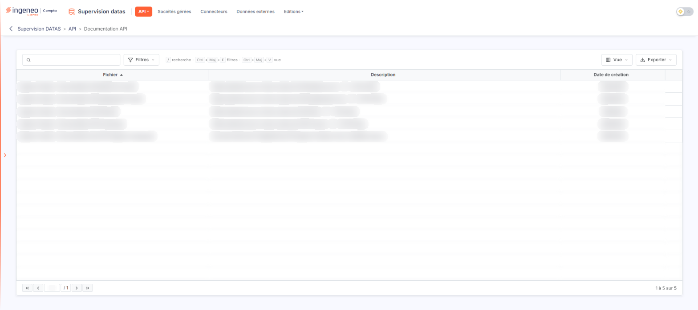
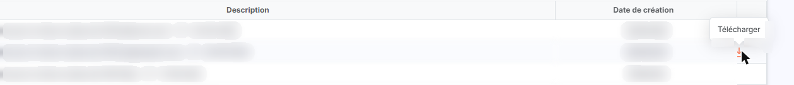

# Documentation API


**Où le trouver :** Menu **API › Documentation API**



**En bref** — Cet écran met à votre disposition, en consultation, la documentation publiée par l'éditeur pour accéder aux API Ingeneo Compta et mettre en place les connexions avec certains partenaires.

* Pour trouver un document : saisissez un mot dans la zone « Rechercher une documentation… » au-dessus de la grille.
* Pour récupérer un document : survolez sa ligne, puis cliquez sur le pictogramme « Télécharger » (flèche vers le bas) à droite.


Cette option met à votre disposition la documentation nécessaire pour accéder aux API Ingeneo Compta et pour mettre en place les connexions avec certains partenaires. Vous y récupérez les documents ; vous n'en ajoutez pas : cette liste est alimentée par l'éditeur, et elle s'allonge au fil des documentations publiées.

<figure><figcaption>
Écran « Documentation API » de la nouvelle interface
</figcaption></figure>

L'écran est constitué d'une seule grille, en consultation : il n'y a ni rubrique, ni onglet, ni bouton de bas d'écran, et aucune case à cocher de sélection.

## La grille

Elle présente trois colonnes, toutes triables :

| Champ                | Ce qu'il faut savoir                                                                             |
| -------------------- | ------------------------------------------------------------------------------------------------ |
| **Fichier**          | Le nom du document, par exemple « Ingeneo Compta - Documentation des API d'Ingeneo Compta.pdf ». |
| **Description**      | Une phrase qui indique ce que couvre le document et sa version.                                  |
| **Date de création** | La date du document.                                                                             |

Les libellés un peu longs sont tronqués à l'affichage : placez le pointeur sur la cellule pour lire la valeur entière.

Au-dessus de la grille, une barre propose, de gauche à droite : la zone « Rechercher une documentation… », qui filtre la liste à mesure que vous tapez ; Bouton \[Filtres], qui ouvre le volet des critères ; et, à droite, Bouton \[Vue], qui permet de choisir les colonnes affichées et d'enregistrer une vue, puis Bouton \[Exporter], dont le menu offre l'aperçu d'édition HTML, l'impression, l'export en Excel ou en PDF et l'envoi de la liste par e-mail. Ce sont les commandes habituelles des listes du logiciel.

Sous la grille, la barre de pagination indique le nombre de documents disponibles, par exemple « 1 à 5 sur 5 ».

## Commande de ligne « Télécharger »

<figure><figcaption>
Rubrique « Commande de ligne « Télécharger » »
</figcaption></figure>

Au survol d'une ligne, un pictogramme de flèche vers le bas apparaît dans la dernière colonne, à droite de la ligne ; son infobulle annonce « Télécharger ». Le logiciel vous remet alors le document PDF lui-même, que votre navigateur ouvre ou enregistre selon la façon dont il est réglé.

Cette commande dépend d'un droit : s'il n'est pas accordé à votre code utilisateur, elle n'apparaît pas sur les lignes.

La liste ci-dessous décrit les API disponibles par module :

**Module Agenda** :

* Création ou modification d’un événement dans l’agenda
* Récupération de tous les événements d’un agenda
* Récupération de tous les événements d’une société gérée
* Récupération d’un événement d’un agenda
* Suppression d’un événement quel que soit le client
* Suppression d’un événement d’un client
* Récupérer la liste des catégories d’événements d’un agenda

**Module Administration** :

* Récupération de la liste des sociétés gérées
* Récupération de la liste des sociétés gérées avec la liste des dossiers annuels
* Récupération d’une fiche société gérée complète
* Récupération d’une fiche et de la liste des dossiers annuels d’une société gérée
* Récupération de la liste des dossiers annuels d’une société gérée
* Récupération de la liste des dossiers annuels de toutes les sociétés gérées d’un abonnement
* Récupération d’une fiche dossier annuel
* Suppression d’une fiche société gérée
* Suppression de la BDD d’une société gérée
* Suppression d’une fiche dossier annuel
* Suppression de la BDD d’un dossier annuel
* Création et modification d’une fiche société gérée
* Création et modification d’un dossier annuel ou de plusieurs simultanément
* Clôture d'un dossier annuel avec ou sans réouverture

**Module Banque** :

* Import d’un fichier au format CFONB

**Module Comptabilité** :

* Récupération sélective des écritures de la comptabilité d’un dossier annuel
* Récupération des écritures de la comptabilité selon un modèle d’export choisi (donc avec optionnellement les pièces jointes)
* Création d’écritures dans la comptabilité (dans le sas d’import)
* Récupération d’un document lié à une écriture de la comptabilité
* Purge des écritures de la comptabilité par journal
* Récupération de la liste des comptes auxiliaires d’un dossier annuel (version simplifiée et version détaillée avec les adresses des contacts et les banques des tiers)
* Import d'un fichier FEC avec les pièces jointes au format .zip

**Module Datas** :

* Récupération des écritures (du container partagé) d’un dossier annuel
* Récupération d’un document lié à une écriture (du container d’écritures)
* Récupération du rapport des exports réalisés depuis le module Datas
* Mise à jour des dates de récupération des écritures (du container partagé)
* Création d’écritures (dans le container d’écritures)

**Module Dossier permanent** :

* Récupération de l’activité d’une société gérée
* Modification de l’activité d’une société gérée
* Récupération d’un document d’une société gérée
* Récupération des impôts directs d’une société gérée
* Modification des impôts directs d’une société gérée
* Récupération des informations liées à la TVA d’une société gérée
* Modification des informations liées à la TVA d’une société gérée
* Récupération de la liste des Organismes de Gestion Agréés d’une société
* Affectation d’un organisme de gestion agréé à une société
* Modification de l’ affectation d’un organisme de gestion agréé à une société
* Récupération des informations générales juridiques
* Modification des informations générales juridiques
* Récupération des actionnaires personnes morales
* Création des actionnaires personnes morales
* Modification des actionnaires personnes morales
* Récupération des actionnaires personnes physiques
* Création des actionnaires personnes physiques
* Modification des actionnaires personnes physiques
* Récupération des filiales
* Création des filiales
* Modification des filiales
* Ajout d’un document dans les documents divers de l’identité
* Ajout d’un document dans les documents divers des autres informations sociales
* Ajout d’un document dans les documents divers des autres informations fiscales
* Ajout d’un document dans les statuts
* Ajout d’un document dans les K-bis
* Ajout d’un document dans les autres documents légaux

**Module Facturation** :

* Création d’un ou plusieurs clients avec les adresses des contacts et les banques

**Module Liasse fiscale** :

* Récupération des suivis des télédéclarations d’un abonné
* Récupération des fichiers EDI d’une ou plusieurs télédéclarations sous forme de fichier .zip

**Module Mon compte** :

* Récupération de la liste de tous les utilisateurs de l’abonnement
* Récupération de la fiche d’un utilisateur
* Création et modification d’un utilisateur ou de plusieurs simultanément (y compris les champs dynamiques)

**Module Supervision datas** :

* Récupération de la liste des exports réalisés dans le module Datas.

**Module Supervision transfert banque** :

* Récupération de toutes les règles de traduction
* Récupération de la fiche d’une règle de traduction
* Création ou modification d’une liste de règles de traduction
* Suppression de toutes les règles de traduction
* Suppression d’une règle de traduction
* Récupération de toutes les affectations
* Récupération de la fiche d’une affectation
* Création ou modification d’une liste d'affectations
* Suppression de toutes les affectations
* Suppression d’une affectation

**Module Vision expert** :

* Récupération de la liste des tags
* Récupération des tags d’un utilisateur
* Attachement de tags (liés aux actualités) à des utilisateurs.
