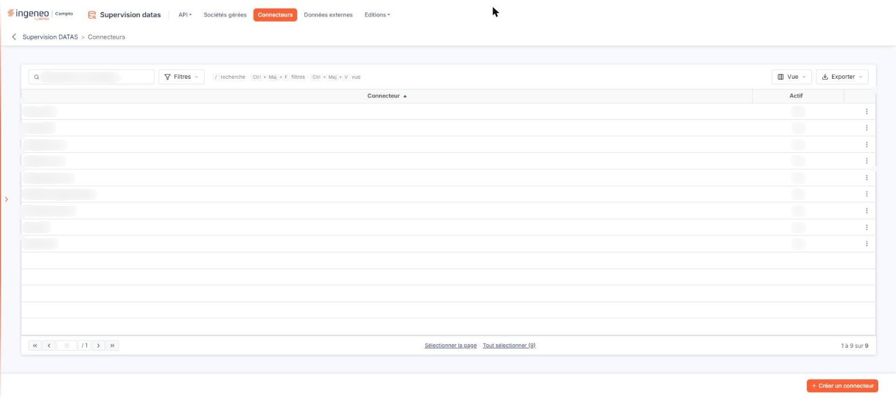
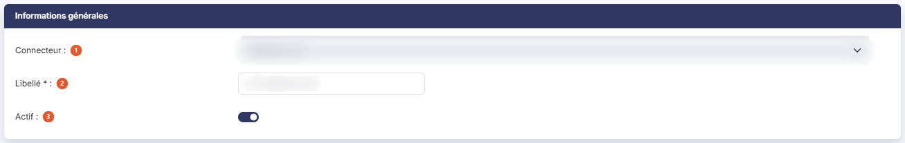
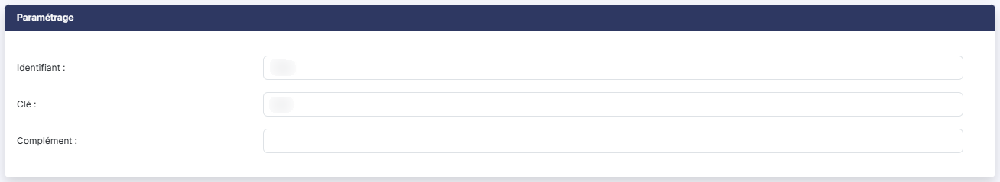
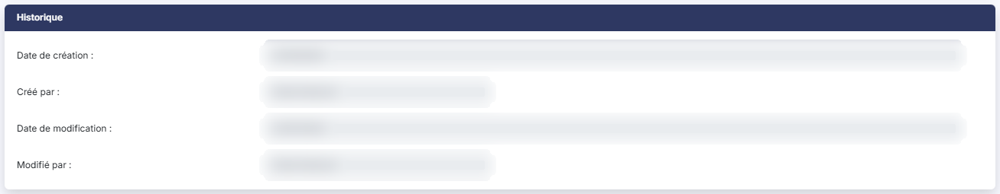

# Connecteurs


**Où le trouver :** Menu **Connecteurs**



**En bref** — Cet écran vous permet de créer et d'activer les connecteurs vers les API d'autres éditeurs, en y saisissant une seule fois les codes de connexion que chaque éditeur vous a remis.

* Pour créer un connecteur : bouton \[Créer un connecteur], choisissez le « Connecteur », saisissez un « Libellé » unique et les champs de la rubrique « Paramétrage », puis bouton \[Enregistrer].
* Pour vérifier que la connexion à l'API de l'éditeur s'établit : bouton \[Tester] sur la fiche du connecteur.
* Pour modifier un connecteur : pictogramme « Autres actions » de sa ligne, puis « Modifier ».


## La liste des connecteurs

<figure><figcaption>
Écran « Connecteurs » de la nouvelle interface
</figcaption></figure>

La grille présente les connecteurs que vous avez créés, en deux colonnes triables, classées à l'ouverture par ordre croissant de connecteur :

| Champ          | Ce qu'il faut savoir                                                                                                                                                                                                                                                                 |
| -------------- | ------------------------------------------------------------------------------------------------------------------------------------------------------------------------------------------------------------------------------------------------------------------------------------ |
| **Connecteur** | Le type de connecteur, c'est-à-dire l'éditeur ou le service auquel il s'adresse. Attention : c'est bien le type qui figure ici, et non le libellé que vous avez saisi ; c'est en revanche ce libellé qui vous sera proposé au moment de rattacher le connecteur à une société gérée. |
| **Actif**      | « Oui » ou « Non ».                                                                                                                                                                                                                                                                  |

Au-dessus de la grille, la barre « Rechercher un connecteur… » filtre la liste à mesure que vous saisissez ; à sa droite, le Bouton \[Filtres], le Bouton \[Vue] et le Bouton \[Exporter].

Le Bouton \[Filtres] ouvre le volet « Filtrer », où « + Ajouter un critère sur… » propose les colonnes Connecteur, Actif, Libellé et Champ de référence ; Bouton \[Vider les filtres] les retire et Bouton \[Filtrer] applique vos critères.

Le Bouton \[Vue] détermine les colonnes affichées : à l'ouverture, seules Connecteur et Actif le sont (« 2 colonnes affichées sur 4 »), mais la liste propose aussi Libellé et Champ de référence. Il permet aussi d'enregistrer la vue actuelle, de rétablir les colonnes d'origine et de les appliquer par le Bouton \[Appliquer].

Le Bouton \[Exporter] ouvre un menu consacré à la liste affichée : « Aperçu édition HTML », « Imprimer » (Ctrl + P), « Exporter en Excel », « Exporter en PDF » et « Envoyer la liste par e-mail ».

En bas de la grille, Bouton \[Sélectionner la page] et Bouton \[Tout sélectionner (N)] cochent respectivement les lignes de la page et toutes les lignes ; une fois la sélection active, ils deviennent Bouton \[Désélectionner la page] et Bouton \[Tout désélectionner (N)]. La grille ne porte plus ni case à cocher ni colonne de commandes en tête.

Au survol d'une ligne, deux commandes apparaissent à droite : le pictogramme « Corbeille » (infobulle « Supprimer ») et le pictogramme « Autres actions » (trois points), dont le menu propose « Modifier » et ouvre la fiche du connecteur.

bouton **\[Créer un connecteur]** : situé dans la barre du bas de l'écran, il ouvre l'écran de création d'un connecteur.

bouton **\[Supprimer]** : il n'apparaît, en rouge, que lorsque des lignes sont sélectionnées ; il supprime alors les connecteurs sélectionnés.

## Rubrique « Informations générales »

<figure><figcaption>
Rubrique « Informations générales »
</figcaption></figure>

Cette rubrique est la même pour tous les connecteurs.

| Champ             | Ce qu'il faut savoir                                                                                                                                                                                                                                                                                                                 |
| ----------------- | ------------------------------------------------------------------------------------------------------------------------------------------------------------------------------------------------------------------------------------------------------------------------------------------------------------------------------------ |
| 1. **Connecteur** | Choisissez dans la liste déroulante, proposée sur « Sélectionnez », le type de connecteur que vous souhaitez créer. C'est ce choix qui détermine le contenu de la rubrique « Paramétrage ». En création, ce champ est obligatoire et son libellé porte l'astérisque correspondant ; en modification, l'astérisque n'est pas affiché. |
| 2. **Libellé**    | Champ obligatoire. Indiquez un libellé qui devra être unique, quel que soit le type de connecteur : plusieurs connecteurs du même type peuvent donc coexister, sous des libellés différents.                                                                                                                                         |
| 3. **Actif**      | Cet interrupteur ouvre ou coupe l'accès au connecteur. À la création, il est proposé activé.                                                                                                                                                                                                                                         |

## Rubrique « Paramétrage »

<figure><figcaption>
Rubrique « Paramétrage »
</figcaption></figure>

Le contenu de cette rubrique dépend entièrement du type de connecteur choisi : tant que vous n'avez rien choisi, à la création, elle reste vide.

Elle commence en général par un texte qui rappelle ce que permet le connecteur et ce qu'il suppose de votre part. Viennent ensuite, s'il y en a, les champs d'identification remis par l'éditeur. Leur nombre et leur nature varient : le connecteur « Jedeclare.com » demande un **Identifiant :**, une **Clé :** et un **Complément :**, le connecteur « Sobank API » un **Identifiant :** seul, et le connecteur « Chorus Pro » n'affiche qu'un texte, sans aucun champ. Certains connecteurs ne se paramètrent pas du tout à ce niveau : leur rubrique « Paramétrage » est alors vide.

**Vider les écritures avant import ?** : cet interrupteur n'apparaît que pour les connecteurs qui produisent des écritures comptables. Si vous répondez « Oui », cela signifie que l'éditeur renvoie à chaque connexion l'intégralité des écritures comptables et qu'il faut donc purger votre base avant tout nouvel import ; cela se produit donc plutôt avec des éditeurs de logiciels de comptabilité. Si vous répondez « Non », cela signifie que l'import doit être incrémentiel et donc s'ajouter simplement aux écritures déjà présentes ; cela se produit donc avec des éditeurs de logiciels verticaux qui ne génèrent qu'une partie des écritures comptables.

Le texte affiché pour le connecteur « Silae API » énumère des « Compléments » numérotés auxquels ne correspond aucun champ de cet écran : ne les cherchez pas, la rubrique n'y présente qu'un **Identifiant :** et une **Clé :**.

**Le cas du connecteur « Everial API »**

C'est le paramétrage le plus fourni. Aux champs d'identification — **Adresse de l'API :**, obligatoire, **Adresse de l'interface web :**, **Activer SSO :**, **Identifiant :** et **Mot de passe :** — s'ajoute une liste d'interrupteurs sous le titre « Choix des champs à intégrer dans les métadonnées des pièces », dont le pictogramme d'information précise : « Les champs que vous choisirez seront intégrés en tant que métadonnées à chacune des pièces client produites par la facturation,la gestion commerciale ou la liasse fiscale et aux documents océrisés. »

Vous désignez ainsi, un interrupteur par champ, ce que vous voulez voir accompagner chaque pièce : l'identité de la société gérée, les caractéristiques de la pièce, ou encore celles de la déclaration. Les cinq premiers de la liste, du code émetteur aux dates de l'exercice, sont présentés grisés : leur interrupteur ne se manipule pas.

## Rubrique « Historique »

<figure><figcaption>
Rubrique « Historique »
</figcaption></figure>

Cette rubrique n'existe que sur la fiche d'un connecteur déjà créé ; elle est absente de l'écran de création. Elle porte des champs grisés, tenus par le logiciel : **Date de création :** et **Créé par :**, auxquels s'ajoutent, une fois le connecteur modifié, **Date de modification :** et **Modifié par :**.

## Les boutons de bas d'écran

bouton **\[Enregistrer]** : il enregistre le connecteur ; avec le Bouton \[Tester], il est placé dans la barre du bas de l'écran.

bouton **\[Tester]** : il est destiné à vérifier, avec les informations que vous venez de saisir, que la connexion à l'API de l'éditeur s'établit.

**Retour à la liste** : utilisez la flèche « Revenir en arrière », à gauche du fil d'Ariane ; le Bouton \[Retour] n'est plus affiché.

Deux connecteurs ajoutent à cette barre un bouton qui leur est propre : bouton **\[Réinitialiser la clé API]** sur la fiche du connecteur « Jefacture.com », et bouton **\[Synchroniser avec le portail de services]** sur celle du connecteur « Portail de services ».
