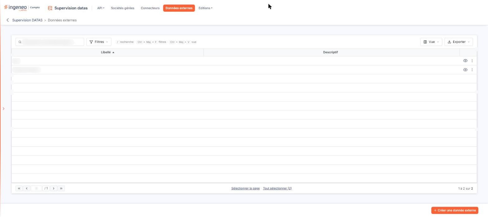
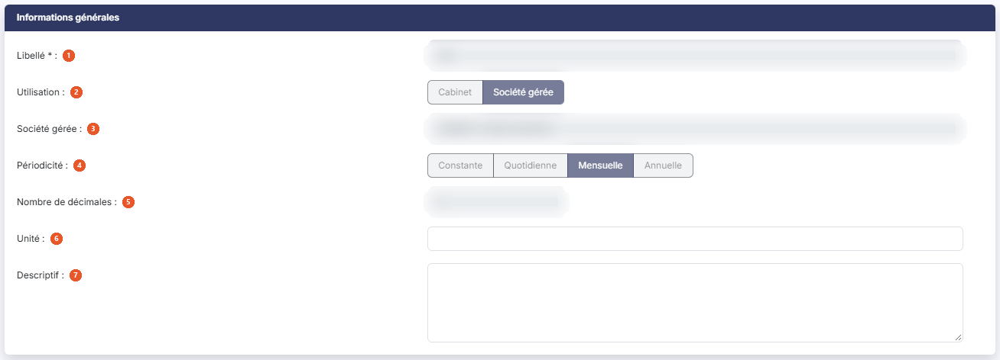
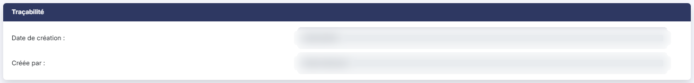
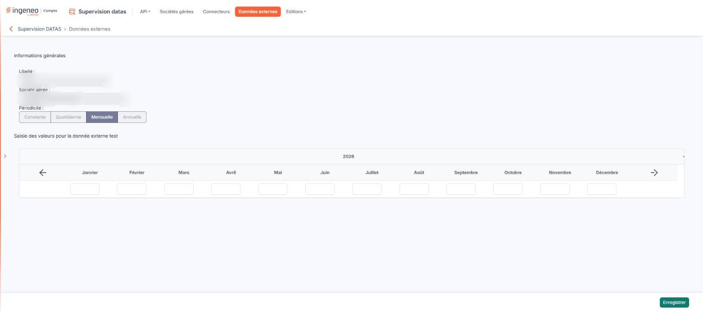

# Données externes


**Où le trouver :** Menu **Données externes**



**En bref** — Cet écran vous permet de créer des données complémentaires, propres au cabinet ou à une société gérée, puis d'en saisir les valeurs afin de les utiliser dans les graphiques du module Vision.

* Pour créer une donnée externe : bouton \[Créer une donnée externe], renseignez le « Libellé », l'« Utilisation », la « Périodicité » et le « Nombre de décimales », puis bouton \[Enregistrer].
* Pour saisir les valeurs : pictogramme « Œil » de la ligne, renseignez les cellules de la période, puis bouton \[Enregistrer].
* Pour supprimer des données externes : sélectionnez leurs lignes, puis bouton \[Supprimer].


## La liste des données externes

<figure><figcaption>
Écran « Données externes » de la nouvelle interface
</figcaption></figure>

La grille présente deux colonnes triables, **Libellé** et **Descriptif**, classées à l'ouverture par ordre croissant de libellé.

Au-dessus de la grille, la barre « Rechercher une donnée externe… » filtre la liste à mesure que vous saisissez ; à sa droite, le Bouton \[Filtres], le Bouton \[Vue] et le Bouton \[Exporter].

Le Bouton \[Filtres] ouvre le volet « Filtrer » : « + Ajouter un critère sur… » propose les colonnes de la liste, Bouton \[Vider les filtres] les retire et Bouton \[Filtrer] applique vos critères.

Le Bouton \[Vue] détermine les colonnes affichées : à l'ouverture, seules Libellé et Descriptif le sont (« 2 colonnes affichées sur 10 »), mais la liste propose aussi, entre autres, Créée le, Créée par, Modifiée le, Modifiée par, Unité et Utilisation. Il permet aussi d'enregistrer la vue actuelle, de rétablir les colonnes d'origine et de les appliquer par le Bouton \[Appliquer].

Le Bouton \[Exporter] ouvre un menu consacré à la liste affichée : « Aperçu édition HTML », « Imprimer » (Ctrl + P), « Exporter en Excel », « Exporter en PDF » et « Envoyer la liste par e-mail ».

En bas de la grille, Bouton \[Sélectionner la page] et Bouton \[Tout sélectionner (N)] cochent respectivement les lignes de la page et toutes les lignes. La grille ne porte plus ni case à cocher ni colonne de commandes en tête.

Au survol d'une ligne, deux commandes apparaissent à droite :

* le pictogramme « Œil », dont l'infobulle annonce « Afficher l'aperçu » mais qui ouvre en réalité l'écran de saisie des valeurs décrit plus bas ;
* le pictogramme « Autres actions » (trois points), dont le menu propose « Modifier » (qui ouvre la fiche de la donnée externe), « Dupliquer » et « Supprimer ».

bouton **\[Créer une donnée externe]** : situé dans la barre du bas de l'écran, il ouvre l'écran de création d'une donnée externe.

bouton **\[Supprimer]** : il n'apparaît, en rouge, que lorsque des lignes sont sélectionnées ; il supprime alors les données externes sélectionnées.

## Rubrique « Informations générales »

<figure><figcaption>
Rubrique « Informations générales »
</figcaption></figure>

<figure><figcaption>
Rubrique « Informations générales »
</figcaption></figure>

À la création, c'est la seule rubrique de la fiche ; en modification, une seconde rubrique « Traçabilité » s'y ajoute (voir plus bas).

**Les caractéristiques d'une donnée externe se fixent à sa création.** Une fois la donnée créée, seuls **Unité** et **Descriptif** restent saisissables : le libellé, l'utilisation, la société gérée, la périodicité et le nombre de décimales sont présentés verrouillés. Prenez donc le temps de les arrêter avant d'enregistrer.

| Champ                      | Ce qu'il faut savoir                                                                                                                                                                                                                                                                      |
| -------------------------- | ----------------------------------------------------------------------------------------------------------------------------------------------------------------------------------------------------------------------------------------------------------------------------------------- |
| 1. **Libellé**             | Champ obligatoire, qui doit être unique. Il ne peut pas dépasser 30 caractères et n'accepte que des lettres, des chiffres, des espaces, le tiret, le point et le souligné.                                                                                                                |
| 2. **Utilisation**         | Indiquez si la donnée est de type « Cabinet », ce qui signifie qu'elle sera accessible à toutes les sociétés gérées, ou de type « Société gérée », ce qui signifie qu'elle sera accessible à une seule société mais pour tous ses dossiers annuels. Le choix est proposé sur « Cabinet ». |
| 3. **Société gérée**       | Ce champ n'apparaît que lorsque vous avez choisi l'utilisation « Société gérée » ; il est alors obligatoire. Vous y désignez la société concernée.                                                                                                                                        |
| 4. **Périodicité**         | La périodicité définit pour quel créneau de temps les données devront être saisies. Vous choisissez entre « Constante », « Quotidienne », « Mensuelle » et « Annuelle » ; le choix est proposé sur « Constante ». Le choix « Constante » permet de saisir une valeur unique, sans date.   |
| 5. **Nombre de décimales** | Il est proposé à 2 et ne peut pas dépasser 4.                                                                                                                                                                                                                                             |
| 6. **Unité**               | —                                                                                                                                                                                                                                                                                         |
| 7. **Descriptif**          | Sur plusieurs lignes.                                                                                                                                                                                                                                                                     |

Les champs **Date de création :** et **Créée par :** sont renseignés par le logiciel ; ils sont regroupés dans la rubrique « Traçabilité », qui n'apparaît, logiquement, que sur la fiche d'une donnée déjà créée. Une fois la fiche modifiée, la rubrique indique aussi la **Date de modification :** et le champ **Modifiée par :**.

bouton **\[Enregistrer]** : placé dans la barre du bas de l'écran, il enregistre la donnée externe. Pour revenir à la liste, utilisez la flèche « Revenir en arrière », à gauche du fil d'Ariane ; le Bouton \[Retour] n'est plus affiché.

## La saisie des valeurs

<figure><figcaption>
Rubrique « La saisie des valeurs »
</figcaption></figure>

Une fois la donnée externe créée, vous saisissez ses valeurs depuis le pictogramme « Œil » de sa ligne dans la grille. L'écran obtenu comporte deux rubriques.

La première, « Informations générales », rappelle la donnée que vous êtes en train de renseigner : son **Libellé :**, la **Société gérée :** à laquelle elle se rapporte le cas échéant, et sa **Périodicité :**.

La seconde porte le libellé de la donnée externe dans son propre titre — « Saisie des valeurs pour la donnée externe » suivi du libellé. Elle présente un tableau d'une seule ligne de cellules de saisie, dont l'aspect dépend de la périodicité que vous avez choisie à la création. Pour une donnée de périodicité « Mensuelle », par exemple, le logiciel affiche l'année en tête, puis les douze mois, et une cellule de saisie sous chaque mois.

Les flèches « Gauche » et « Droite » qui encadrent les en-têtes du tableau vous déplacent vers la période précédente ou suivante. Vous n'avez pas besoin d'enregistrer votre saisie avant de cliquer sur une flèche : le logiciel enregistre les valeurs saisies avant d'afficher la période demandée.

Lorsque vous avez terminé, cliquez sur le bouton **\[Enregistrer]**, dans la barre du bas. Pour revenir à la liste des données externes, utilisez la flèche « Revenir en arrière », à gauche du fil d'Ariane.

Pour utiliser les données externes dans les indicateurs graphiques, reportez-vous à l'aide du module « Vision », menu « Contenu », sous-menu « Indicateurs personnalisés ».
