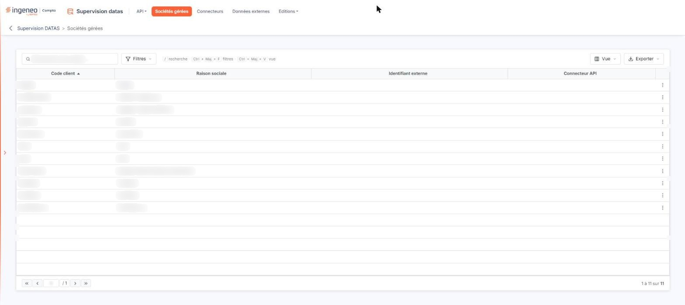
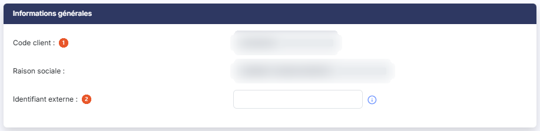
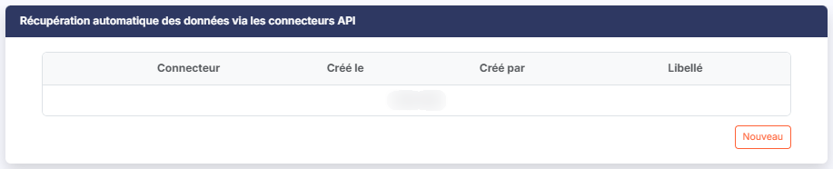
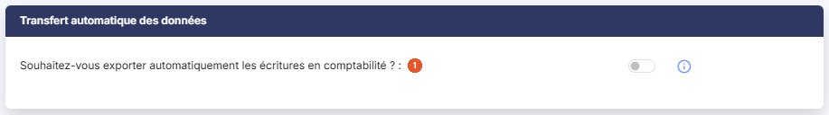
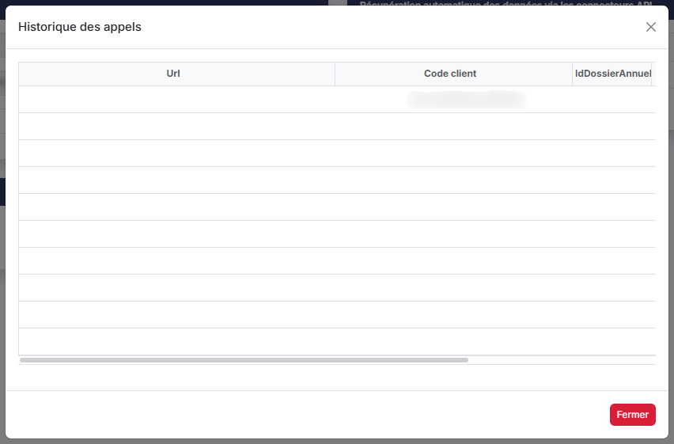
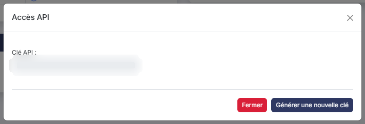

# Sociétés gérées


**Où le trouver :** Menu **Sociétés gérées**



**En bref** — Cet écran liste les sociétés gérées de votre abonnement et vous permet, depuis leur fiche, de leur rattacher des connecteurs API et de régler le transfert automatique de leurs écritures en comptabilité.

* Pour rattacher un connecteur : « Autres actions » de la ligne, puis « Modifier », bouton \[Nouveau], choisissez le « Connecteur », puis bouton \[Enregistrer] de la zone.
* Pour transférer automatiquement les écritures du module Datas : activez « Souhaitez-vous exporter automatiquement les écritures en comptabilité ? », puis bouton \[Enregistrer].
* Pour gérer la clé API de la société : « Autres actions » de la fiche, puis « Clef client API » et bouton \[Générer une nouvelle clé].


## La liste des sociétés gérées

<figure><figcaption>
Écran « Sociétés gérées » de la nouvelle interface
</figcaption></figure>

Au-dessus de la grille, la barre « Rechercher une société… » vous permet de restreindre la liste : ce que vous saisissez devient un critère « Contient » qui reste appliqué tant que vous ne l'avez pas retiré. À côté, le bouton **\[Filtres]** ouvre le volet de filtres, le bouton **\[Vue]** permet d'enregistrer ou de retrouver une présentation de la liste et de rétablir les colonnes d'origine, et le bouton **\[Exporter]** ouvre le menu des éditions de la liste (aperçu, impression, export Excel ou PDF, envoi par e-mail, mise en page).

La grille présente quatre colonnes, toutes triables :

**Code client** et **Raison sociale :** ils identifient la société gérée.

| Champ                   | Ce qu'il faut savoir                                                                                                                                  |
| ----------------------- | ----------------------------------------------------------------------------------------------------------------------------------------------------- |
| **Identifiant externe** | L'identifiant saisi dans la fiche de la société gérée (voir la rubrique « Informations générales » ci-dessous).                                       |
| **Connecteur API**      | Les libellés des connecteurs rattachés à cette société gérée, séparés par une virgule. La colonne reste vide tant qu'aucun connecteur n'est rattaché. |

Sur chaque ligne, le pictogramme « Autres actions » (trois points verticaux, visible au survol de la ligne, en dernière colonne) ouvre un petit menu dont la seule entrée, « Modifier », ouvre la fiche de la société gérée. La liste n'a pas de case de sélection et ne propose aucune action sur plusieurs lignes ; l'écran ne comporte aucun bouton de bas d'écran.

## Rubrique « Informations générales » de la fiche

<figure><figcaption>
Rubrique « Informations générales »
</figcaption></figure>

| Champ                      | Ce qu'il faut savoir                                                                                                                                                                                                     |
| -------------------------- | ------------------------------------------------------------------------------------------------------------------------------------------------------------------------------------------------------------------------ |
| 1. **Code client**         | **Raison sociale :** ces deux champs rappellent l'identité de la société gérée ; ils sont grisés et ne se modifient pas ici.                                                                                             |
| 2. **Identifiant externe** | C'est le seul champ saisissable de la rubrique. Le pictogramme d'information placé à sa droite précise : « Ce champ va vous permettre de faire le lien avec le connecteur externe permettant de récupérer les données. » |

## Rubrique « Récupération automatique des données via les connecteurs API »

<figure><figcaption>
Rubrique « Récupération automatique des données via les connecteurs API »
</figcaption></figure>

Cette rubrique présente, sous la forme d'un petit tableau, les connecteurs déjà rattachés à la société gérée, avec les colonnes **Connecteur**, **Créé le**, **Créé par** et **Libellé**. Tant qu'aucun connecteur n'est rattaché, le tableau affiche « Liste vide ».

bouton **\[Nouveau]** : placé sous le tableau, il rattache un connecteur de plus à cette société gérée. Le bouton laisse alors la place à une liste déroulante **Connecteur :**, proposée sur « Sélectionnez », qui présente les connecteurs créés dans l'option « Connecteurs » du module, désignés par le libellé que vous leur avez donné. Le bouton **\[Enregistrer]** de cette zone valide le rattachement, le bouton **\[Annuler]** y renonce.

## Rubrique « Transfert automatique des données »

<figure><figcaption>
Rubrique « Transfert automatique des données »
</figcaption></figure>

| Champ                                                                          | Ce qu'il faut savoir                                                                                                                                                                                                                                                                       |
| ------------------------------------------------------------------------------ | ------------------------------------------------------------------------------------------------------------------------------------------------------------------------------------------------------------------------------------------------------------------------------------------ |
| 1. **Souhaitez-vous exporter automatiquement les écritures en comptabilité ?** | Cet interrupteur commande le transfert ; son état suit le paramétrage enregistré pour la société. Le pictogramme d'information placé à sa droite précise : « Si vous répondez Oui toutes les écritures ajoutées dans le module Datas seront transférées automatiquement en comptabilité. » |
| **Souhaitez-vous purger les écritures existantes avant chaque export ?**       | Ce second interrupteur n'apparaît que lorsque le premier est activé.                                                                                                                                                                                                                       |

## Les boutons de bas de fiche

<figure><figcaption>
Rubrique « Les boutons de bas de fiche »
</figcaption></figure>

<figure><figcaption>
Rubrique « Les boutons de bas de fiche »
</figcaption></figure>

La barre du bas de la fiche porte le bouton **\[Enregistrer]**, qui enregistre la fiche, et, à sa droite, un menu « Autres actions » (trois points verticaux) qui regroupe deux entrées : « Historique des connexions » et « Clef client API ». Leur présence dépend de vos droits.

| Champ                                    | Ce qu'il faut savoir                                                                                                                                                                                                                                                                                                                                                                                                                                                                                                    |
| ---------------------------------------- | ----------------------------------------------------------------------------------------------------------------------------------------------------------------------------------------------------------------------------------------------------------------------------------------------------------------------------------------------------------------------------------------------------------------------------------------------------------------------------------------------------------------------- |
| **Entrée « Historique des connexions »** | Elle ouvre une fenêtre — dont le bandeau s'intitule « Historique des appels » — qui présente les appels d'API effectués pour cette société gérée. Sa grille porte les colonnes **Url**, **Code client**, **IdDossierAnnuel**, **Nb lignes**, **Date début** et **Date fin** ; les deux premières se trient. Un défilement horizontal est nécessaire pour atteindre les dernières colonnes. Lorsqu'aucun appel n'a été enregistré, la fenêtre affiche « Aucun élément à afficher. ». Le bouton **\[Fermer]** la referme. |
| **Entrée « Clef client API »**           | Elle ouvre une fenêtre — dont le bandeau s'intitule « Accès API » — qui porte la clé propre à cette société gérée. Le champ **Clé API :** n'est pas saisissable : il affiche la clé en place, et reste vide tant qu'aucune clé n'a été générée. Le bouton **\[Générer une nouvelle clé]** en produit une ; lorsqu'une clé existe, un bouton **\[Supprimer la clé actuelle]** s'ajoute pour la révoquer. Le bouton **\[Fermer]** referme la fenêtre.                                                                     |

Pour revenir à la liste des sociétés gérées, utilisez la flèche « Revenir en arrière », à gauche du fil d'Ariane.
