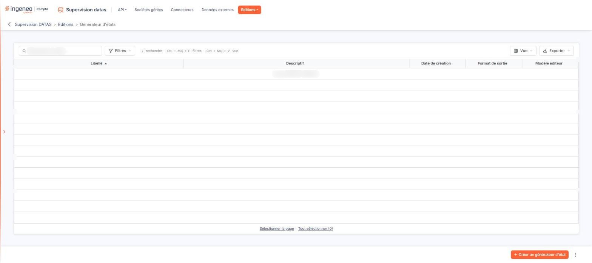

# Générateur d'états


**Où le trouver :** Menu **Editions › Générateur d'états**



**En bref** — Cet écran donne accès au générateur d'états d'édition, décrit dans le chapitre « Généralités » de l'aide ; les fichiers proposés sont ceux rattachés au module Supervision DATAS.

* Pour apprendre à créer un état : reportez-vous au chapitre « Généralités » en tête de l'aide.


L'aide en ligne concernant le générateur d'états d'édition, commune à tous les modules de l'application où il est présent, se trouve dans le chapitre « Généralités » en tête de la présente aide.

<figure><figcaption>
Écran « Générateur d'états » de la nouvelle interface
</figcaption></figure>

Les fichiers proposés lorsque vous créez un état sont ceux qui sont rattachés au module depuis lequel vous ouvrez cet écran : ils ne sont donc pas les mêmes d'un module à l'autre.
