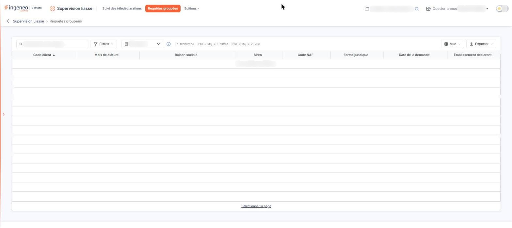

# Requêtes groupées


**Où le trouver :** Menu **Requêtes groupées**



**En bref** — Cet écran permet de demander en une seule fois, pour plusieurs sociétés gérées, la liste des locaux nécessaire à la déclaration des loyers.

* Pour envoyer des demandes : choisissez l'Établissement du cabinet, cliquez sur les lignes des sociétés voulues, puis bouton \[Envoyer les demandes].
* Pour sélectionner toutes les sociétés de la page : lien « Sélectionner la page », au pied de la grille.
* Si la liste est vide : vérifiez que la déclaration des loyers est activée dans le dossier permanent fiscal et que l'établissement déclarant est celui que vous avez choisi.


## L'établissement du cabinet

<figure><figcaption>
Écran « Requêtes groupées » de la nouvelle interface
</figcaption></figure>

<figure><figcaption>
Rubrique « L'établissement du cabinet »
</figcaption></figure>

**Établissement du cabinet** : cette liste déroulante, placée dans la barre d'outils de la grille, à côté du bouton \[Filtres], désigne l'établissement de votre cabinet qui effectue les télédéclarations. Une infobulle le rappelle et précise que vous pouvez sélectionner jusqu'à 1 500 sociétés gérées pour une demande groupée.

Le premier établissement de la liste est proposé par défaut. Dès que vous en choisissez un autre, la liste des sociétés se recharge sur cet établissement. Un établissement est toujours retenu : pour revenir au premier de la liste, choisissez-le de nouveau dans le déroulant.

La barre d'outils comporte aussi un champ « Rechercher une société… » et les boutons \[Filtres], \[Vue] et \[Exporter]. Le menu \[Exporter] propose « Aperçu édition HTML », « Imprimer », « Exporter en Excel », « Exporter en PDF » et « Envoyer la liste par e-mail ».

## La liste des sociétés concernées

La grille présente les sociétés gérées pour lesquelles une demande peut être faite. Une société n'y figure que si elle remplit les trois conditions suivantes : la déclaration des loyers est activée dans son dossier permanent fiscal, elle a un dossier annuel en cours, et son établissement déclarant est celui que vous avez choisi ci-dessus.

C'est la première explication à chercher devant une liste vide : le message « Aucun élément à afficher. » signifie qu'aucune société gérée ne réunit ces trois conditions pour l'établissement sélectionné, et non que l'écran est en défaut.

Pour désigner les sociétés à inclure dans l'envoi, cliquez sur leur ligne ; le lien « Sélectionner la page », au pied de la grille, sélectionne les lignes de la page. La grille comporte huit colonnes : **Code client**, **Mois de clôture**, **Raison sociale**, **Siren**, **Code NAF**, **Forme juridique**, **Date de la demande** et **Établissement déclarant**.

La colonne **Date de la demande** porte la date de la dernière demande déjà transmise pour la société, sur son dossier annuel en cours : elle vous évite de redemander ce que vous avez déjà demandé. Cette date provient des télédéclarations enregistrées pour votre cabinet : une demande transmise depuis cet écran y est tracée comme telle.

## Les actions

bouton **\[Envoyer les demandes]**

Il transmet une demande pour chacune des sociétés que vous avez sélectionnées, puis recharge la liste. Le bouton n'apparaît qu'une fois au moins une société sélectionnée.

L'envoi part immédiatement, sans fenêtre de confirmation : vérifiez votre sélection avant de cliquer.

Le logiciel refuse l'envoi au-delà de 1 500 sociétés — c'est le plafond annoncé par l'infobulle du sélecteur.

L'envoi suppose enfin que le compte « JeDeclare » de l'établissement choisi soit renseigné. S'il ne l'est pas, ou s'il est erroné, aucune demande n'est transmise et le logiciel vous invite à le paramétrer dans « Dossier permanent > Social > Etablissements ».
