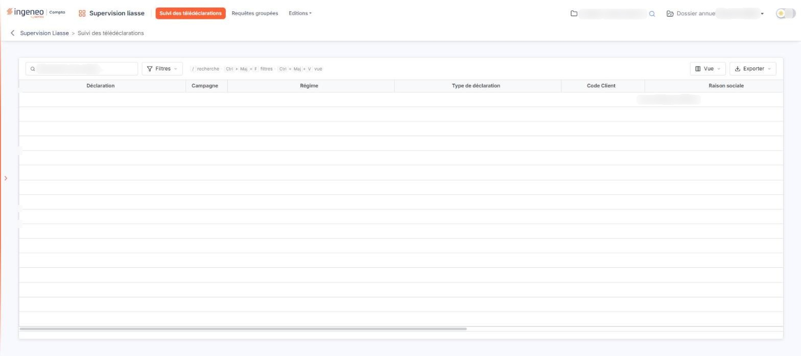
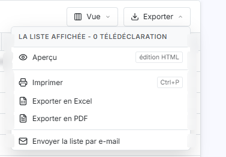

# Suivi des télédéclarations


**Où le trouver :** Menu **Suivi des télédéclarations**



**En bref** — Cet écran permet de suivre les télédéclarations transmises par votre cabinet : déclaration, société concernée, utilisateur, date de télétransmission et type d'EDI.

* Pour retrouver une télédéclaration : champ « Rechercher une société… », ou bouton \[Filtres].
* Pour choisir les colonnes affichées : bouton \[Vue].
* Pour sortir la liste : bouton \[Exporter], puis « Exporter en Excel » ou « Exporter en PDF ».


## La liste des télédéclarations

<figure><figcaption>
Écran « Suivi des télédéclarations » de la nouvelle interface
</figcaption></figure>

<figure><figcaption>
Rubrique « La liste des télédéclarations »
</figcaption></figure>

Au-dessus de la grille, une barre d'outils propose un champ « Rechercher une société… » et les boutons \[Filtres], \[Vue] et \[Exporter]. Le menu \[Exporter] propose « Aperçu édition HTML », « Imprimer », « Exporter en Excel », « Exporter en PDF » et « Envoyer la liste par e-mail ».

Elle comporte onze colonnes, qui répondent à quatre questions :

* de quelle déclaration s'agit-il : **Déclaration**, **Campagne**, **Régime** et **Type de déclaration** ;
* pour quel dossier : **Code Client**, **Raison sociale** et **Dossier annuel** ;
* par qui : **Code utilisateur** et **Utilisateur** ;
* et comment elle est partie : **Date télétransmission** et **Type d'EDI**.

Tant qu'aucune télédéclaration n'a été transmise, la liste affiche « Aucun élément à afficher. ».
