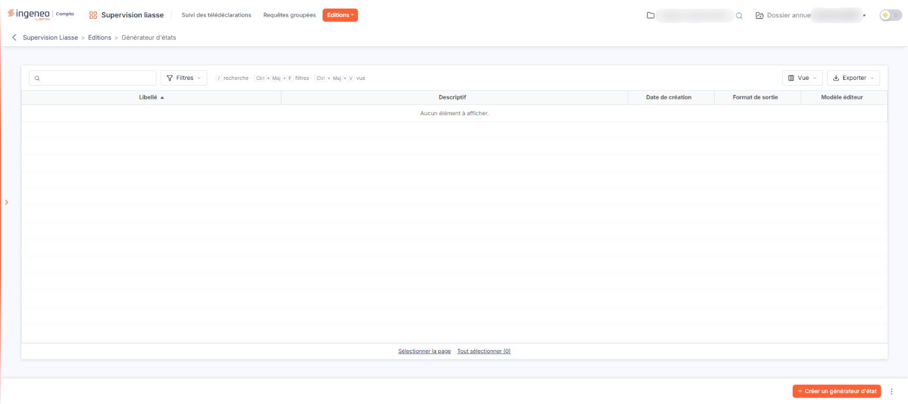
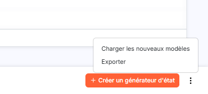
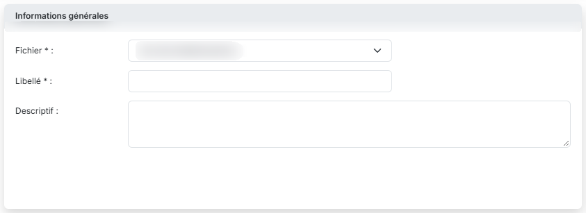
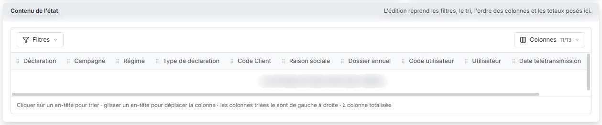
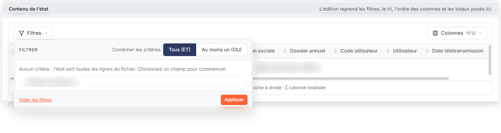
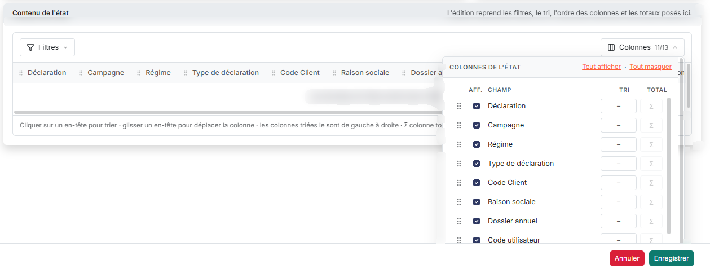
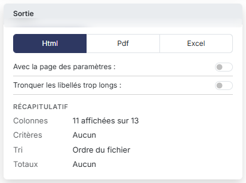
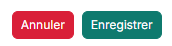

# Générateur d'états


**Où le trouver :** Menu **Editions › Générateur d'états**



**En bref** — Cet écran permet de composer, mémoriser et relancer vos propres éditions sur le suivi des télédéclarations, avec en plus la date et le statut du retour de la transmission.

* Pour créer un état : bouton \[Créer un générateur d'état], choisissez le Fichier à éditer, donnez un Libellé, puis bouton \[Enregistrer].
* Pour éditer le retour de l'administration : dans la carte « Contenu de l'état », bouton \[Colonnes], affichez la Date du retour de la transmission et le Statut du retour de la transmission (masqués par défaut), puis bouton \[Enregistrer].
* Pour recopier des états vers d'autres sociétés : sélectionnez-les dans la liste, bouton \[Exporter], puis désignez les sociétés de destination.


Le générateur d'états vous permet de composer vos propres éditions, de les mémoriser et de les relancer aussi souvent que nécessaire. Dans ce module, il porte sur un seul fichier : **Suivi des télédéclarations** — c'est-à-dire sur les mêmes données que la liste du même nom.

<figure><figcaption>
Écran « Générateur d'états » de la nouvelle interface
</figcaption></figure>

Son intérêt est de vous donner davantage que cette liste : outre les champs qu'elle affiche déjà, le générateur vous propose la **Date du retour de la transmission** et le **Statut du retour de la transmission**, qui ne figurent dans aucune de ses colonnes. C'est donc ici que vous éditez le retour de l'administration.

## La liste de vos états

<figure><figcaption>
Bouton [Créer un générateur d'état]
</figcaption></figure>

<figure><figcaption>
Bouton [Charger les nouveaux modèles]
</figcaption></figure>

L'écran s'ouvre sur la liste des états que vous avez déjà créés, décrits par cinq colonnes : **Libellé**, **Descriptif**, **Date de création**, **Format de sortie** et **Modèle éditeur**. Tant qu'aucun état n'a été enregistré, la liste affiche « Aucun élément à afficher. ».

bouton **\[Créer un générateur d'état]**

Placé en bas à droite de l'écran, il ouvre à droite le panneau « Nouvel état », qui est la fiche d'un nouvel état (voir ci-dessous).

bouton **\[Charger les nouveaux modèles]**

Il vous propose les modèles d'états livrés avec le logiciel que ce dossier ne possède pas encore : choisissez ceux qui vous intéressent et validez, le logiciel les recopie dans votre liste. Si votre dossier les possède déjà tous, il vous le dit et n'en charge aucun.

bouton **\[Exporter]**

Il recopie les états que vous avez sélectionnés dans la liste vers d'autres sociétés gérées : sélectionnez les états à recopier, cliquez sur \[Exporter], puis désignez les sociétés de destination.

bouton **\[Supprimer]**

Il supprime les états que vous avez sélectionnés dans la liste.

## La fiche d'un état

<figure><figcaption>
Rubrique « b) La fiche d'un état »
</figcaption></figure>

<figure><figcaption>
Rubrique « b) La fiche d'un état »
</figcaption></figure>

<figure><figcaption>
Bouton [Filtres]
</figcaption></figure>

<figure><figcaption>
Bouton [Colonnes]
</figcaption></figure>

<figure><figcaption>
Rubrique « b) La fiche d'un état »
</figcaption></figure>

<figure><figcaption>
Bouton [Enregistrer]
</figcaption></figure>

<figure><figcaption>
Bouton [Annuler]
</figcaption></figure>

La fiche s'ouvre dans un panneau à droite de l'écran, intitulé « Nouvel état », et se compose de trois cartes : « Informations générales », « Sortie » et « Contenu de l'état ».

Dans la première, choisissez le **Fichier** à éditer (champ obligatoire) — ici, **Suivi des télédéclarations** est le seul proposé —, donnez un **Libellé** à votre état (champ obligatoire) et éventuellement un **Descriptif**.

La carte « Contenu de l'état » présente un aperçu des colonnes de l'édition. Le fichier est déjà sélectionné à l'ouverture de la fiche : l'état dispose d'emblée de treize champs, dont onze sont affichés par défaut ; la **Date du retour de la transmission** et le **Statut du retour de la transmission** sont masqués par défaut, à vous de les afficher. Deux menus la composent : le bouton **\[Filtres]**, qui sert à poser des critères et dans lequel vous réglez « Combiner les critères » sur « Tous (ET) », pour que toutes les conditions soient respectées, ou « Au moins un (OU) », pour qu'une condition au moins le soit ; et le bouton **\[Colonnes]**, qui indique le nombre de colonnes affichées (« 11/13 ») et liste les champs avec, pour chacun, une case d'affichage, un choix de tri et une totalisation, ainsi que les liens « Tout afficher » et « Tout masquer ». Une phrase sous l'aperçu rappelle que l'on clique sur un en-tête pour trier, que l'on glisse un en-tête pour déplacer la colonne, que les colonnes triées le sont de gauche à droite et que le signe Σ marque une colonne totalisée.

La carte « Sortie » commande la présentation du résultat : un choix de format **Html**, **Pdf** ou **Excel**, et deux interrupteurs, **Avec la page des paramètres** et **Tronquer les libellés trop longs**, désactivés à l'ouverture. Un « Récapitulatif » résume l'état en cours de composition : colonnes affichées, critères, tri et totaux.

Le fonctionnement détaillé du générateur d'états, commun à tous les modules où il est présent, est décrit dans le chapitre « Généralités » en tête de la présente aide.

bouton **\[Enregistrer]**

Il conserve votre état afin que vous puissiez le relancer plus tard.

bouton **\[Annuler]**

Il referme le panneau sans rien enregistrer ; vous retrouvez la liste de vos états.
