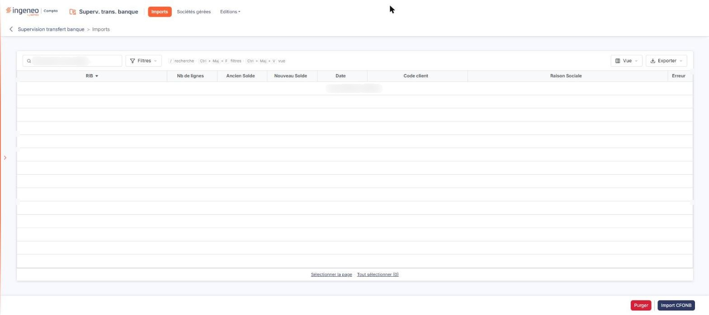
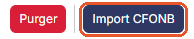
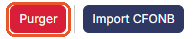

# Imports


**Où le trouver :** Menu **Imports**



**En bref** — Cet écran liste les relevés bancaires reçus par le cabinet, découpés par RIB, et vous permet de les exporter vers les sociétés gérées auxquelles ils correspondent.

* Pour charger vous-même un relevé : bouton \[Import CFONB], puis choisissez le fichier au format CFONB sur votre poste.
* Pour envoyer des relevés dans leurs sociétés gérées : cochez les lignes, puis bouton \[Export par société].
* Pour un relevé dont le RIB n'est pas reconnu : créez la banque avec son RIB dans la société gérée, puis sélectionnez la ligne et bouton \[Vérifier les RIB].


## La liste des relevés

<figure><figcaption>
Écran « Imports » de la nouvelle interface
</figcaption></figure>

Au-dessus de la grille, vous disposez :

* du champ **Rechercher une société…**, qui restreint la liste aux relevés de la société dont vous saisissez la raison sociale ;
* du Bouton \[Filtres], qui vous permet de restreindre la liste en posant un ou plusieurs critères sur ses colonnes ;
* du Bouton \[Vue], qui vous permet de choisir les colonnes affichées et d'enregistrer la présentation de la liste ;
* du Bouton \[Exporter], qui propose l'aperçu de la liste affichée, son impression, son export en Excel ou en PDF et son envoi par e-mail.

Sous la grille, les liens « Sélectionner la page » et « Tout sélectionner » vous permettent de sélectionner toutes les lignes de la page affichée, ou celles de toutes les pages.

La grille présente les colonnes suivantes, toutes triables ; elle est triée sur le RIB à l'ouverture :

| Champ             | Ce qu'il faut savoir                                                                                                                                                                                                                                                       |
| ----------------- | -------------------------------------------------------------------------------------------------------------------------------------------------------------------------------------------------------------------------------------------------------------------------- |
| **RIB**           | Le RIB du compte bancaire auquel se rapportent les lignes du relevé.                                                                                                                                                                                                       |
| **Nb de lignes**  | Le nombre de lignes d'opérations contenues dans le relevé.                                                                                                                                                                                                                 |
| **Ancien Solde**  | Le solde du compte avant la prise en compte des lignes du relevé.                                                                                                                                                                                                          |
| **Nouveau Solde** | Le solde du compte après la prise en compte des lignes du relevé.                                                                                                                                                                                                          |
| **Date**          | 
La date de l'import du relevé. <strong>Code client</strong> et <strong>Raison Sociale :</strong> ils désignent la société gérée à laquelle appartient le RIB. Ils restent vides tant que le logiciel n'a pas reconnu le RIB (voir le bouton [Vérifier les RIB]).
 |
| **Erreur**        | Elle indique si une erreur a été détectée sur le relevé. Un relevé en erreur, ou un relevé sans aucune ligne d'opération, n'est pas exporté vers la société gérée.                                                                                                         |

La visualisation des lignes d'un relevé ouvre la fenêtre « Visualisation des lignes importées », qui présente les lignes d'opérations contenues dans le relevé. Si des erreurs ont été détectées, elles sont affichées en rouge au-dessus de la liste.

## Bouton \[Export par société]

Ce bouton envoie les lignes des relevés sélectionnés dans le dossier annuel en cours des sociétés gérées auxquelles ils correspondent.

Ce bouton n'apparaît qu'une fois au moins une ligne sélectionnée. Si aucun des relevés sélectionnés n'est rattaché à une société gérée, le logiciel vous le signale et n'exporte rien.

Le traitement se déroule société par société, et le logiciel vous en montre l'avancement dans une fenêtre de progression.

Les relevés exportés avec succès sont supprimés de la liste. Ceux qui n'ont pas pu l'être y restent, et le motif de l'échec vous est indiqué société par société en fin de traitement.

## Bouton \[Import CFONB]

<figure><figcaption>
Bouton [Import CFONB]
</figcaption></figure>

Ce bouton vous permet de charger vous-même un relevé. Le logiciel ouvre le sélecteur de fichiers de votre poste de travail : choisissez le fichier au format CFONB à importer.

Un même fichier peut contenir les opérations de plusieurs comptes bancaires : le logiciel crée alors une ligne par RIB dans la liste.

## Bouton \[Vérifier les RIB]

Il se peut qu'un relevé soit importé alors que le RIB qu'il porte ne figure dans aucune des sociétés gérées ; ce relevé ne pourra donc pas être exporté. Vous le reconnaissez au fait que ni le **Code client** ni la **Raison Sociale** ne sont renseignés, et qu'il est en erreur.

Il convient alors d'aller dans le module « Banque » de la société gérée concernée et d'y créer la banque correspondante avec son RIB. Notez qu'un RIB n'est pas reconnu si le transfert n'a pas été activé pour la société gérée concernée : il suffit alors de l'activer depuis l'option « Sociétés gérées ».

Le bouton \[Vérifier les RIB], qui n'apparaît qu'une fois des lignes sélectionnées, relance la recherche afin de permettre un nouvel export.

## Bouton \[Purger]

<figure><figcaption>
Bouton [Purger]
</figcaption></figure>

Ce bouton supprime **tous** les relevés importés manuellement, et non les seules lignes que vous avez sélectionnées. Le logiciel vous demande de confirmer avant de procéder.

## Bouton \[Supprimer]

Ce bouton, qui n'apparaît qu'une fois des lignes sélectionnées, supprime les relevés de ces lignes.
