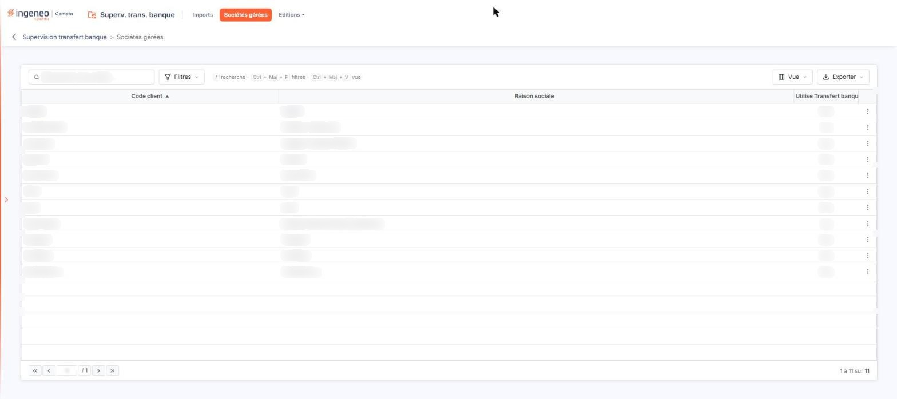
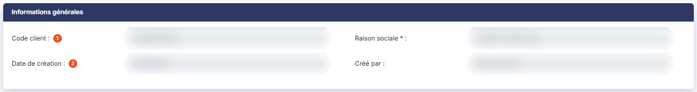
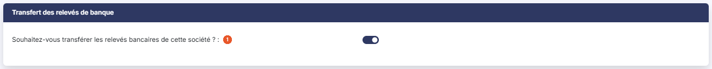
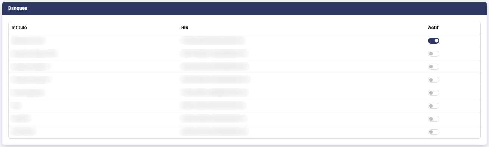

# Sociétés gérées


**Où le trouver :** Menu **Sociétés gérées**



**En bref** — Cet écran vous permet d'indiquer quelles sociétés gérées reçoivent l'export des relevés bancaires et de choisir, pour chacune, les banques dont les relevés sont récupérés.

* Pour activer le transfert d'une société : pictogramme « Crayon » de sa ligne, mettez « Souhaitez-vous transférer les relevés bancaires de cette société ? » à « Oui », puis bouton \[Enregistrer].
* Pour choisir les banques concernées : dans la rubrique « Banques », mettez l'interrupteur Actif à « Oui » ; il s'enregistre dès que vous le basculez.


## La liste des sociétés gérées

<figure><figcaption>
Écran « Sociétés gérées » de la nouvelle interface
</figcaption></figure>

Au-dessus de la grille, vous disposez :

* du champ **Rechercher une société…**, qui restreint la liste à la société dont vous saisissez la raison sociale ;
* du Bouton \[Filtres], qui vous permet de restreindre la liste en posant un ou plusieurs critères sur ses colonnes ;
* du Bouton \[Vue], qui vous permet de choisir les colonnes affichées et d'enregistrer la présentation de la liste ;
* du Bouton \[Exporter], qui propose l'aperçu de la liste affichée, son impression, son export en Excel ou en PDF et son envoi par e-mail.

Cette grille ne propose pas de sélection de lignes.

La grille présente trois colonnes :

**Code client** et **Raison sociale :** ils identifient la société gérée. La liste est triée sur le code client à l'ouverture.

**Utilise Transfert banque** : elle indique, par « Oui » ou par « Non », si le transfert des relevés bancaires a été activé pour cette société gérée.

Lorsque vous survolez une ligne, le pictogramme « Crayon » (infobulle « Modifier »), à droite de la ligne, ouvre la fiche de la société gérée. L'écran ne comporte aucun bouton de bas d'écran.

## Rubrique « Informations générales » de la fiche

<figure><figcaption>
Rubrique « Rubrique « Informations générales » »
</figcaption></figure>

Les quatre champs de cette rubrique rappellent l'identité de la société gérée ; ils sont tous grisés et ne se modifient pas ici.

| Champ                   | Ce qu'il faut savoir                                                                                                                                                                                                    |
| ----------------------- | ----------------------------------------------------------------------------------------------------------------------------------------------------------------------------------------------------------------------- |
| 1. **Code client**      | **Raison sociale \* :** l'identité de la société gérée. La raison sociale porte l'astérisque des champs obligatoires alors qu'elle n'est pas saisissable sur cet écran : elle se modifie depuis la fiche de la société. |
| 2. **Date de création** | **Créé par :** la date à laquelle la société gérée a été créée, et l'utilisateur qui l'a créée.                                                                                                                         |

## Rubrique « Transfert des relevés de banque » de la fiche

<figure><figcaption>
Rubrique « Rubrique « Transfert des relevés de banque » »
</figcaption></figure>

Cette rubrique ne contient qu'un champ :

**Souhaitez-vous transférer les relevés bancaires de cette société ?** : mettez cet interrupteur à « Oui » pour permettre l'export des lignes de relevés bancaires dans cette société gérée. Le logiciel affiche alors la rubrique « Banques » décrite ci-dessous ; tant que l'interrupteur est à « Non », cette rubrique n'apparaît pas et la fiche ne comporte que deux rubriques.

## Rubrique « Banques » de la fiche

<figure><figcaption>
Rubrique « Rubrique « Banques » »
</figcaption></figure>

Cette rubrique n'apparaît que si l'interrupteur de la rubrique précédente est à « Oui ». Elle présente, sous la forme d'un tableau, toutes les banques que le logiciel a détectées dans le dossier annuel en cours de la société gérée. Ce tableau ne se trie pas, ne se filtre pas et ne se pagine pas.

| Champ        | Ce qu'il faut savoir                                                                                    |
| ------------ | ------------------------------------------------------------------------------------------------------- |
| **Intitulé** | Le libellé de la banque, tel qu'il a été saisi dans la société gérée.                                   |
| **RIB**      | Le RIB de la banque, en quatre blocs : code banque, code guichet, numéro de compte et clé.              |
| **Actif**    | Mettez cet interrupteur à « Oui » pour les banques dont vous souhaitez récupérer les relevés bancaires. |

N. B. : pour être affichée dans ce tableau, la banque doit disposer d'un RIB.

L'interrupteur **Actif** d'une ligne s'enregistre **dès que vous le basculez**, sans attendre le bouton \[Enregistrer] : revenir à la liste sans enregistrer ne l'annule pas.

## Bouton \[Enregistrer]

<figure><figcaption>
Bouton [Enregistrer]
</figcaption></figure>

Il enregistre votre réponse à la question « Souhaitez-vous transférer les relevés bancaires de cette société ? ». Les banques que vous avez rendues actives, elles, sont déjà enregistrées.

## Flèche « Revenir en arrière »

La flèche « Revenir en arrière », à gauche du fil d'Ariane, referme la fiche et vous ramène à la liste des sociétés gérées.
