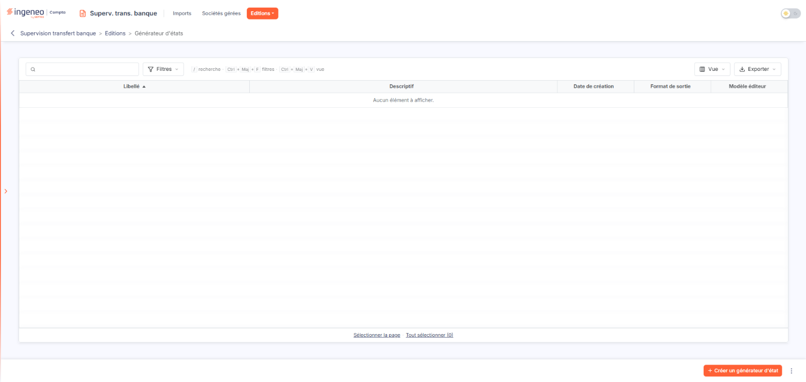
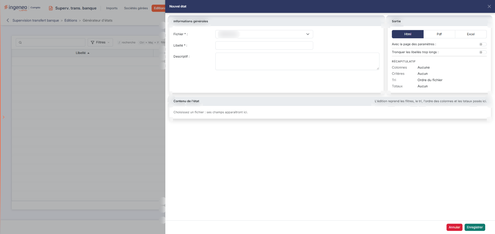

# Générateur d'états


**Où le trouver :** Menu **Editions › Générateur d'états**



**En bref** — Le générateur d'états vous permet de créer vos propres éditions à partir des informations du module, en choisissant colonnes, conditions de sélection et format du document produit.

* Pour créer un état : bouton \[Créer un générateur d'état].
* Pour récupérer les modèles de l'éditeur : menu « ⋮ », puis « Charger les nouveaux modèles ».
* Pour exporter des états : sélectionnez-les, puis menu « ⋮ », commande « Exporter ».


Le générateur d'états vous permet de créer vos propres éditions à partir des informations de ce module : vous choisissez les colonnes qui doivent y figurer, les conditions de sélection des lignes et le format du document produit.

<figure><figcaption>
Écran « Générateur d'états » de la nouvelle interface
</figcaption></figure>

L'écran présente la liste des états déjà créés pour votre cabinet. Tant qu'aucun état n'existe, la liste est vide et le logiciel affiche « Aucun élément à afficher. ».

## La liste des états

Au-dessus de la liste, vous disposez du champ « Rechercher un état… » et des boutons \[Filtres], \[Vue] et \[Exporter]. Les cinq colonnes sont triables : cliquez sur l'en-tête de la colonne pour trier.

* **Libellé** : le nom que vous avez donné à l'état. C'est la colonne de tri initial, par ordre croissant.
* **Descriptif** : le commentaire libre que vous avez pu saisir pour expliquer à quoi sert l'état.
* **Date de création** : la date à laquelle l'état a été créé.
* **Format de sortie** : le format du document produit lorsque l'état est lancé.
* **Modèle éditeur** : indique si l'état est un modèle fourni par l'éditeur du logiciel, ou un état créé par votre cabinet.

Sous la liste, les liens « Sélectionner la page » et « Tout sélectionner » (suivi du nombre d'éléments sélectionnés) permettent de sélectionner les lignes de la page affichée ou celles de toutes les pages.

## Les boutons de la liste

<figure><figcaption>
Bouton [Créer un générateur d'état]
</figcaption></figure>

<figure><figcaption>
Bouton [Créer un générateur d'état]
</figcaption></figure>

bouton **\[Créer un générateur d'état]**

Placé en bas à droite de l'écran, il ouvre à droite le panneau « Nouvel état », qui est la fiche d'un nouvel état.

**Menu « ⋮ »**

Il propose deux commandes : « Charger les nouveaux modèles », qui porte sur les modèles d'états mis à disposition par l'éditeur du logiciel, et « Exporter », qui porte sur les états que vous avez sélectionnés.
