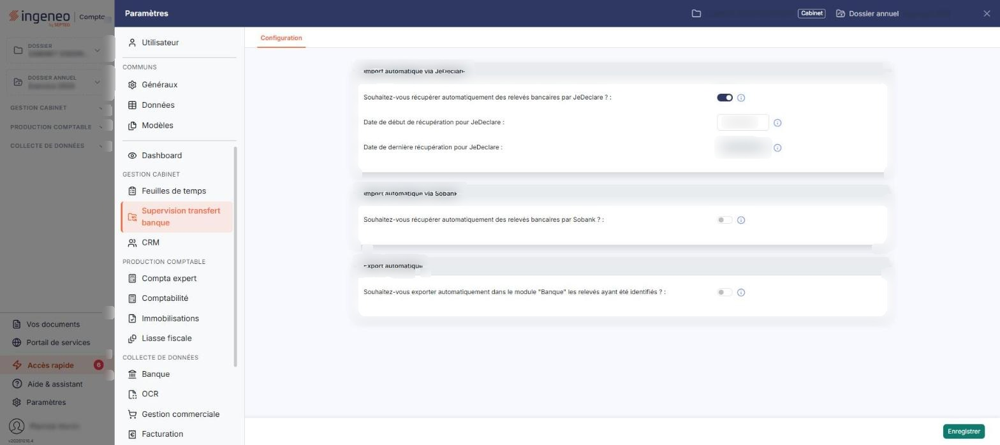
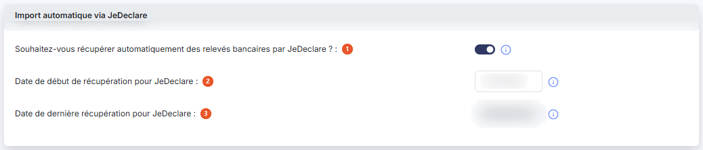
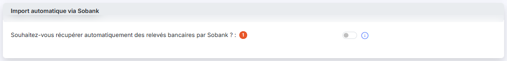
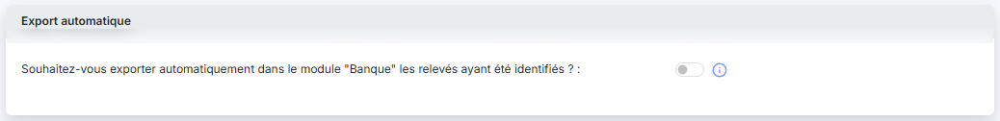

# Configuration


**Où le trouver :** Panneau **Paramètres** › **Supervision transfert banque** › **Configuration**



**En bref** — Cet écran paramètre, pour tout le cabinet, la récupération automatique des relevés auprès de JeDeclare et de Sobank, et leur export automatique vers le module "Banque".

* Pour activer une récupération automatique : mettez l'interrupteur du fournisseur à « Oui », vérifiez la date de début proposée, puis bouton \[Enregistrer].
* Pour exporter automatiquement les relevés identifiés : mettez à « Oui » l'interrupteur de la rubrique « Export automatique », puis bouton \[Enregistrer].


Cette option vous permet de paramétrer, pour l'ensemble de votre cabinet, la façon dont les relevés bancaires entrent dans le module et la façon dont ils en sortent : leur récupération automatique auprès de JeDeclare et de Sobank, et leur export automatique vers le module "Banque".

<figure><figcaption>
Écran « Configuration » de la nouvelle interface
</figcaption></figure>

Cet écran ne figure plus dans la barre de menus du module : il se trouve dans le panneau « Paramètres », que vous ouvrez par l'entrée « Paramètres » en bas de la barre latérale (hors tableau de bord, cette barre est masquée : cliquez sur le bord gauche de l'écran pour l'ouvrir). Choisissez la rubrique « Supervision transfert banque », dans la section « GESTION CABINET » : l'écran s'affiche sous son onglet unique, « Configuration ».

L'écran se présente comme un formulaire unique, en trois rubriques toujours affichées et dans cet ordre : « Import automatique via JeDeclare », « Import automatique via Sobank » et « Export automatique ». Il n'y a ni liste, ni zone de filtre. Chaque champ porte à sa droite le pictogramme d'information du logiciel, qui en rappelle le rôle.

## Rubrique « Import automatique via JeDeclare »

<figure><figcaption>
Rubrique « Rubrique « Import automatique via JeDeclare » »
</figcaption></figure>

| Champ                                                                                 | Ce qu'il faut savoir                                                                                                                                                                                                                                                                                                                         |
| ------------------------------------------------------------------------------------- | -------------------------------------------------------------------------------------------------------------------------------------------------------------------------------------------------------------------------------------------------------------------------------------------------------------------------------------------- |
| 1. **Souhaitez-vous récupérer automatiquement des relevés bancaires par JeDeclare ?** | Mettez cet interrupteur à « Oui » pour que le logiciel aille chercher vos relevés de lui-même. Son infobulle précise : « La récupération des relevés se fait via notre automate nocturne qui se connecte directement à votre compte JeDeclare. Il faut donc au préalable avoir paramétré ce connecteur dans le module "Supervision datas". » |
| 2. **Date de début de récupération pour JeDeclare**                                   | Ce champ n'apparaît que lorsque l'interrupteur est à « Oui ». Il se saisit directement ou dans le calendrier qui s'ouvre lorsque vous cliquez dans le champ. Son infobulle précise : « Date à partir de laquelle les relevés bancaires seront récupérés s'ils sont disponibles auprès de JeDeclare. »                                        |
| 3. **Date de dernière récupération pour JeDeclare**                                   | Ce champ n'est pas modifiable, le logiciel l'inscrit lui-même. Il ne s'affiche que lorsqu'une récupération a déjà eu lieu. Son infobulle précise : « Date de la dernière récupération des relevés bancaires depuis l'automate JeDeclare. »                                                                                                   |

## Rubrique « Import automatique via Sobank »

<figure><figcaption>
Rubrique « Rubrique « Import automatique via Sobank » »
</figcaption></figure>

Cette rubrique fonctionne exactement comme la précédente, pour l'autre fournisseur de relevés.

| Champ                                                                              | Ce qu'il faut savoir                                                                                                                                                                                                                       |
| ---------------------------------------------------------------------------------- | ------------------------------------------------------------------------------------------------------------------------------------------------------------------------------------------------------------------------------------------ |
| 1. **Souhaitez-vous récupérer automatiquement des relevés bancaires par Sobank ?** | Son infobulle précise : « La récupération des relevés se fait via notre automate nocturne qui se connecte directement à votre compte Sobank. Il faut donc au préalable avoir paramétré ce connecteur dans le module "Supervision datas". » |
| **Date de début de récupération pour Sobank**                                      | Ce champ n'apparaît que lorsque l'interrupteur est à « Oui ». Il en va de même de la **Date de dernière récupération pour Sobank**, non modifiable, qui n'est présentée qu'une fois qu'une récupération a eu lieu.                         |

Tant que l'interrupteur est à « Non », la rubrique ne contient rien d'autre que lui : les dates ne sont pas seulement inaccessibles, elles ne sont pas affichées.

Dans les deux rubriques, la récupération n'a lieu que si le connecteur correspondant a bien été créé, et laissé actif, dans le module "Supervision datas" : mettre cet interrupteur à « Oui » sans avoir fait ce préalable n'apporte aucun relevé.

## Rubrique « Export automatique »

<figure><figcaption>
Rubrique « Rubrique « Export automatique » »
</figcaption></figure>

**Souhaitez-vous exporter automatiquement dans le module "Banque" les relevés ayant été identifiés ? :** cette rubrique ne comporte que cet interrupteur. Son infobulle explique ce qu'il faut entendre par « identifiés » : « Lorsqu'un fichier arrive dans le menu imports du module, chacun de ces RIB est analysé pour déterminer à quelle société gérée il est rattaché. Si une correspondance est trouvée, les champs "Code client" et "Raison Sociale" sont renseignés. Il est dès lors possible d'exporter automatiquement les opérations vers le module "Banque". »

Un relevé exporté avec succès vers le module "Banque" est retiré du menu « Imports » : il n'est plus conservé dans ce module. Un export en échec, lui, ne retire rien et sera retenté la nuit suivante.

## Le déploiement des dates

Dans les deux rubriques d'import, le passage de l'interrupteur à « Oui » déplie immédiatement les dates du fournisseur concerné, sans attendre l'enregistrement, et **le logiciel prérenseigne la date de début avec la date du jour**. **Il le fait même si une date plus ancienne y était enregistrée** : celle-ci est alors remplacée à l'écran par la date du jour. Si vous souhaitez remonter plus loin dans le temps, remplacez cette date avant d'enregistrer.

Le retour de l'interrupteur à « Non » referme les dates de la rubrique et efface la date de début qui y était saisie.

## Bouton \[Enregistrer]

<figure><figcaption>
Bouton [Enregistrer]
</figcaption></figure>

C'est le **seul** bouton de cet écran, placé en bas à droite : il n'y a ni bouton d'annulation, ni bouton de retour. Vous quittez cet écran en fermant le panneau par la croix en haut à droite, ou en choisissant une autre rubrique du panneau. Tant que vous n'avez pas cliqué sur \[Enregistrer], rien de ce que vous avez modifié n'est conservé.
