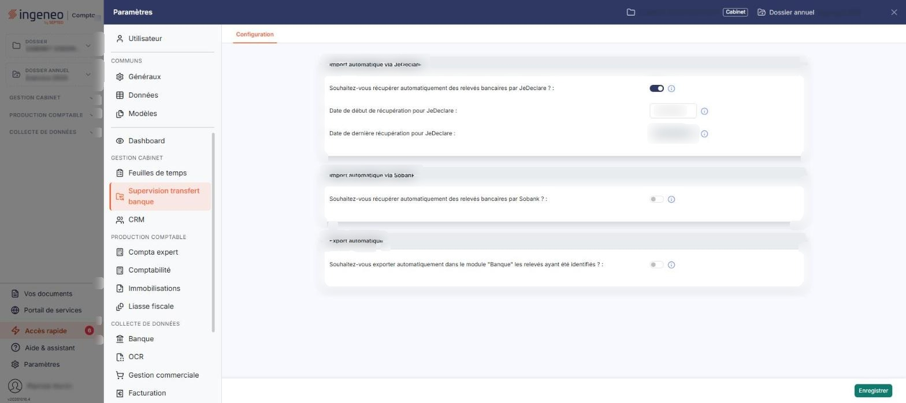
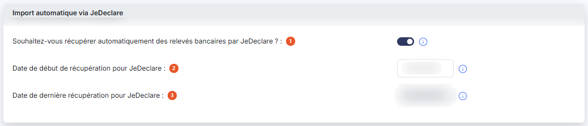
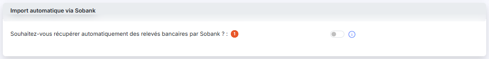
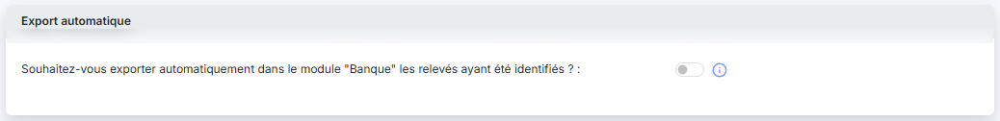

# Configuration — récupération via JeDeclare


**Où le trouver :** Panneau **Paramètres** › **Supervision transfert banque** › **Configuration**



**En bref** — Cette page explique comment faire récupérer automatiquement, chaque nuit, les relevés bancaires de vos clients auprès de JeDeclare, sans les importer vous-même.

* Pour préparer la récupération : créez le connecteur JeDeclare dans le module « Teogest Supervision datas », option « Connecteurs », avec vos codes de connexion.
* Pour l'activer : panneau « Paramètres », rubrique « Supervision transfert banque », onglet « Configuration », mettez la question JeDeclare à « Oui » et indiquez la Date de début de récupération pour JeDeclare.


1. Créez le connecteur JeDeclare dans le module « Teogest Supervision datas », option « Connecteurs », et renseignez-y les codes de connexion qui vous ont été remis pour la plateforme JeDeclare. Le paramétrage d'un connecteur est décrit dans l'aide de ce module.

<figure><figcaption>
Écran « Configuration » de la nouvelle interface
</figcaption></figure>

2. Revenez dans le présent module, ouvrez le panneau « Paramètres », rubrique « Supervision transfert banque », onglet « Configuration », et mettez à « Oui » la question « Souhaitez-vous récupérer automatiquement des relevés bancaires par JeDeclare ? ». Indiquez ensuite la **Date de début de récupération pour JeDeclare :**, c'est-à-dire la date à partir de laquelle les relevés seront récupérés s'ils sont disponibles.

## Autres vues de l'écran

<figure><figcaption>
Rubrique « Import automatique via JeDeclare »
</figcaption></figure>

<figure><figcaption>
Rubrique « Import automatique via Sobank »
</figcaption></figure>

<figure><figcaption>
Rubrique « Export automatique »
</figcaption></figure>
