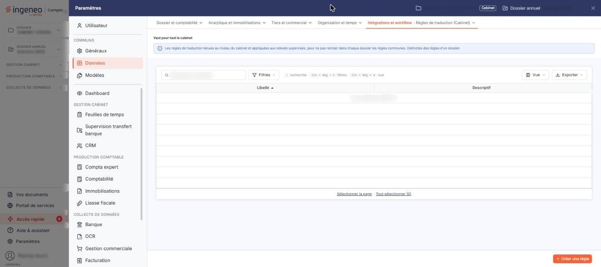
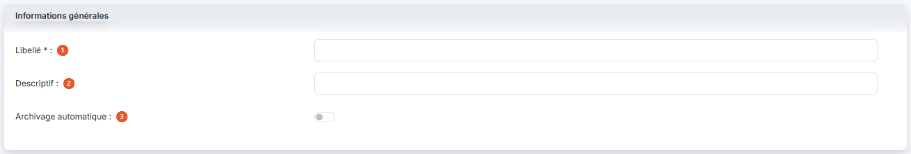
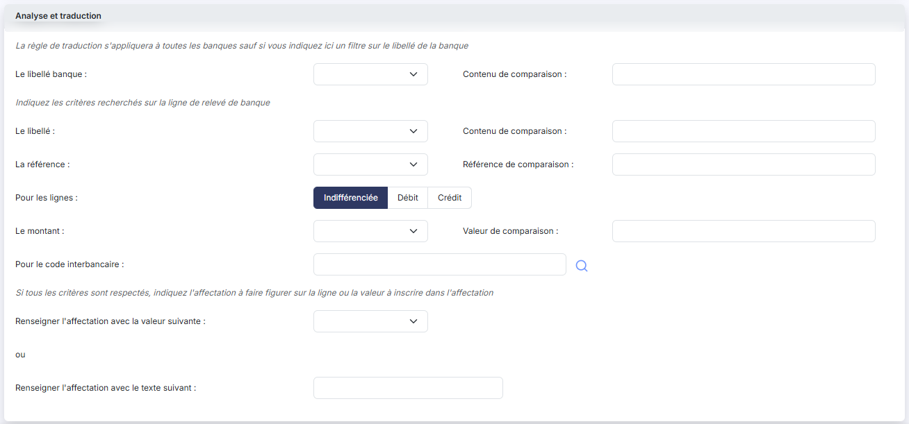

# Règles de traduction


**Où le trouver :** Panneau **Paramètres** › **Données** › **Intégrations et workflow** › **Règles de traduction**



**En bref** — Cet écran tient les règles de traduction communes au cabinet : chacune reconnaît des lignes de relevé bancaire selon vos critères et leur inscrit une affectation.

* Pour créer une règle : bouton \[Nouveau], renseignez le Libellé, au moins un critère et une affectation, puis bouton \[Enregistrer].
* Pour supprimer des règles : cochez-les, puis bouton \[Supprimer].


Cette option vous permet de tenir la liste de vos règles de traduction. Une règle de traduction décrit une ligne de relevé bancaire à reconnaître — par son libellé, sa référence, son montant, son sens ou son code interbancaire — et l'affectation à porter sur les lignes qui répondent à tous ces critères.

<figure><figcaption>
Écran « Règles de traduction » de la nouvelle interface
</figcaption></figure>

L'affectation portée est soit l'un des types d'affectations que vous avez créés dans l'écran « Affectations (Cabinet) », voisin de celui-ci dans le panneau « Paramètres », soit un texte que vous saisissez librement.

Les règles de traduction sont communes à l'ensemble de votre cabinet.

Cet écran ne figure plus dans la barre de menus du module : il se trouve dans le panneau « Paramètres », que vous ouvrez par l'entrée « Paramètres » en bas de la barre latérale (hors tableau de bord, cette barre est masquée : cliquez sur le bord gauche de l'écran pour l'ouvrir). Choisissez la rubrique « Données », puis, dans le menu déroulant « Intégrations et workflow », l'entrée « Règles de traduction (Cabinet) ». Ne la confondez pas avec l'entrée « Règles de traduction », placée juste au-dessus, qui tient les règles d'un dossier. En tête de l'écran, le panneau rappelle « Vaut pour tout le cabinet ».

Ces règles sont appliquées par le logiciel dans le module « Banque » : à l'intégration d'un relevé bancaire, lorsque les écritures comptables sont préparées, et à la demande depuis l'écran des relevés. Elles y sont appliquées en deux temps : d'abord les règles de ce module, communes à votre cabinet, puis celles propres au dossier. Une ligne de relevé ne reçoit qu'une seule règle, même lorsque plusieurs la reconnaissent : une fois traduite, elle n'est plus modifiée par les autres.

## La liste des règles de traduction

L'écran s'ouvre sur la liste de vos règles. Il n'y a ni zone de filtre au-dessus de la liste, ni onglet. Les deux colonnes sont triables : cliquez sur l'en-tête de la colonne pour trier.

* **Libellé** : le nom que vous avez donné à la règle. C'est la colonne de tri initial, par ordre croissant.
* **Descriptif** : le commentaire que vous avez pu saisir pour expliquer à quoi sert la règle.

Ces deux colonnes sont les seules : la liste ne présente ni les critères de la règle, ni l'affectation qu'elle produit, ni la banque à laquelle elle s'applique. Il est donc préférable de renseigner le **Descriptif** de vos règles, faute de quoi vous devrez ouvrir chacune d'elles pour savoir ce qu'elle fait.

L'en-tête de la première colonne comporte une case qui sélectionne toutes les lignes de la page affichée et une case qui étend la sélection à toutes les pages de la liste — son infobulle vous indique le nombre d'éléments sélectionnés, « Aucun élément sélectionné. » tant que vous n'avez rien coché. Le pictogramme « Roue crantée », qui ouvre la personnalisation des colonnes, est placé juste au-dessus de la liste, à gauche.

Tant qu'aucune règle n'a été créée, la liste est vide et le logiciel affiche « Aucun élément à afficher. ».

## Les boutons de la liste

<figure><figcaption>
Bouton [Nouveau]
</figcaption></figure>

bouton **\[Nouveau]**

Vous ouvrez la fiche de création d'une nouvelle règle de traduction.

bouton **\[Supprimer]**

Vous supprimez en une fois toutes les règles dont vous avez coché la case. Ce bouton reste proposé même lorsque la liste est vide et qu'aucune ligne n'est cochée.

## La fiche d'une règle — rubrique « Informations générales »

<figure><figcaption>
Rubrique « rubrique « Informations générales » »
</figcaption></figure>

| Champ                                                      | Ce qu'il faut savoir                                                                                                                                                                                                              |
| ---------------------------------------------------------- | --------------------------------------------------------------------------------------------------------------------------------------------------------------------------------------------------------------------------------- |
| 
1. <strong>Libellé</strong> <em>Obligatoire</em>
 | Champ obligatoire, de 30 caractères au maximum, et qui doit être différent de celui de vos autres règles : si vous reprenez un libellé existant, le logiciel refuse l'enregistrement et affiche « Ce libellé est déjà utilisé. ». |
| 2. **Descriptif**                                          | Commentaire libre, sur une seule ligne, de 30 caractères au maximum.                                                                                                                                                              |
| 3. **Archivage automatique**                               | Interrupteur proposé à « Non ».                                                                                                                                                                                                   |

## La fiche d'une règle — rubrique « Analyse et traduction »

<figure><figcaption>
Rubrique « rubrique « Analyse et traduction » »
</figcaption></figure>

C'est ici que vous décrivez la règle. La rubrique se lit en trois temps, annoncés par trois phrases : à quelles banques la règle s'applique, ce qu'elle doit reconnaître sur la ligne de relevé, et ce qu'elle inscrit.

## « La règle de traduction s'appliquera à toutes les banques sauf si vous indiquez ici un filtre sur le libellé de la banque »

**Le libellé banque** : choisissez un opérateur — « Contient », « Commence par » ou « Finit par » — et saisissez à droite, dans le **Contenu de comparaison**, le texte recherché, sur 50 caractères au maximum. Laissez ces deux zones vides pour que la règle s'applique à toutes les banques.

L'opérateur et le contenu vont ensemble : le logiciel refuse l'enregistrement si vous ne renseignez que l'un des deux.

## « Indiquez les critères recherchés sur la ligne de relevé de banque »

| Champ                          | Ce qu'il faut savoir                                                                                                                                                                                                                                                         |
| ------------------------------ | ---------------------------------------------------------------------------------------------------------------------------------------------------------------------------------------------------------------------------------------------------------------------------- |
| **Le libellé**                 | Le même jeu d'opérateurs — « Contient », « Commence par », « Finit par » — et son **Contenu de comparaison** à droite, sur 50 caractères au maximum.                                                                                                                         |
| **La référence**               | Les mêmes opérateurs, et sa **Référence de comparaison** à droite, sur 50 caractères au maximum.                                                                                                                                                                             |
| **Pour les lignes**            | Trois boutons — « Indifférenciée », proposé par défaut, « Débit » et « Crédit » — pour ne retenir que les lignes d'un seul sens.                                                                                                                                             |
| **Le montant**                 | Un opérateur de comparaison numérique — « Egal = », « Inférieur ou égal <= », « Supérieur ou égal >= », « Strictement inférieur < » ou « Strictement supérieur > » — et sa **Valeur de comparaison** à droite. Là encore, l'opérateur et la valeur vont ensemble.            |
| **Pour le code interbancaire** | Saisissez le code recherché ; le logiciel vous propose les codes existants au fil de la frappe, et le pictogramme « Loupe » placé à sa droite ouvre une fenêtre de recherche. Un code qui n'existe pas est refusé, avec le message « Le code interbancaire est incorrect. ». |

**Une règle doit porter au moins un de ces cinq critères** — libellé, référence, sens autre qu'« Indifférenciée », montant ou code interbancaire — sans quoi le logiciel refuse de l'enregistrer et affiche « Il faut définir au moins un critère. ». Le filtre sur le libellé de la banque, lui, ne compte pas comme critère : une règle qui ne porterait que ce filtre est refusée.

Les critères se cumulent : une ligne de relevé n'est reconnue que si elle les respecte tous.

## « Si tous les critères sont respectés, indiquez l'affectation à faire figurer sur la ligne ou la valeur à inscrire dans l'affectation »

| Champ                                                | Ce qu'il faut savoir                                                                                                                                                                                                                                                                          |
| ---------------------------------------------------- | --------------------------------------------------------------------------------------------------------------------------------------------------------------------------------------------------------------------------------------------------------------------------------------------- |
| **Renseigner l'affectation avec la valeur suivante** | 
Choisissez dans cette liste l'un des types d'affectations créés dans l'écran « Affectations (Cabinet) » du panneau « Paramètres ». Ils y sont proposés par ordre alphabétique, précédés d'un choix vide. Le mot <strong>ou</strong>, seul sur sa ligne, sépare ce choix du suivant.
 |
| **Renseigner l'affectation avec le texte suivant**   | Saisissez ici le texte de votre choix, sur 50 caractères au maximum, plutôt que de désigner un type d'affectation.                                                                                                                                                                            |

**Ces deux zones s'excluent, et l'une des deux doit être renseignée.** Si vous les renseignez toutes les deux, le logiciel affiche « Vous ne pouvez renseigner qu'un seul type d'affectation. » ; si vous n'en renseignez aucune, il affiche « Vous devez renseigner une affectation. ».

bouton **\[Enregistrer]**

Placé en bas à droite, il enregistre la règle et vous ramène à la liste.

**Pictogramme « Retour »**

Placé à gauche de la barre d'onglets du panneau, il vous ramène à la liste sans enregistrer.
