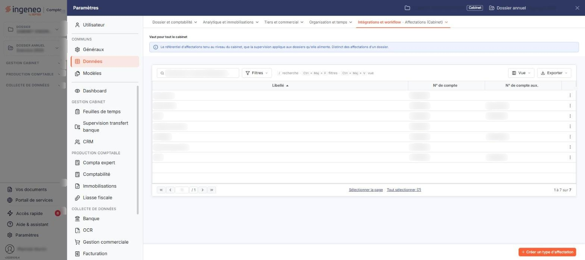
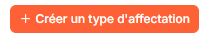
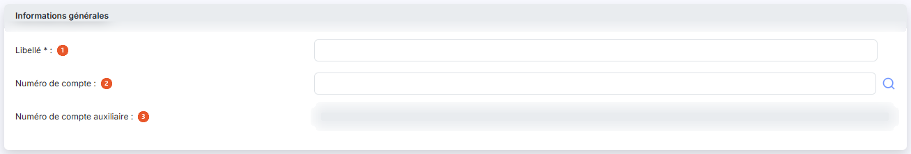

# Types d'affectations


**Où le trouver :** Panneau **Paramètres**



**En bref** — Cet écran tient les types d'affectations du cabinet : des libellés associés à un compte comptable, proposés ensuite dans les règles de traduction.

* Pour créer un type : bouton \[Nouveau], saisissez le Libellé et le Numéro de compte, puis bouton \[Enregistrer].
* Pour supprimer des types : cochez-les, puis bouton \[Supprimer].


Cette option vous permet de tenir la liste de vos types d'affectations. Un type d'affectation est un libellé de votre choix — « EDF », « Assurance », « Intérêts bancaires » — auquel vous associez un compte comptable. Ces types sont ensuite proposés dans l'écran « Règles de traduction (Cabinet) », voisin de celui-ci dans le panneau « Paramètres » : c'est le type d'affectation qu'une règle vient inscrire sur les lignes de relevé qu'elle reconnaît.

<figure><figcaption>
Écran « Types d'affectations » de la nouvelle interface
</figcaption></figure>

Le compte que vous associez au type sert de **compte de contrepartie** lorsque les écritures sont générées dans le module "Banque" : une ligne de relevé reconnue par une règle qui porte ce type est passée sur ce compte — et sur son compte auxiliaire s'il est renseigné — au lieu du compte d'attente de la banque.

Les types d'affectations sont communs à l'ensemble de votre cabinet.

Cet écran ne figure plus dans la barre de menus du module : il se trouve dans le panneau « Paramètres », que vous ouvrez par l'entrée « Paramètres » en bas de la barre latérale (hors tableau de bord, cette barre est masquée : cliquez sur le bord gauche de l'écran pour l'ouvrir). Choisissez la rubrique « Données », puis, dans le menu déroulant « Intégrations et workflow », l'entrée « Affectations (Cabinet) ». Ne la confondez pas avec l'entrée « Affectations », placée juste au-dessus, qui tient les affectations d'un dossier. En tête de l'écran, le panneau rappelle « Vaut pour tout le cabinet ».

## La liste des types d'affectations

L'écran s'ouvre sur la liste de vos types d'affectations. Il n'y a ni zone de filtre au-dessus de la liste, ni onglet. Les trois colonnes sont triables : cliquez sur l'en-tête de la colonne pour trier.

* **Libellé** : le nom que vous avez donné au type d'affectation. C'est la colonne de tri initial, par ordre croissant.
* **N° de compte** : le compte général que vous avez rattaché au type.
* **N° de compte aux.** : le compte auxiliaire, lorsque le compte général est un compte collectif. Cette colonne reste vide pour les types rattachés à un compte qui ne l'est pas.

L'en-tête de la première colonne comporte une case qui sélectionne toutes les lignes de la page affichée et une case qui étend la sélection à toutes les pages de la liste — son infobulle vous indique le nombre d'éléments sélectionnés, « Aucun élément sélectionné. » tant que vous n'avez rien coché. Le pictogramme « Roue crantée », qui ouvre la personnalisation des colonnes, est placé juste au-dessus de la liste, à gauche. Ce pictogramme ne porte pas d'infobulle.

Chaque ligne porte, à gauche, sa case de sélection — dont l'infobulle indique « Sélectionner » — et, à droite, deux pictogrammes : le pictogramme « Crayon », dont l'infobulle indique « Modifier », ouvre la fiche du type d'affectation, et le pictogramme « Supprimer » le supprime.

Sous la liste, le logiciel rappelle à droite les lignes affichées et leur nombre total, ainsi « 1 à N sur N ». À gauche, les commandes de page se suivent dans cet ordre : un pictogramme qui ramène à la première page, un pictogramme qui recule d'une page, la zone de saisie du numéro de la page affichée suivie du nombre total de pages (ainsi « / N »), un pictogramme qui avance d'une page, puis un pictogramme qui mène à la dernière page.

## Les boutons de la liste

<figure><figcaption>
Bouton [Nouveau]
</figcaption></figure>

bouton **\[Nouveau]**

Vous ouvrez la fiche de création d'un nouveau type d'affectation.

bouton **\[Supprimer]**

Vous supprimez en une fois tous les types d'affectations dont vous avez coché la case.

## La fiche d'un type d'affectation

<figure><figcaption>
Rubrique « La fiche d'un type d'affectation »
</figcaption></figure>

La création et la modification se font sur la même fiche, qui ne comporte qu'une rubrique, « Informations générales », et trois champs toujours affichés.

| Champ                                                      | Ce qu'il faut savoir                                                                                                                                                                                                                                                                                                                                                                                                                                                                                                              |
| ---------------------------------------------------------- | --------------------------------------------------------------------------------------------------------------------------------------------------------------------------------------------------------------------------------------------------------------------------------------------------------------------------------------------------------------------------------------------------------------------------------------------------------------------------------------------------------------------------------- |
| 
1. <strong>Libellé</strong> <em>Obligatoire</em>
 | Champ obligatoire, de 50 caractères au maximum, et qui doit être différent de celui de tous vos autres types d'affectations : si vous reprenez un libellé existant, le logiciel refuse l'enregistrement et affiche « Ce libellé est déjà utilisé. ». C'est le nom sous lequel le type est proposé partout ailleurs dans le module. **Il ne se modifie plus une fois le type créé :** sur la fiche d'un type existant, le champ est grisé. Choisissez donc son libellé avec soin ; pour en changer, il faut créer un nouveau type. |
| 2. **Numéro de compte**                                    | Le compte général à rattacher au type, sur 12 caractères au maximum et en chiffres uniquement. Saisissez-le directement, ou cliquez sur le pictogramme « Loupe » placé à sa droite pour le rechercher dans le plan comptable.                                                                                                                                                                                                                                                                                                     |
| 3. **Numéro de compte auxiliaire**                         | Le compte auxiliaire, sur 12 caractères au maximum, à rechercher lui aussi par son pictogramme « Loupe ». **Ce champ ne s'ouvre que si le compte général saisi au-dessus est un compte collectif** : tant que ce n'est pas le cas — et c'est notamment la situation à la création, où aucun compte n'est encore saisi — il reste inactif et sa loupe n'est pas proposée. Si vous remplacez un compte collectif par un compte qui ne l'est pas, le logiciel vide le compte auxiliaire.                                             |

bouton **\[Enregistrer]**

Placé en bas à droite, il enregistre le type d'affectation et vous ramène à la liste.

**Pictogramme « Retour »**

Placé à gauche de la barre d'onglets du panneau, il vous ramène à la liste sans enregistrer.
