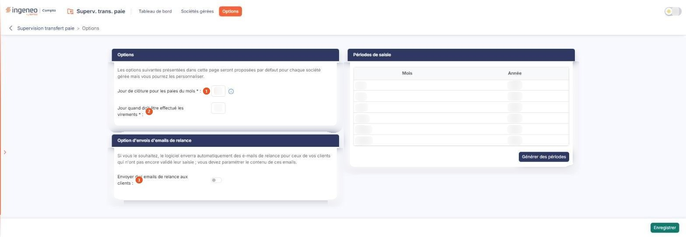
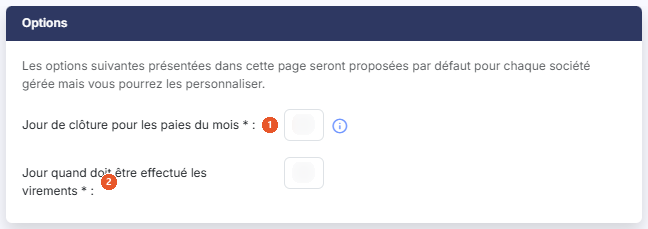
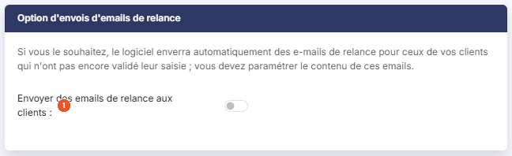
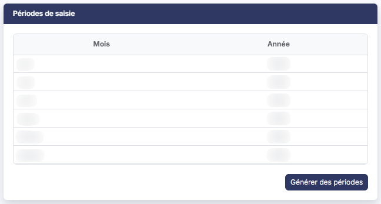
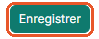

# Options


**Où le trouver :** Menu **Options**



**En bref** — Cet écran permet de paramétrer, pour l'ensemble de votre cabinet, la clôture des paies du mois et les e-mails de relance destinés à vos clients, ainsi que de créer les périodes de saisie.

* Pour fixer la clôture des paies : renseignez « Jour de clôture pour les paies du mois » (31 pour gérer les éléments de paie au mois le mois) et « Jour quand doit être effectué les virements », puis bouton \[Enregistrer].
* Pour relancer automatiquement vos clients : activez « Envoyer des emails de relance aux clients », renseignez l'expéditeur, le jour et le contenu du premier e-mail, puis bouton \[Enregistrer].
* Pour créer plusieurs périodes de saisie d'un coup : bouton \[Générer des périodes], choisissez la fourchette de mois et d'années, puis bouton \[Générer les périodes].


## Rubrique « Options »

<figure><figcaption>
Écran « Options » de la nouvelle interface
</figcaption></figure>

<figure><figcaption>
Rubrique « Rubrique « Options » »
</figcaption></figure>

Ses deux champs sont obligatoires.

| Champ                                              | Ce qu'il faut savoir                                                                                                    |
| -------------------------------------------------- | ----------------------------------------------------------------------------------------------------------------------- |
| 1. **Jour de clôture pour les paies du mois**      | Le pictogramme d'information placé à sa droite précise « Indiquez 31 pour gérer les éléments de paie au mois le mois. » |
| 2. **Jour quand doit être effectué les virements** | Ce champ ne porte aucune infobulle.                                                                                     |

## Rubrique « Option d'envois d'emails de relance »

<figure><figcaption>
Rubrique « Rubrique « Option d'envois d'emails de relance » »
</figcaption></figure>

Elle s'ouvre sur la phrase « Si vous le souhaitez, le logiciel enverra automatiquement des e-mails de relance pour ceux de vos clients qui n'ont pas encore validé leur saisie ; vous devez paramétrer le contenu de ces emails. »

| Champ                                            | Ce qu'il faut savoir                                                                                                                     |
| ------------------------------------------------ | ---------------------------------------------------------------------------------------------------------------------------------------- |
| 1. **Envoyer des emails de relance aux clients** | Tant que cet interrupteur est désactivé, la rubrique ne contient rien d'autre que lui. Activez-le : sept champs apparaissent au-dessous. |
| **Expéditeur email**                             | Champ obligatoire.                                                                                                                       |
| **Jour d'envoi du premier email de relance**     | Champ obligatoire.                                                                                                                       |

**Objet du premier email de relance** et **Texte du premier email de relance :** champs obligatoires. Le logiciel vous propose un objet et un corps de message que vous pouvez remplacer entièrement.

**Jour d'envoi du second email de relance**, **Objet du second email de relance** et **Texte du second email de relance :** ces trois champs concernent une seconde relance et sont facultatifs. Le logiciel vous propose là aussi un objet et un corps de message.

Aucun de ces champs ne porte d'infobulle, et l'interrupteur non plus.

**Cette rubrique ne comporte pas de destinataire.** Les adresses auxquelles les relances doivent parvenir se saisissent société gérée par société gérée, dans les champs **Premier destinataire de l'email** et **Second destinataire de l'email** de l'option « Sociétés gérées » du module ; le premier y est obligatoire. Renseignez donc bien **Expéditeur email** ici — il est recopié tel quel dans les fiches, y compris vide — et les destinataires dans chaque fiche.

## Rubrique « Périodes de saisie »

<figure><figcaption>
Rubrique « Rubrique « Périodes de saisie » »
</figcaption></figure>

Cette rubrique, placée à droite de l'écran, présente, du plus récent au plus ancien, les périodes de saisie existantes, sous la forme d'un petit tableau à deux colonnes, **Mois** et **Année**. Ce tableau est un simple affichage : ses colonnes ne se trient pas, ses lignes ne portent aucune commande, et il n'a ni pagination ni possibilité d'impression.

## Bouton \[Générer des périodes]

<figure><figcaption>
Bouton [Générer des périodes]
</figcaption></figure>

Placé sous le tableau, à droite.

## Bouton \[Enregistrer]

<figure><figcaption>
Bouton [Enregistrer]
</figcaption></figure>

C'est le seul bouton de la barre du bas de l'écran, à droite. Il enregistre le paramétrage des deux premières rubriques.
