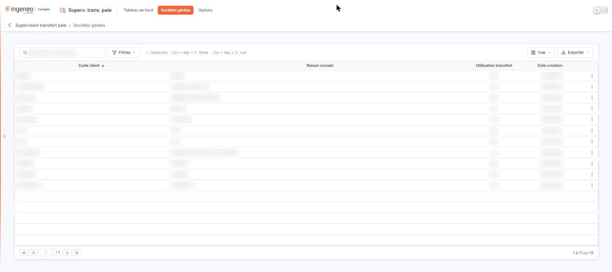
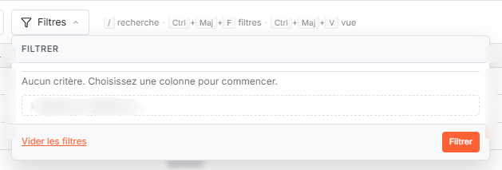
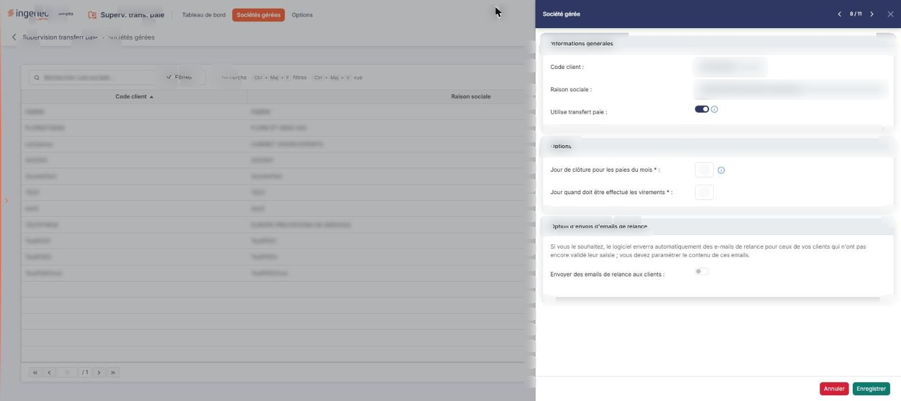
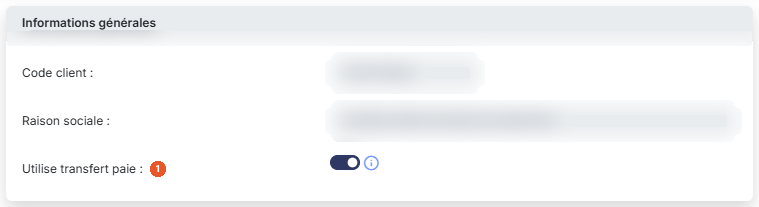
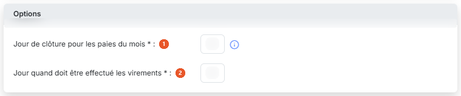
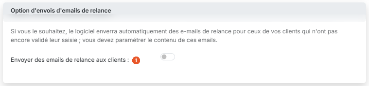

# Sociétés gérées


**Où le trouver :** Menu **Sociétés gérées**



**En bref** — Cet écran permet d'indiquer quelles sociétés gérées utilisent le transfert des éléments de paie et de paramétrer, pour chacune, la clôture des paies du mois et les e-mails de relance adressés à vos clients.

* Pour activer le transfert paie d'une société : menu « Autres actions » de sa ligne, « Modifier », activez « Utilise transfert paie », puis bouton \[Enregistrer].
* Pour paramétrer les relances d'une société : activez « Envoyer des emails de relance aux clients », saisissez le premier destinataire de l'email, puis bouton \[Enregistrer].
* Pour retrouver une société : champ « Rechercher une société… », ou bouton \[Filtres].


## La liste des sociétés gérées

<figure><figcaption>
Écran « Sociétés gérées » de la nouvelle interface
</figcaption></figure>

<figure><figcaption>
Boutons [Filtres], [Vue] et [Exporter]
</figcaption></figure>

La grille présente toutes les sociétés gérées de votre cabinet, y compris la société du cabinet lui-même, triées par ordre croissant de code client. Elle comporte quatre colonnes, toutes triables par un clic sur leur en-tête :

**Code client** et **Raison sociale :** ils proviennent de la fiche de la société gérée et ne se modifient pas ici.

| Champ                                         | Ce qu'il faut savoir                                                                                                                                                                                                                                                                                                                                                                                        |
| --------------------------------------------- | ----------------------------------------------------------------------------------------------------------------------------------------------------------------------------------------------------------------------------------------------------------------------------------------------------------------------------------------------------------------------------------------------------------- |
| **Utilisation transfert paie**                | « Oui » ou « Non », selon que la société utilise ou non le transfert des éléments de paie. Cette valeur est affichée en texte simple, sans pastille ni couleur particulière : un « Oui » ne se distingue d'un « Non » que par le mot lui-même. À la largeur d'affichage par défaut, l'en-tête de cette colonne est tronqué.                                                                                 |
| **Date création**                             | 
Date de création de la société gérée. Chaque ligne porte à droite un pictogramme « Trois points », dont l'infobulle indique « Autres actions » : son menu ne propose qu'une seule entrée, « Modifier », qui ouvre la fiche de la société gérée. C'est la seule commande de ligne, et il n'y a ni case à cocher de sélection, ni commande de suppression. Le bas de l'écran ne porte aucun bouton.
 |
| **Rechercher une société…**                   | Cette zone de saisie, placée au-dessus de la grille et précédée d'une loupe, sert à retrouver une société gérée dans la liste.                                                                                                                                                                                                                                                                              |
| **Boutons \[Filtres], \[Vue] et \[Exporter]** | Ils suivent la zone de recherche, sur la même ligne. Le bouton \[Filtres] ouvre un menu où l'on ajoute un critère sur une colonne (« + Ajouter un critère sur… »), avec les boutons \[Vider les filtres] et \[Filtrer] ; le bouton \[Vue] et le bouton \[Exporter] ouvrent chacun un menu.                                                                                                                  |

Le pied de grille permet de circuler d'une page à l'autre et indique le nombre de sociétés affichées sur le nombre total. Le fonctionnement général d'une grille — tri, largeur et choix des colonnes par le bouton \[Vue], pagination — est décrit dans le chapitre « Généralités » en tête de la présente aide.

## La fiche d'une société gérée

<figure><figcaption>
Rubrique « La fiche d'une société gérée »
</figcaption></figure>

La fiche s'ouvre à droite de la liste, dans un panneau intitulé « Société gérée », sans quitter la liste. En tête du panneau, les flèches « Société précédente » et « Société suivante », accompagnées d'un compteur du type « 8 / 11 », permettent de passer à la société voisine de la liste ; la croix « Fermer » referme le panneau.

La fiche peut comporter jusqu'à trois rubriques, mais elle ne les présente pas toutes d'emblée : **elle se déploie en deux temps**.

À l'ouverture d'une société qui n'utilise pas le transfert paie, la fiche ne montre que la rubrique « Informations générales », soit deux zones non saisissables et un interrupteur. Rien à l'écran n'annonce ce qui suit.

* activez l'interrupteur **Utilise transfert paie** : les rubriques « Options » et « Option d'envois d'emails de relance » apparaissent, cette dernière réduite à son texte d'introduction et à un interrupteur ;
* activez ensuite l'interrupteur **Envoyer des emails de relance aux clients** : les neuf champs de paramétrage des deux e-mails apparaissent à leur tour, sous cet interrupteur.

Vous passez ainsi d'un seul champ saisissable à quatre, puis à treize. Les deux interrupteurs fonctionnent dans les deux sens : désactivés de nouveau, ils masquent de nouveau ce qu'ils avaient fait apparaître.

**Attention : ces deux interrupteurs ne font pas que montrer ou masquer des champs, ils en modifient le contenu.**

* lorsque vous activez **Utilise transfert paie**, le logiciel recopie dans la fiche les deux jours et l'état de l'envoi des relances tels qu'ils sont paramétrés dans l'option « Options » du module ; désactivé de nouveau, il efface les deux jours et ramène l'interrupteur des relances à l'état désactivé ;
* lorsque vous activez **Envoyer des emails de relance aux clients**, le logiciel recopie de la même façon le paramétrage des deux e-mails ; désactivé de nouveau, il **efface les neuf champs** de la rubrique, sans vous demander de confirmation.

L'option « Options » du module ne fournit donc pas des valeurs dont la fiche hériterait en permanence : elle fournit des valeurs de départ, recopiées au moment où vous activez, et que vous pouvez ensuite modifier pour cette seule société gérée. Si vous avez saisi vos adresses et rédigé vos deux e-mails, ne désactivez pas l'interrupteur des relances : votre saisie serait perdue.

## Rubrique « Informations générales »

<figure><figcaption>
Rubrique « Rubrique « Informations générales » »
</figcaption></figure>

**Code client** et **Raison sociale :** ces deux zones sont affichées en grisé et ne sont pas saisissables. Elles proviennent de la fiche de la société gérée, qui se modifie dans le module « Administration ».

**Utilise transfert paie** : activez cet interrupteur pour que la société gérée utilise le transfert des éléments de paie. C'est lui qui la fait entrer dans le suivi du « Tableau de bord » et qui déploie le reste de la fiche. Le pictogramme d'information placé à sa droite affiche « Cette société utilise le transfert des éléments de paie. » ; ce texte décrit l'effet de l'activation, il ne décrit pas l'état affiché.

## Rubrique « Options »

<figure><figcaption>
Rubrique « Rubrique « Options » »
</figcaption></figure>

Cette rubrique n'apparaît que lorsque **Utilise transfert paie** est activé. Ses deux champs sont obligatoires.

| Champ                                              | Ce qu'il faut savoir                                                                                                    |
| -------------------------------------------------- | ----------------------------------------------------------------------------------------------------------------------- |
| 1. **Jour de clôture pour les paies du mois**      | Le pictogramme d'information placé à sa droite précise « Indiquez 31 pour gérer les éléments de paie au mois le mois. » |
| 2. **Jour quand doit être effectué les virements** | Ce champ ne porte aucune infobulle.                                                                                     |

## Rubrique « Option d'envois d'emails de relance »

<figure><figcaption>
Rubrique « Rubrique « Option d'envois d'emails de relance » »
</figcaption></figure>

Cette rubrique n'apparaît elle aussi que lorsque **Utilise transfert paie** est activé. Elle s'ouvre sur la phrase « Si vous le souhaitez, le logiciel enverra automatiquement des e-mails de relance pour ceux de vos clients qui n'ont pas encore validé leur saisie ; vous devez paramétrer le contenu de ces emails. »

| Champ                                            | Ce qu'il faut savoir                                                                                                     |
| ------------------------------------------------ | ------------------------------------------------------------------------------------------------------------------------ |
| 1. **Envoyer des emails de relance aux clients** | Activez cet interrupteur pour faire apparaître, et paramétrer, le contenu des deux e-mails de relance.                   |
| **Expéditeur email**                             | Champ obligatoire. C'est l'adresse au nom de laquelle les relances sont adressées.                                       |
| **Premier destinataire de l'email**              | Champ obligatoire. C'est l'adresse de la personne, chez votre client, à qui la relance doit parvenir.                    |
| **Second destinataire de l'email**               | Il permet d'adresser la même relance à une seconde personne chez votre client, par exemple au comptable et au dirigeant. |
| **Jour d'envoi du premier email de relance**     | Champ obligatoire.                                                                                                       |

**Objet du premier email de relance** et **Texte du premier email de relance :** champs obligatoires. Ils vous sont proposés préremplis d'un objet et d'un corps de message que vous pouvez remplacer entièrement.

**Jour d'envoi du second email de relance**, **Objet du second email de relance** et **Texte du second email de relance :** ces trois champs concernent une seconde relance et sont facultatifs. Ils vous sont eux aussi proposés préremplis.

Aucun de ces champs ne porte d'infobulle.

**Attention aux deux adresses obligatoires.** Le champ **Premier destinataire de l'email** ne figure pas dans le paramétrage de l'option « Options » du module : il n'est donc jamais prérempli, et vous devez le saisir société gérée par société gérée. Une société gérée peut utiliser le transfert paie avec ces deux adresses vides, alors qu'elles portent l'une et l'autre une marque d'obligation : vérifiez-les avant de compter sur l'envoi des relances.

## Bouton \[Enregistrer]

<figure><figcaption>
Bouton [Enregistrer]
</figcaption></figure>

Il enregistre le paramétrage de la société gérée affichée.

## Bouton \[Annuler]

<figure><figcaption>
Bouton [Annuler]
</figcaption></figure>

Placé à gauche de \[Enregistrer], en bas du panneau, il referme la fiche et ramène à la liste des sociétés gérées, comme la croix « Fermer ». C'est une simple fermeture : ce que vous avez saisi sans l'avoir enregistré est abandonné.
