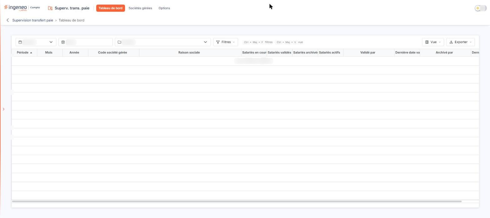
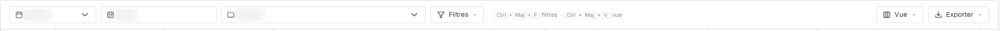
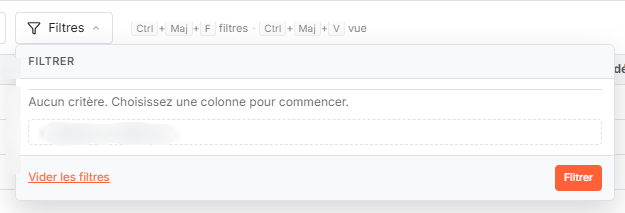
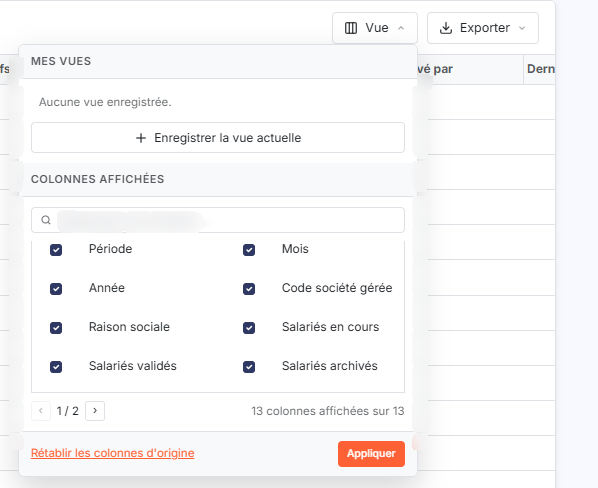
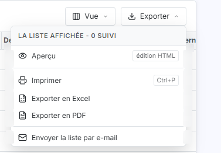

# Tableau de bord


**Où le trouver :** Menu **Tableau de bord**



**En bref** — Cet écran permet de suivre, mois par mois, l'avancement de la saisie des éléments de paie de vos sociétés gérées : salariés validés, archivés et traces de validation.

* Pour afficher un suivi à jour : bouton \[Mettre à jour], placé en bas de l'écran.
* Pour cibler un mois, une année ou une société : renseignez les champs Mois, Année et Société de la barre de filtres.
* Pour sortir le suivi : bouton \[Exporter], puis « Exporter en Excel » ou « Exporter en PDF ».


## La barre de filtres

<figure><figcaption>
Écran « Tableau de bord » de la nouvelle interface
</figcaption></figure>

<figure><figcaption>
Rubrique « La barre de filtres »
</figcaption></figure>

Elle est placée au-dessus de la grille et comporte trois champs ; les boutons \[Filtres], \[Vue] et \[Exporter], décrits plus bas, se trouvent à sa suite.

| Champ       | Ce qu'il faut savoir                                                                                                                                                                          |
| ----------- | --------------------------------------------------------------------------------------------------------------------------------------------------------------------------------------------- |
| **Mois**    | La liste propose les douze mois de l'année et s'ouvre sur le mois en cours. Sa première ligne est vide.                                                                                       |
| **Année**   | Zone de saisie, préremplie avec l'année en cours. Vous pouvez la vider pour ne pas filtrer sur l'année.                                                                                       |
| **Société** | La liste s'ouvre sur son intitulé « Société », sans société retenue, et propose les sociétés gérées qui utilisent le transfert paie, sous la forme du code client suivi de la raison sociale. |

## Bouton \[Filtres]

<figure><figcaption>
Bouton [Filtres]
</figcaption></figure>

Placé à droite des trois champs, il ouvre sous lui un petit menu intitulé « Filtrer » : le message « Aucun critère. Choisissez une colonne pour commencer. », la liste « + Ajouter un critère sur… » qui permet de poser un critère sur une colonne de la grille, puis, en bas du menu, les boutons \[Vider les filtres] et \[Filtrer]. Le bouton \[Filtrer] n'est donc plus dans la barre : il est dans ce menu.

## Boutons \[Vue] et \[Exporter]

<figure><figcaption>
Boutons [Vue] et [Exporter]
</figcaption></figure>

<figure><figcaption>
Boutons [Vue] et [Exporter]
</figcaption></figure>

Ils sont placés à l'extrême droite de la barre. Le bouton \[Vue] ouvre un menu qui permet d'enregistrer la vue actuelle, de la supprimer et de rétablir les colonnes d'origine. Le bouton \[Exporter] ouvre un menu qui propose « Aperçu édition HTML », « Imprimer », « Exporter en Excel », « Exporter en PDF » et « Envoyer la liste par e-mail », avec le choix de l'orientation (Portrait ou Paysage) et de la largeur (Ajustée ou Fixe), puis le bouton \[Lancer l'édition].

## La grille de suivi

Chaque ligne de la grille correspond à une période de saisie d'une société gérée. Les colonnes se répartissent en quatre groupes, dans cet ordre :

* la période concernée : « Période », « Mois » et « Année » ;
* la société gérée : « Code société gérée » et « Raison sociale » ;
* quatre décomptes de salariés : « Salariés en cours », « Salariés validés », « Salariés archivés » et « Salariés actifs » ;
* les traces de la validation et de l'archivage de la saisie : « Validé par », « Dernière date validation », « Archivé par » et « Dernière date archivage ».

Toutes ces colonnes se trient par un clic sur leur en-tête.

L'ensemble des colonnes est plus large que l'écran : les deux dernières ne sont visibles qu'après avoir utilisé la barre de défilement horizontale placée sous la grille. Vous pouvez y remédier en réduisant la largeur des colonnes qui ne vous servent pas, ou en les gérant à l'aide du bouton \[Vue].

Le filtrage se fait par les trois champs de la barre et par le bouton \[Filtres] décrits plus haut ; l'impression et l'export se lancent par le bouton \[Exporter].

Le fonctionnement général d'une grille, le tri, la largeur et le choix des colonnes sont décrits dans le chapitre « Généralités » en tête de la présente aide.

## Bouton \[Mettre à jour]

Placé en bas de l'écran, ce bouton reconstruit entièrement le suivi affiché dans la grille, société gérée par société gérée. C'est le seul moyen d'actualiser cet écran : ni l'ouverture de l'écran, ni le bouton \[Filtrer] ne rafraîchissent le suivi.

Ce bouton n'est présent que si votre administrateur vous a accordé le droit correspondant. S'il ne vous a pas été accordé, le bas de l'écran reste vide et aucun message ne vous l'indique : adressez-vous alors à la personne qui administre votre logiciel.
