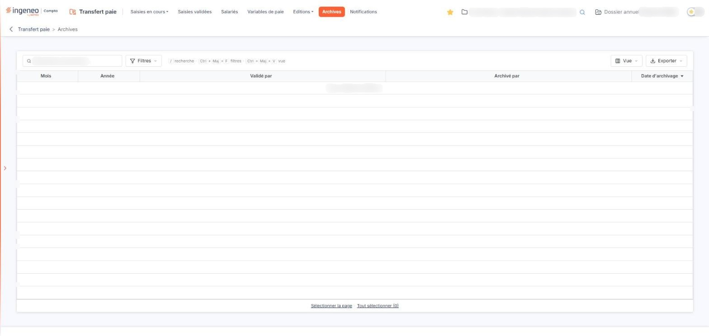

# Archives


**Où le trouver :** Menu **Archives**



**En bref** — Cet écran liste les grilles de saisie archivées, une ligne par période, avec l'utilisateur qui a validé la saisie, celui qui l'a archivée et la date d'archivage.

* Pour consulter une archive : ouvrez-la depuis sa ligne ; la période, la date d'archivage et les lignes de la saisie s'affichent en lecture seule.
* Pour retrouver une archive : saisissez votre recherche dans « Rechercher une archive… » ou posez des critères par le bouton \[Filtres].


Une ligne correspond à une période de saisie archivée. La liste conserve la trace de qui a validé la saisie, de qui l'a archivée et à quelle date.

<figure><figcaption>
Écran « Archives » de la nouvelle interface
</figcaption></figure>

Tant qu'aucune saisie n'a été archivée sur la société gérée, la liste est vide et le logiciel affiche « Aucun élément à afficher. ».

La liste est présentée sous une barre « Rechercher une archive… », et sans sélecteur de période : elle présente toutes les périodes archivées. Elle comporte cinq colonnes :

* **Mois** : le mois de la période de saisie archivée.
* **Année** : l'année de cette période.
* **Validé par** : l'utilisateur qui a validé la saisie.
* **Archivé par** : l'utilisateur qui l'a archivée.
* **Date d'archivage** : la date de l'archivage. C'est la colonne de tri initial, par ordre **décroissant** : l'archive la plus récente est donc présentée en tête de liste.

La liste n'a plus de case d'en-tête ni de pictogramme « Roue crantée ». Sous la barre de recherche, les boutons \[Filtres], \[Vue] et \[Exporter] remplacent les anciens contrôles d'en-tête : le bouton \[Filtres] pose des critères sur les colonnes, le bouton \[Vue] choisit les colonnes affichées (c'est là que se trouve désormais la personnalisation des colonnes), le bouton \[Exporter] propose l'aperçu, l'impression, l'export Excel ou PDF de la liste et son envoi par courriel. Au pied de la liste, les liens « Sélectionner la page » et « Tout sélectionner (N) » étendent la sélection. La liste ne comporte aucun bouton de pied.

bouton **\[Supprimer]**

Ce bouton n'est plus proposé dans le pied de la liste : l'écran ne porte plus aucun bouton de pied,.
