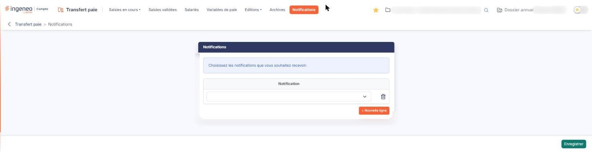
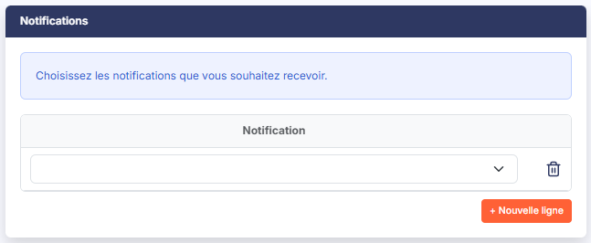
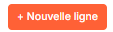

# Notifications


**Où le trouver :** Menu **Notifications**



**En bref** — Cet écran permet de choisir les évènements du module qui vous sont signalés par courriel ; le paramétrage est propre à l'utilisateur connecté, pour la société et l'exercice en cours.

* Pour être averti d'un évènement : bouton \[Nouveau], choisissez l'évènement dans la liste, puis bouton \[Enregistrer].
* Pour retirer une notification : pictogramme « Croix » de sa ligne, puis bouton \[Enregistrer].


## Rubrique " Notifications "

<figure><figcaption>
Écran « Notifications » de la nouvelle interface
</figcaption></figure>

<figure><figcaption>
Rubrique « a) Rubrique " Notifications " »
</figcaption></figure>

Le logiciel présente un tableau à une seule colonne, intitulée " Notification ", précédée d'une colonne de commandes. Ce tableau ne se trie pas et ne se filtre pas. Une ligne vide est présentée d'emblée lorsqu'aucune notification n'est encore paramétrée.

Sur chaque ligne, vous choisissez l'évènement dans une liste déroulante qui n'a pas d'intitulé propre. Trois évènements sont proposés :

* " Salarié - Modification ",
* " Saisie de paie - Validation ",
* " Saisie de paie - ajout de commentaire ".

bouton **\[Enregistrer]**

Il enregistre le paramétrage des notifications.

C'est le seul bouton de bas d'écran : il n'y a ni retour ni annulation, la sortie de l'option se fait par le menu.

## Autres vues de l'écran

<figure><figcaption>
b) Bouton [Nouveau]
</figcaption></figure>

<figure><figcaption>
c) Pictogramme " Croix "
</figcaption></figure>
