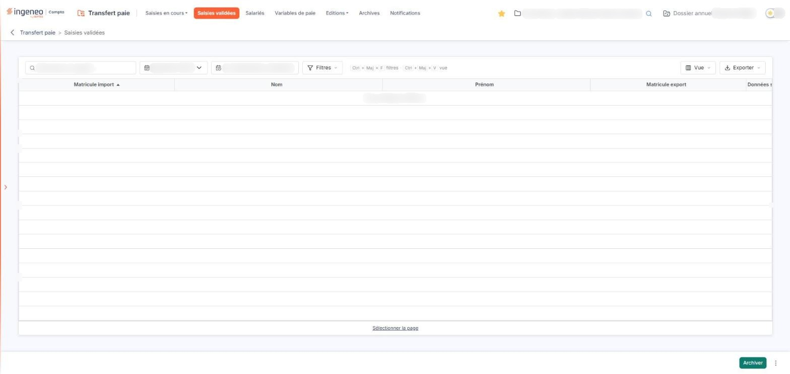
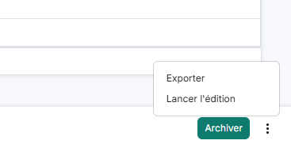

# Saisies validées


**Où le trouver :** Menu **Saisies validées**



**En bref** — Cet écran présente, pour une période, les salariés dont la saisie est validée ; c'est de là que la saisie est exportée vers votre logiciel de paie, éditée, puis archivée.

* Pour archiver la période : bouton \[Archiver], puis confirmez ; l'archivage porte sur la période entière.
* Pour produire le fichier de votre logiciel de paie : menu ⋮ « Autres actions », entrée « Exporter », puis choisissez le modèle d'export.
* Pour reprendre une saisie : sélectionnez la ligne, puis bouton \[Dévalider la saisie] du bandeau de sélection ; seuls les salariés sélectionnés sont dévalidés.


Une saisie n'arrive ici que lorsque vous l'avez validée, depuis l'une des options de la rubrique « Saisies en cours ». Tant qu'aucune saisie n'a été validée sur la période retenue, la liste est vide et le logiciel affiche « Aucun élément à afficher. » : ce n'est pas une erreur, c'est qu'il n'y a rien encore à traiter.

<figure><figcaption>
Écran « Saisies validées » de la nouvelle interface
</figcaption></figure>

Une barre surmonte la liste : elle porte trois contrôles, puis les boutons \[Filtres], \[Vue] et \[Exporter]. Les deux champs de période n'affichent pas de libellé : leur nom apparaît en infobulle.

| Champ                      | Ce qu'il faut savoir                                                                                                                                                                                                                                                                                                                                                                                                                                                                                                                                                         |
| -------------------------- | ---------------------------------------------------------------------------------------------------------------------------------------------------------------------------------------------------------------------------------------------------------------------------------------------------------------------------------------------------------------------------------------------------------------------------------------------------------------------------------------------------------------------------------------------------------------------------- |
| **Période**                | Choisissez dans la liste la période dont vous voulez consulter les saisies validées. La liste ne propose que les périodes déjà créées ; les périodes se créent depuis Paramètres > Transfert paie > Configuration, qui décrit leur constitution.                                                                                                                                                                                                                                                                                                                             |
| **Période de saisie**      | Cette zone n'est pas à renseigner. Elle affiche les bornes de la période retenue, sous la forme « du 01/09/2026 au 30/09/2026 ».                                                                                                                                                                                                                                                                                                                                                                                                                                             |
| **Rechercher un salarié…** | 
Saisissez ici un salarié pour ne conserver que lui. La liste comporte les colonnes « Matricule import », « Nom », « Prénom », « Matricule export » et « Données saisies », qui se trient toutes par un clic sur leur en-tête, puis une colonne de commandes, sans libellé. Elle s'ouvre triée sur « Matricule import », par ordre croissant. Ce sont les mêmes colonnes que la liste de l'option « Saisie par salarié » : le même effectif y est présenté avant validation, ici après. <strong>Nom</strong> et <strong>Prénom :</strong> l'identité du salarié.
 |
| **Matricule export**       | Le matricule du salarié dans votre logiciel de paie.                                                                                                                                                                                                                                                                                                                                                                                                                                                                                                                         |

Au-dessus de la liste, le bouton \[Vue] ouvre la personnalisation des colonnes, le bouton \[Filtres] permet de poser des critères et le bouton \[Exporter] ouvre un menu pour imprimer, exporter ou envoyer la liste affichée. Sous la liste, le lien « Sélectionner la page » sélectionne les lignes de la page affichée.

Le bas de l'écran présente le bouton \[Archiver] et un menu ⋮ « Autres actions », qui porte « Exporter » et « Lancer l'édition » ; ils restent proposés même lorsque la liste est vide. Un autre bouton, \[Dévalider la saisie], apparaît dans le bandeau de sélection, une fois une ligne sélectionnée.

bouton **\[Archiver]**

Il archive la saisie validée.

**Menu ⋮ « Autres actions », entrée « Exporter »**

Ne la confondez pas avec le bouton \[Exporter] de la barre, qui sort la liste affichée.

**Menu ⋮ « Autres actions », entrée « Lancer l'édition »**

Entrée du menu ⋮ « Autres actions ».

bouton **\[Dévalider la saisie]**

Il apparaît dans le bandeau de sélection, une fois une ligne sélectionnée.

## Autres vues de l'écran

<figure><figcaption>
Menu ⋮ « Autres actions », entrée « Exporter »
</figcaption></figure>
