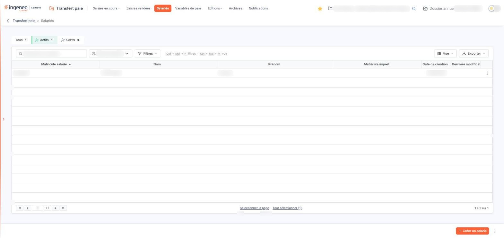
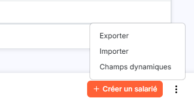
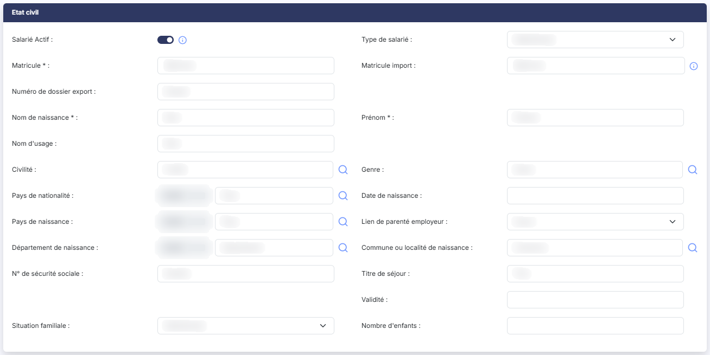
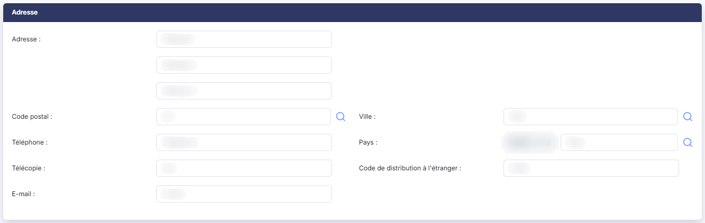
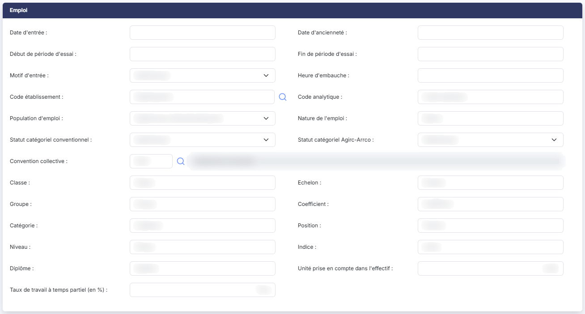
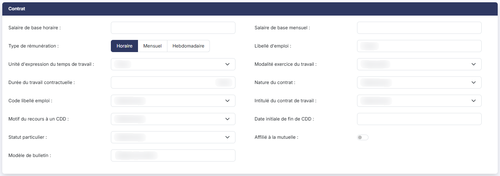
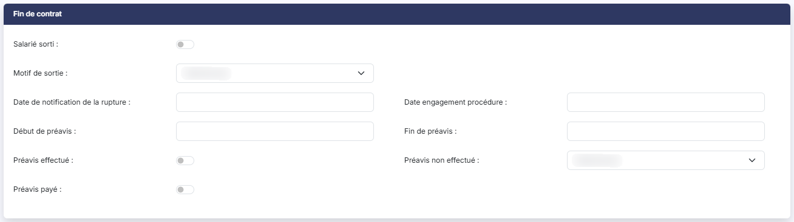
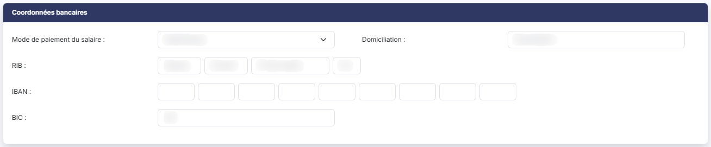
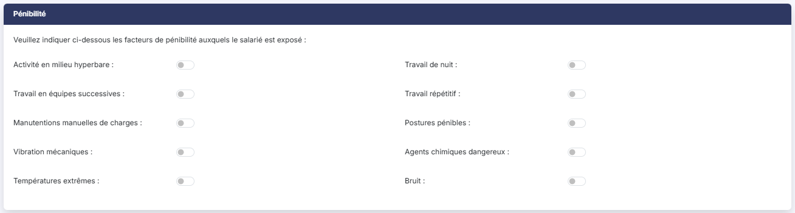
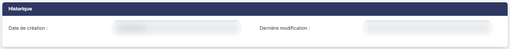

# Salariés


**Où le trouver :** Menu **Salariés**



**En bref** — Cet écran liste les salariés de la société gérée et permet de gérer leur fiche ; ce fichier sert à afficher les noms en saisie et à exporter les salariés vers le logiciel de paie.

* Pour ajouter un salarié : bouton \[Créer un salarié], renseignez le matricule, le nom de naissance et le prénom, puis bouton \[Enregistrer].
* Pour retrouver un salarié sorti : onglet « Sortis », car « Actifs » est retenu à l'ouverture.
* Pour produire le fichier destiné à votre logiciel de paie : menu « Autres actions » du pied, puis \[Exporter].


Au-dessus de la liste, trois éléments vous permettent de restreindre l'affichage (la barre d'outils décrite plus bas s'y ajoute) :

<figure><figcaption>
Écran « Salariés » de la nouvelle interface
</figcaption></figure>

* **Rechercher un salarié…** : vous saisissez ce que vous cherchez dans ce champ pour ne conserver que les salariés correspondants,
* trois onglets « Tous », « Actifs » et « Sortis », chacun suivi d'un compteur (« Tous (1) », « Actifs (1) », « Sortis (0) »), qui remplacent les anciens boutons « Tous les salariés », « Uniquement les salariés actifs » et « Uniquement les salariés sortis » ; le logiciel retient « Actifs » à l'ouverture, un salarié sorti n'apparaît donc pas d'emblée dans la liste,
* **Type de salariés** : vous choisissez un des types déclarés dans le panneau Paramètres (Paramètres > « Transfert paie » > « Types de salariés »). Tant qu'aucun type n'est déclaré, cette liste ne propose que « Tous ».

La liste comporte six colonnes, toutes triables : cliquez sur l'en-tête de la colonne pour trier.

* **Matricule salarié** : le matricule du salarié dans le logiciel de paie vers lequel les données seront exportées. C'est la colonne de tri initial, par ordre croissant.
* **Nom** : le nom de naissance du salarié.
* **Prénom** : le prénom du salarié.
* **Matricule import** : le matricule du salarié dans le fichier importé, lorsque vous alimentez le fichier salariés depuis un autre logiciel. Il peut être différent du matricule salarié.
* **Date de création** : la date du premier enregistrement de la fiche.
* **Dernière modification** : la date du dernier enregistrement de la fiche. Elle reste vide tant que la fiche n'a pas été modifiée depuis sa création.

La liste n'affiche pas si un salarié est actif ou sorti : cet état se lit dans sa fiche, ou se retrouve par les trois onglets décrits ci-dessus.

Pour agir sur plusieurs salariés à la fois, sélectionnez des lignes : un clic sur une ligne la sélectionne. La liste n'a plus de case à cocher visible, ni de case d'en-tête, ni de pictogramme « Roue crantée ». Au pied de la liste, les liens « Sélectionner la page » et « Tout sélectionner (N) » étendent la sélection ; une fois une ligne sélectionnée, un bandeau de sélection apparaît, qui porte le bouton \[Supprimer].

La barre d'outils comporte, à droite du champ de recherche et de la liste « Type de salariés », trois boutons : le bouton \[Filtres], pour poser des critères sur les colonnes ; le bouton \[Vue], pour choisir les colonnes affichées, ce qui remplace la personnalisation des colonnes de l'ancienne roue crantée ; le bouton \[Exporter], dont le menu propose l'aperçu, l'impression, l'export Excel ou PDF de la liste affichée et son envoi par courriel. La liste dispose donc d'un filtre et d'une impression.

Chaque ligne ne porte plus qu'une commande visible : un bouton à trois points, d'infobulle « Autres actions », qui ouvre un menu de trois entrées en texte :

* « Modifier », qui ouvre la fiche du salarié,
* « Dupliquer », qui recopie le salarié de la ligne,
* « Supprimer », qui supprime le salarié.

Les entrées « Modifier » et « Supprimer » sont voisines : le fichier salariés étant utilisé par toutes vos saisies, vérifiez l'entrée avant de cliquer.

Le bas de la liste comporte les boutons de changement de page, une zone où saisir directement un numéro de page, et à droite le nombre de lignes affichées sur le nombre total.

Le pied de la liste ne montre plus qu'un seul bouton, \[Créer un salarié], et un bouton à trois points d'infobulle « Autres actions », dont le menu porte \[Exporter], \[Importer] et \[Champs dynamiques]. Il n'y a plus de bouton \[Supprimer] dans le pied. Chaque commande est décrite sous la forme « Bouton \[Libellé] ».

bouton **\[Créer un salarié]**

Bouton orange du pied de la liste, en bas à droite, qui remplace le bouton \[Nouveau]. Vous ouvrez la fiche vierge d'un nouveau salarié, décrite au paragraphe c).

bouton **\[Champs dynamiques]**

Entrée du menu « Autres actions » du pied. Elle porte sur les champs dynamiques du fichier salariés, c'est-à-dire les champs supplémentaires que votre cabinet ajoute lui-même à la fiche.

bouton **\[Exporter]**

Entrée du menu « Autres actions » du pied : ne la confondez pas avec le bouton \[Exporter] de la barre d'outils, au-dessus de la liste, qui sort la liste affichée (aperçu, impression, Excel, PDF, courriel).

bouton **\[Importer]**

Entrée du menu « Autres actions » du pied.

bouton **\[Supprimer]**

Vous supprimez les salariés que vous avez sélectionnés. Ce bouton se trouve dans le bandeau de sélection, qui n'apparaît qu'une fois une ligne sélectionnée.

Après avoir cliqué sur le bouton \[Créer un salarié], le logiciel vous affiche le formulaire de saisie. Il comporte sept rubriques, toutes déployées, que vous atteignez en faisant défiler l'écran : « Etat civil », « Adresse », « Emploi », « Contrat », « Fin de contrat », « Coordonnées bancaires » et « Pénibilité ». Une huitième rubrique, « Historique », s'ajoute en fin de fiche lorsque vous ouvrez un salarié existant.

La fiche ne comporte que **trois champs obligatoires**, tous trois dans la rubrique « Etat civil » : **Matricule \* :**, **Nom de naissance \* :** et **Prénom \* :**. Tous les autres champs sont facultatifs : vous renseignez ceux que votre logiciel de paie attend.

Ces trois champs sont ceux qui identifient le salarié, et **ils ne sont plus modifiables une fois la fiche enregistrée** : sur un salarié existant ils apparaissent grisés, et sans astérisque. Vérifiez-les donc avant votre premier enregistrement.

Les rubriques se répartissent ainsi :

* **Etat civil** : l'identité et la situation du salarié — matricules, nom, prénom, civilité, dates et lieux de naissance, n° de sécurité sociale, titre de séjour, situation familiale, nombre d'enfants. La rubrique porte aussi deux informations de gestion : **Salarié Actif :** et **Type de salarié :**.
* **Adresse** : l'adresse postale et les coordonnées du salarié (téléphone, télécopie, e-mail).
* **Emploi** : les dates d'entrée, d'ancienneté et de période d'essai, le motif d'entrée, l'établissement, et la qualification du salarié (convention collective, classe, échelon, coefficient, statut catégoriel…).
* **Contrat** : la rémunération de base et le contrat de travail (type de rémunération, unité et modalité d'exercice du temps de travail, durée contractuelle, nature et intitulé du contrat, affiliation à la mutuelle).
* **Fin de contrat** : la sortie du salarié — motif de sortie, dates de notification, de procédure et de préavis.
* **Coordonnées bancaires** : le mode de paiement du salaire, la domiciliation, puis le RIB, l'IBAN et le BIC, saisis case par case.
* **Pénibilité** : une phrase d'introduction, « Veuillez indiquer ci-dessous les facteurs de pénibilité auxquels le salarié est exposé : », suivie de dix facteurs, chacun commandé par un interrupteur que vous activez ou désactivez (activité en milieu hyperbare, travail de nuit, travail répétitif, bruit…).
* **Historique** : les deux dates **Date de création :** et **Dernière modification :** de la fiche. Elles ne se saisissent pas.

Trois points sont à connaître sur cette fiche :

* l'interrupteur **Salarié Actif :** commande la saisie : son infobulle rappelle que « La saisie de variables n'est possible que si le salarié est actif. » ;
* la rubrique « Fin de contrat » est affichée même sur un salarié qui n'est pas sorti ;
* dans la rubrique « Emploi », la liste **Population d'emploi :** ne comporte pas d'entrée « Sélectionnez » : son premier choix est donc retenu par défaut, sans que vous ayez rien indiqué. Vérifiez-la avant d'enregistrer.

Les champs suivis d'une **loupe** (civilité, genre, pays, département, commune, code postal, ville) ouvrent une fenêtre de recherche où vous choisissez la valeur ; le code retenu s'affiche à gauche du libellé, sans être saisissable.

Le champ **Matricule import :** porte l'infobulle « A ne renseigner que dans le cas d'un import effectué depuis un autre logiciel. » : ne le renseignez donc que si vous alimentez le fichier salariés par le bouton \[Importer].

Le bas de la fiche d'un salarié existant porte trois boutons : bouton **\[Enregistrer]**, bouton **\[Précédent]** et bouton **\[Suivant]**, suivis d'un bouton à trois points, d'infobulle « Autres actions », dont le menu propose « Consulter l'historique » et « Compte utilisateur ». Le bouton \[Retour] a disparu, sur la fiche d'un nouveau salarié comme sur celle d'un salarié existant : pour quitter la fiche, utilisez la flèche « Revenir en arrière », à gauche du fil d'Ariane.

bouton **\[Enregistrer]**

Vous enregistrez la fiche.

bouton **\[Consulter l'historique]**

Entrée du menu « Autres actions » de la fiche. Elle porte sur l'historique de la fiche. Il est distinct de la rubrique « Historique », qui n'affiche que les deux dates de création et de dernière modification.

bouton **\[Compte utilisateur]**

Entrée du menu « Autres actions » de la fiche. Elle porte sur le compte utilisateur du salarié, c'est-à-dire son accès au module « Mon compte ».

**Flèche « Revenir en arrière »**

Elle remplace le bouton \[Retour] : vous quittez la fiche et revenez à la liste des salariés.

La suppression d'un salarié ne se fait pas depuis sa fiche : elle est portée par l'entrée « Supprimer » du menu « Autres actions » de sa ligne et par le bouton \[Supprimer] du bandeau de sélection de la liste.

Un salarié déjà employé dans vos saisies ne se supprime pas librement : si sa saisie est validée, le logiciel refuse la suppression et vous l'indique ; si sa saisie est seulement en cours, il vous demande de confirmer et vous avertit que les lignes de saisie contenant ce salarié seront elles aussi détruites.

## Autres vues de l'écran

<figure><figcaption>
Bouton [Créer un salarié]
</figcaption></figure>

<figure><figcaption>
Bouton [Champs dynamiques]
</figcaption></figure>

<figure><figcaption>
c) La fiche du salarié
</figcaption></figure>

<figure><figcaption>
c) La fiche du salarié
</figcaption></figure>

<figure><figcaption>
c) La fiche du salarié
</figcaption></figure>

<figure><figcaption>
c) La fiche du salarié
</figcaption></figure>

<figure><figcaption>
c) La fiche du salarié
</figcaption></figure>

<figure><figcaption>
c) La fiche du salarié
</figcaption></figure>

<figure><figcaption>
c) La fiche du salarié
</figcaption></figure>

<figure><figcaption>
c) La fiche du salarié
</figcaption></figure>

<figure><figcaption>
Bouton [Consulter l'historique]
</figcaption></figure>
