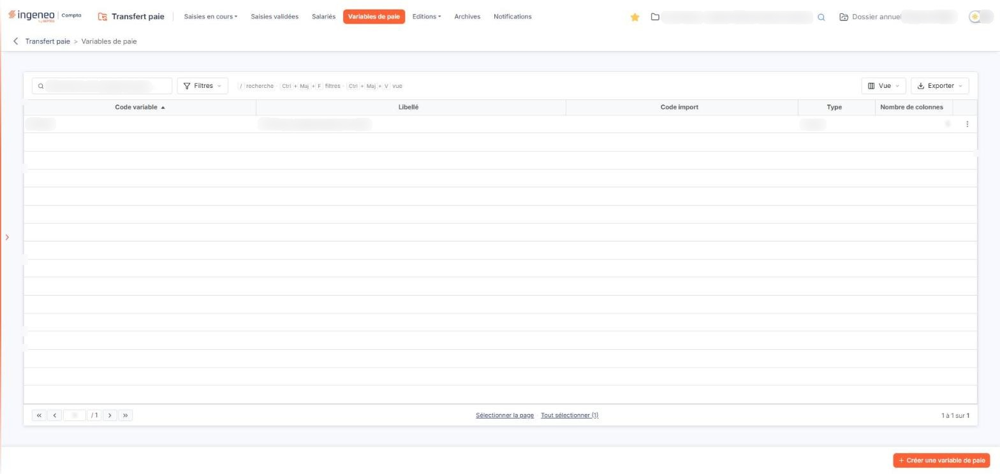
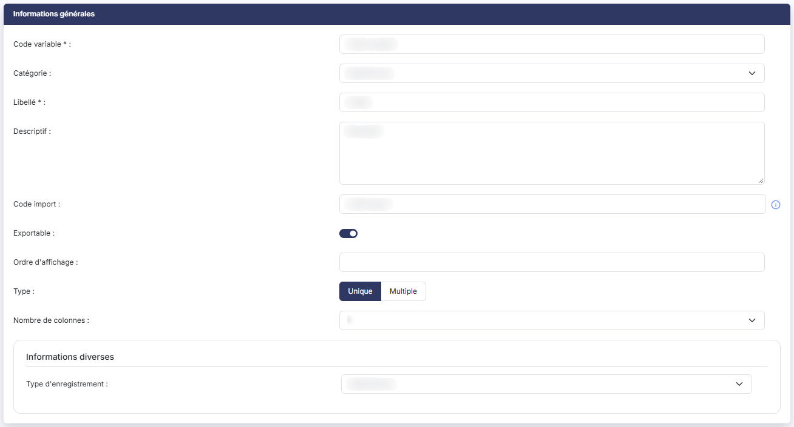
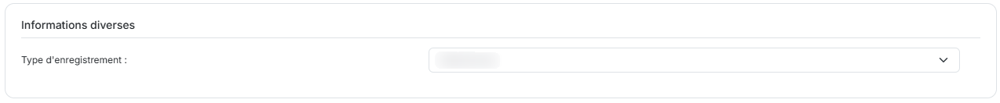
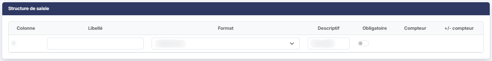

# Variables de paie


**Où le trouver :** Menu **Variables de paie**



**En bref** — Cet écran liste les variables de paie propres à la société et permet de les créer, modifier ou supprimer ; chaque variable définit son code, son libellé et les colonnes proposées en saisie.

* Pour créer une variable : bouton \[Créer une variable de paie], renseignez « Code variable » et « Libellé », indiquez le « Nombre de colonnes » et décrivez-les dans « Structure de saisie », puis bouton \[Enregistrer].
* Pour modifier ou recopier une variable : menu « Autres actions » de sa ligne, puis « Modifier » ou « Dupliquer ».
* Pour supprimer des variables : sélectionnez leurs lignes, puis bouton \[Supprimer] du bandeau de sélection.


La liste est présentée sous une barre « Rechercher une variable de paie… » qui comporte aussi les boutons \[Filtres], \[Vue] et \[Exporter], décrits plus bas. Elle comporte cinq colonnes.

<figure><figcaption>
Écran « Variables de paie » de la nouvelle interface
</figcaption></figure>

* **Code variable** : le code de la variable. C'est la colonne de tri initial, par ordre croissant.
* **Libellé** : le libellé de la variable.
* **Code import** : le code de la variable dans le fichier importé, lorsque vous alimentez vos saisies depuis un autre logiciel.
* **Type** : « Unique » ou « Multiple ».
* **Nombre de colonnes** : le nombre de colonnes que la variable présente en saisie.

Pour agir sur plusieurs variables à la fois, sélectionnez des lignes : un clic sur une ligne la sélectionne. La liste n'a plus de case à cocher visible, ni de case d'en-tête, ni de pictogramme « Roue crantée ». Au pied de la liste, les liens « Sélectionner la page » et « Tout sélectionner (N) » étendent la sélection ; une fois une ligne sélectionnée, un bandeau de sélection apparaît, qui porte le bouton \[Supprimer].

La barre d'outils comporte, à droite du champ de recherche, trois boutons : le bouton \[Filtres], pour poser des critères sur les colonnes ; le bouton \[Vue], pour choisir les colonnes affichées, ce qui remplace la personnalisation des colonnes de l'ancienne roue crantée ; le bouton \[Exporter], dont le menu propose l'aperçu, l'impression, l'export Excel ou PDF de la liste affichée et son envoi par courriel. La liste dispose donc d'un filtre et d'une impression.

Chaque ligne ne porte plus qu'une commande visible : un bouton à trois points, d'infobulle « Autres actions », qui ouvre un menu de trois entrées en texte :

* « Modifier », qui ouvre la fiche de la variable,
* « Dupliquer », qui recopie la variable de la ligne,
* « Supprimer », qui supprime la variable.

Les entrées « Modifier » et « Supprimer » sont voisines : vos saisies s'appuyant sur les variables de paie, vérifiez l'entrée avant de cliquer.

Le bas de la liste comporte les boutons de changement de page, une zone où saisir directement un numéro de page, et à droite le nombre de lignes affichées sur le nombre total.

Le pied de la liste ne montre plus qu'un seul bouton, \[Créer une variable de paie], en bas à droite ; il n'y a plus de bouton \[Exporter] ni de bouton \[Supprimer] dans le pied, et la liste ne comporte pas de bouton d'import.

bouton **\[Créer une variable de paie]**

Il remplace le bouton \[Nouveau]. Vous ouvrez la fiche vierge d'une nouvelle variable de paie.

bouton **\[Exporter]**

Ce bouton n'est plus dans le pied : il figure dans la barre d'outils, au-dessus de la liste. Son menu sort la liste affichée (aperçu, impression, Excel, PDF, envoi par courriel).

bouton **\[Supprimer]**

Vous supprimez les variables que vous avez sélectionnées. Ce bouton se trouve dans le bandeau de sélection, qui n'apparaît qu'une fois une ligne sélectionnée.

Une variable déjà employée dans vos saisies ne se supprime pas librement : si elle figure dans une saisie validée, le logiciel refuse la suppression et vous l'indique ; si elle ne figure que dans une saisie en cours, il vous demande de confirmer et vous avertit que les lignes de saisie contenant cette variable seront elles aussi détruites. La règle vaut pour ce bouton comme pour l'entrée « Supprimer » du menu d'une ligne.

Après avoir cliqué sur le bouton \[Créer une variable de paie], le logiciel vous affiche le formulaire de saisie, qui contient deux rubriques : « Informations générales » et « Structure de saisie ». La première contient un bloc « Informations diverses ».

Deux champs seulement sont obligatoires : **Code variable \* :** et **Libellé \* :**. Le **code de la variable n'est plus modifiable une fois la fiche enregistrée** : sur une variable existante il apparaît grisé, et sans astérisque.

* **Code variable** \* : correspond au code qu'aura la variable de paie dans le logiciel de paie dans lequel seront exportées les données. Champ obligatoire, et figé après le premier enregistrement.
* **Catégorie** : la catégorie de la variable, parmi celles déclarées dans le panneau Paramètres (Paramètres > « Transfert paie » > « Catégories de variables »). Tant qu'aucune catégorie n'est déclarée, cette liste ne propose que « Sélectionnez ».
* **Libellé** \* : le libellé de la variable. Champ obligatoire.
* **Descriptif** : un commentaire libre sur plusieurs lignes.
* **Code import** : si vous utilisez l'importation de fichier, il correspond au code de la variable dans le fichier importé qui peut être différent de celui du logiciel de paie. Son infobulle le rappelle : « A ne renseigner que dans le cas d'un import effectué depuis un autre logiciel. »
* **Exportable** : activez cet interrupteur pour que la variable figure dans les exports vers votre logiciel de paie. Il est activé sur une fiche nouvelle.
* **Ordre d'affichage** : le rang de la variable dans les écrans de saisie.
* **Type** : deux boutons, « Unique » et « Multiple ». « Unique » est retenu sur une fiche nouvelle.
* **Nombre de colonnes** : le nombre de colonnes que la variable présentera en saisie, de 1 à 6. Chacune de ces colonnes se décrit dans la rubrique « Structure de saisie ».

Ce bloc, qui fait partie de la rubrique « Informations générales », **change de composition** selon le type d'enregistrement retenu.

* **Type d'enregistrement** : « MHE » ou « MAB ». Ce choix commande le champ complémentaire à renseigner, et lui seul l'affiche : tant que vous laissez « Sélectionnez », aucun des deux champs suivants n'est proposé. Ces deux codes servent au fichier d'export vers Cegid : « MAB » y produit une ligne d'absence, dont vous précisez le motif, et « MHE » une ligne d'élément variable, dont le type d'alimentation indique la donnée servie (base, taux, coefficient ou montant).
* **Type d'alimentation** \* : affiché, et obligatoire, lorsque le type d'enregistrement vaut « MHE ». Le logiciel n'accepte que les valeurs annoncées par l'infobulle du champ : « Seules les valeurs BAS, COE, MON, TAU, ou la combinaison des lettres M, T, B C (une seule fois au plus chacune) sont autorisées. »
* **Motif d'absence** \* : affiché, et obligatoire, lorsque le type d'enregistrement vaut « MAB ». Le champ se compose de deux zones de saisie côte à côte : le code du motif, puis son libellé. Il ne comporte pas de loupe de recherche.

Les deux champs sont donc exclusifs l'un de l'autre : en passant d'un type d'enregistrement à l'autre, celui qui était affiché disparaît.

C'est la rubrique qui détermine ce que les écrans de saisie afficheront. Vous y trouvez une ligne par colonne de la variable, et sept colonnes à renseigner :

* **Colonne** : le numéro de la colonne. Il ne se saisit pas.
* **Libellé** : le libellé de la colonne. Ce libellé sera repris dans les différentes colonnes de la grille de saisie.
* **Format** : la nature de la donnée attendue — « Date », « Texte », « Numérique », « Jour », ou l'un des formats numériques particuliers proposés par la liste.
* **Descriptif** : un commentaire libre sur plusieurs lignes.
* **Obligatoire** : ce réglage rend la colonne obligatoire en saisie.
* **Compteur** : le compteur que la colonne alimente, parmi ceux déclarés dans le panneau Paramètres (Paramètres > « Transfert paie » > « Compteurs »). Tant qu'aucun compteur n'est déclaré, cette liste ne propose que « Sélectionnez ». Cette liste n'est proposée que lorsque le **Format :** de la colonne est « Numérique » : sur tout autre format, la case reste vide.
* **+/- compteur** : « Addition » ou « Soustraction », selon que la valeur saisie s'ajoute au compteur ou s'en retranche. Cette liste n'apparaît qu'une fois un compteur retenu dans la colonne précédente : tant qu'aucun compteur n'est choisi, la case reste vide.

Cette rubrique ne comporte ni bouton d'ajout ni bouton de suppression de ligne : le nombre de lignes est commandé par le champ **Nombre de colonnes :** de la première rubrique.

bouton **\[Enregistrer]**

Vous enregistrez la variable de paie.

**Flèche « Revenir en arrière »**

Elle remplace le bouton \[Retour], masqué : vous quittez la fiche et revenez à la liste des variables. Elle se trouve à gauche du fil d'Ariane.

Le pied de la fiche ne porte que le bouton \[Enregistrer] : la suppression d'une variable ne se fait pas depuis sa fiche, mais par l'entrée « Supprimer » du menu de sa ligne ou par le bouton \[Supprimer] du bandeau de sélection de la liste.

## Autres vues de l'écran

<figure><figcaption>
Bouton [Créer une variable de paie]
</figcaption></figure>

<figure><figcaption>
Rubrique « Informations générales »
</figcaption></figure>

<figure><figcaption>
Rubrique « Informations diverses »
</figcaption></figure>

<figure><figcaption>
Rubrique « Structure de saisie »
</figcaption></figure>
