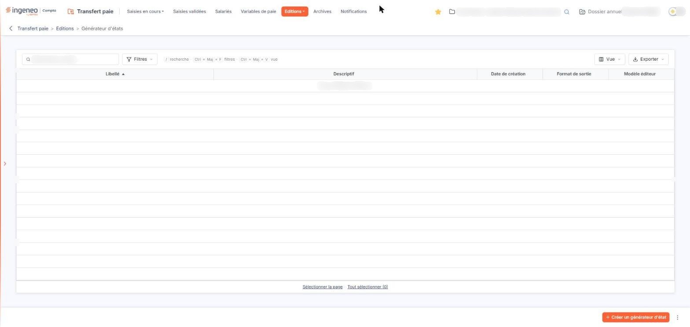
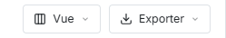
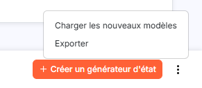

# Générateur d'états


**Où le trouver :** Menu **Editions › Générateur d'états**



**En bref** — Cet écran permet de créer vos propres éditions à partir des informations du module : colonnes, conditions de sélection des lignes et format du document produit. Il liste les états déjà créés.

* Pour créer un état : bouton \[Nouveau].
* Pour récupérer les modèles d'états de l'éditeur : bouton \[Charger les nouveaux modèles].
* Pour supprimer des états : cochez-les, puis bouton \[Supprimer].


Le générateur d'états vous permet de créer vos propres éditions à partir des informations du module : vous choisissez les colonnes qui doivent y figurer, les conditions de sélection des lignes et le format du document produit.

<figure><figcaption>
Écran « Générateur d'états » de la nouvelle interface
</figcaption></figure>

L'écran présente la liste des états déjà créés pour la société gérée. Tant qu'aucun état n'existe, la liste est vide et le logiciel affiche « Aucun élément à afficher. ».

Elle présente les colonnes suivantes :

* **Libellé** : le nom que vous avez donné à l'état. C'est la colonne de tri initial, par ordre croissant.
* **Descriptif** : le commentaire libre que vous avez pu saisir pour expliquer à quoi sert l'état.
* **Date de création** : la date à laquelle l'état a été créé.
* **Format de sortie** : le format du document produit lorsque l'état est lancé.
* **Modèle éditeur** : indique si l'état est un modèle fourni par l'éditeur du logiciel, ou un état créé par votre cabinet.

## Autres vues de l'écran

<figure><figcaption>
Bouton [Exporter]
</figcaption></figure>

<figure><figcaption>
Bouton [Charger les nouveaux modèles]
</figcaption></figure>
