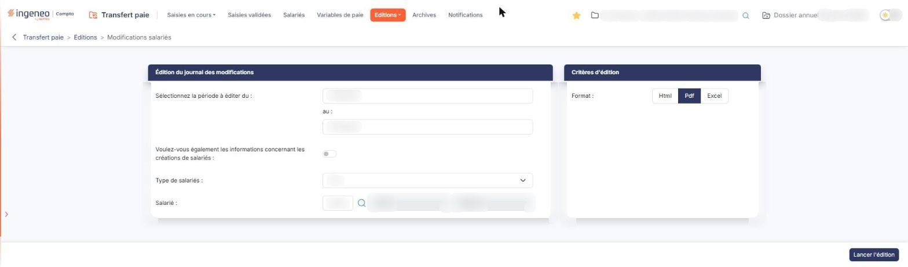
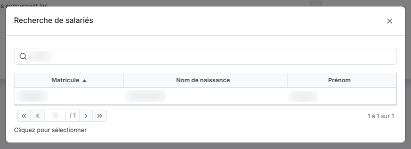

# Modifications salariés


**Où le trouver :** Menu **Editions › Modifications salariés**



**En bref** — Cet écran permet d'éditer le journal des modifications apportées aux fiches des salariés sur la période de votre choix, au format Html, Pdf ou Excel.

* Pour éditer le journal : vérifiez les deux dates de la période, choisissez le « Format », puis bouton \[Lancer l'édition].
* Pour y inclure les nouveaux salariés : activez l'interrupteur « Voulez-vous également les informations concernant les créations de salariés ».
* Pour limiter l'édition à un salarié : pictogramme « Loupe » du champ Salarié, puis cliquez sa ligne dans la fenêtre « Recherche de salariés ».


Cette option vous permet d'éditer le journal des modifications apportées aux fiches des salariés sur une période que vous choisissez.

<figure><figcaption>
Écran « Modifications salariés » de la nouvelle interface
</figcaption></figure>

L'écran ne présente pas de liste : vous renseignez les critères de l'édition dans deux rubriques, puis vous la lancez par le bouton \[Lancer l'édition]. Il n'y a ni enregistrement, ni retour : la sortie de l'option se fait par le menu.

* **Sélectionnez la période à éditer du** : … **au :** les deux bornes de la période sur laquelle porte le journal. Chaque date se saisit directement ou se choisit dans le calendrier qui s'ouvre au clic dans le champ. Le logiciel prérenseigne les deux dates : vérifiez-les avant de lancer l'édition.
* **Voulez-vous également les informations concernant les créations de salariés** : activez l'interrupteur pour que le journal comporte aussi les salariés créés pendant la période, avec les informations renseignées lors du premier enregistrement de leur fiche ; interrupteur désactivé, vous n'obtenez que les modifications apportées à des fiches existantes. Le logiciel le laisse désactivé à l'ouverture.
* **Type de salariés** : vous restreignez l'édition à un des types déclarés dans l'écran « Types de salariés » du panneau Paramètres, rubrique « Transfert paie ». Tant qu'aucun type n'est déclaré, cette liste ne propose que « Tous ».
* **Salarié** : vous restreignez l'édition à un seul salarié. Vous le choisissez par le pictogramme « Loupe » ; à droite du champ, deux zones non saisissables sont réservées à l'affichage du salarié retenu. Laissez ce champ vide pour éditer tous les salariés.

Aucun de ces quatre critères n'est obligatoire.

Le pictogramme « Loupe » du champ **Salarié :** ouvre la fenêtre « Recherche de salariés ». Elle comporte :

* un champ **Salarié :** qui porte une loupe intégrée,
* la liste des salariés de la société gérée, en trois colonnes triables : « Matricule », « Nom de naissance » et « Prénom »,
* les boutons de changement de page et, à droite, le nombre de lignes affichées sur le nombre total.

La liste des salariés s'affiche dès l'ouverture de la fenêtre.

Vous retenez un salarié en cliquant sa ligne, comme l'indique la phrase « Cliquez pour sélectionner » placée sous la liste : cette liste n'a ni case à cocher, ni commande de ligne.

La croix du bandeau de titre referme la fenêtre sans rien retenir.

* **Format** : trois boutons, « Html », « Pdf » et « Excel ». Le logiciel retient « Pdf ». C'est le seul champ de cette rubrique : cette édition ne propose pas de choix d'orientation.

bouton **\[Lancer l'édition]**

Vous produisez le journal des modifications dans le format retenu. Il est placé en bas à droite de l'écran et c'est le seul bouton de l'écran.

## Autres vues de l'écran

<figure><figcaption>
Recherche de salariés
</figcaption></figure>
