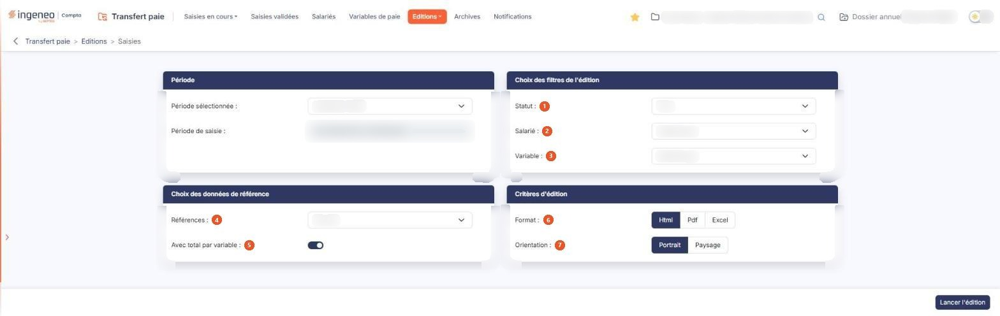

# Saisies


**Où le trouver :** Menu **Editions › Saisies**



**En bref** — Cet écran permet d'éditer les variables de paie saisies sur une période, en choisissant les filtres, les données de référence et le format de sortie.

* Pour éditer une période : choisissez la « Période sélectionnée », puis bouton \[Lancer l'édition].
* Pour ne retenir que les saisies validées : liste « Statut », puis « Saisies validées ».
* Pour changer le format : « Format », puis « Pdf » ou « Excel » à la place de « Html ».


Cette option permet d'éditer les variables de paie saisies sur une période de saisie. Vous choisissez la période, les filtres à appliquer, les données de référence à joindre et le format de sortie, puis vous lancez l'édition.

<figure><figcaption>
Écran « Saisies » de la nouvelle interface
</figcaption></figure>

Cette édition s'appuie sur les périodes de saisie du module : si aucune période n'existe encore, il n'y a rien à éditer : les périodes se créent dans Paramètres > Transfert paie > Configuration. La notion de période de saisie est expliquée dans l'aide de cet écran.

En haut de l'écran, la rubrique " Période " porte le choix de la période :

| Champ                    | Ce qu'il faut savoir                                                                                                          |
| ------------------------ | ----------------------------------------------------------------------------------------------------------------------------- |
| **Période sélectionnée** | Choisissez dans la liste la période de saisie à éditer.                                                                       |
| **Période de saisie**    | Le logiciel affiche pour mémoire les dates de début et de fin de la période choisie. Cette information n'est pas saisissable. |

## Rubrique " Choix des filtres de l'édition "

Les trois filtres sont facultatifs. Ils restreignent les saisies retenues par l'édition.

| Champ           | Ce qu'il faut savoir                                                                                                                                                                                      |
| --------------- | --------------------------------------------------------------------------------------------------------------------------------------------------------------------------------------------------------- |
| 1. **Statut**   | " Tous " par défaut. Vous pouvez ne retenir que les " Saisies en cours " ou que les " Saisies validées ".                                                                                                 |
| 2. **Salarié**  | La liste ne présente que les salariés qui portent une saisie sur la période sélectionnée, et non l'ensemble des salariés de la société. Laissez la valeur " Sélectionnez " pour éditer tous ces salariés. |
| 3. **Variable** | De la même façon, la liste ne présente que les variables de paie saisies sur la période sélectionnée. Laissez la valeur " Sélectionnez " pour éditer toutes ces variables.                                |

## Rubrique " Choix des données de référence "

| Champ                          | Ce qu'il faut savoir                                                                                                                                                                                                                                                |
| ------------------------------ | ------------------------------------------------------------------------------------------------------------------------------------------------------------------------------------------------------------------------------------------------------------------- |
| 4. **Références**              | " Aucune " par défaut. Vous pouvez demander en complément les données de référence des " Salariés " ou celles des " Variables ".                                                                                                                                    |
| 5. **Avec total par variable** | Interrupteur activé par défaut. Il demande un total par variable. Cet interrupteur n'a d'effet que si vous avez demandé des données de référence : lorsque " Références " reste sur " Aucune ", ce qui est la valeur par défaut, le logiciel n'en tient pas compte. |

## Rubrique " Critères d'édition "

| Champ              | Ce qu'il faut savoir                                                                 |
| ------------------ | ------------------------------------------------------------------------------------ |
| 6. **Format**      | " Html " par défaut. Vous pouvez également demander une sortie " Pdf " ou " Excel ". |
| 7. **Orientation** | " Portrait " par défaut, ou " Paysage ".                                             |

bouton **\[Lancer l'édition]**

Situé en bas à droite de l'écran, il lance l'édition selon les critères choisis. C'est le seul bouton de cet écran, qui ne comporte ni enregistrement ni retour : les critères que vous choisissez ne sont pas conservés lorsque vous revenez sur cette option.

Ce bouton n'apparaît que si votre profil vous autorise à imprimer les saisies. S'il est absent, adressez-vous à la personne qui gère les droits de votre cabinet ou de votre société.
