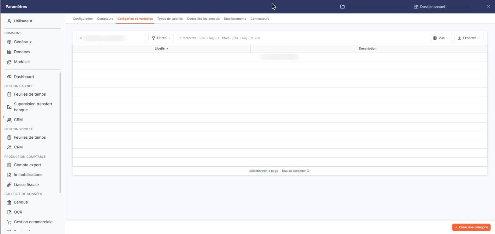
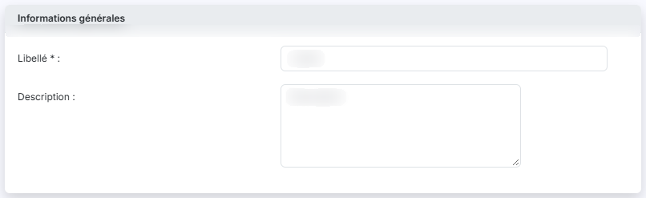

# Catégories de variables


**Où le trouver :** Panneau **Paramètres** › **Transfert paie** › **Catégories de variables**



**En bref** — Cet écran permet de constituer la liste des catégories de variables de la société ; une catégorie regroupe des variables de paie qui se ressemblent.

* Pour créer une catégorie : bouton \[Créer une catégorie], saisissez le « Libellé » (30 caractères au plus), puis bouton \[Enregistrer].
* Pour supprimer des catégories : sélectionnez-les, puis bouton \[Supprimer] du bandeau de sélection.


Cette option permet de constituer la liste des catégories de variables de la société. Une catégorie sert à regrouper les variables de paie qui se ressemblent : sur la fiche d'une variable de paie, vous choisissez sa catégorie dans le champ " Catégorie ", ce choix étant facultatif. Cette option s'ouvre par Paramètres > Transfert paie > Catégories de variables.

<figure><figcaption>
Écran « Catégories de variables » de la nouvelle interface
</figcaption></figure>

Le logiciel présente la liste des catégories déjà créées, sur deux colonnes :

| Champ           | Ce qu'il faut savoir                                                                            |
| --------------- | ----------------------------------------------------------------------------------------------- |
| **Libellé**     | Le nom de la catégorie. La liste est triée sur cette colonne par ordre croissant à l'ouverture. |
| **Description** | Le texte libre que vous avez porté sur la catégorie.                                            |

Au-dessus de la liste, une barre porte le champ " Rechercher une catégorie… " et les boutons \[Filtres], \[Vue] et \[Exporter] ; le bouton \[Vue] ouvre la personnalisation des colonnes. Sous la liste, les liens " Sélectionner la page " et " Tout sélectionner " (suivi du nombre de lignes) permettent de sélectionner les lignes de la page en cours ou celles de toutes les pages.

Tant qu'aucune catégorie n'a été créée, la liste affiche la mention " Aucun élément à afficher. ".

## Bouton \[Créer une catégorie]

<figure><figcaption>
Bouton [Créer une catégorie]
</figcaption></figure>

<figure><figcaption>
Rubrique « Informations générales »
</figcaption></figure>

Situé en bas à droite du panneau, il ouvre la fiche de création d'une catégorie, qui comporte une seule rubrique " Informations générales " :

| Champ                                                   | Ce qu'il faut savoir                                                                                                                                                   |
| ------------------------------------------------------- | ---------------------------------------------------------------------------------------------------------------------------------------------------------------------- |
| 
<strong>Libellé</strong> <em>Obligatoire</em>
 | 30 caractères au maximum, et différent du libellé des catégories déjà créées. C'est le nom sous lequel la catégorie sera proposée sur la fiche d'une variable de paie. |
| **Description**                                         | 1 024 caractères au maximum. Cette zone accepte plusieurs lignes et vous permet de préciser ce que la catégorie regroupe.                                              |

bouton **\[Enregistrer]** : il enregistre la nouvelle catégorie.

**Chevron " Retour "**, à gauche de la barre d'onglets du panneau : il vous ramène à la liste sans rien enregistrer.

## Bouton \[Supprimer]

Il apparaît dans le bandeau de sélection, une fois une catégorie sélectionnée dans la liste, et supprime les catégories sélectionnées.

Ces deux boutons n'apparaissent que si votre profil vous autorise respectivement à créer et à supprimer une catégorie de variables.
