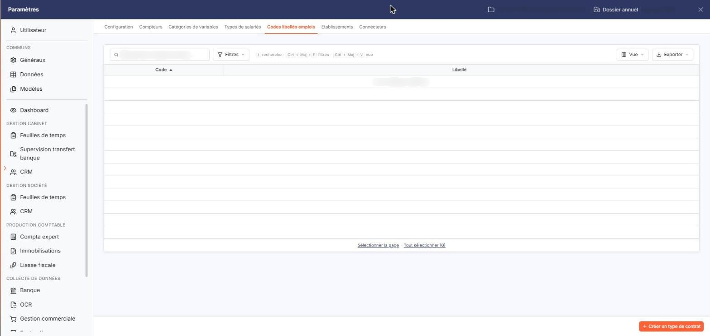
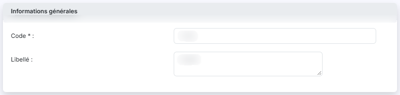
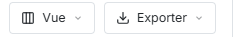

# Codes libellés emplois


**Où le trouver :** Panneau **Paramètres** › **Transfert paie** › **Codes libellés emplois**



**En bref** — Cet écran permet de constituer la liste des codes libellés emplois de la société, proposés ensuite dans une liste déroulante sur la fiche d'un salarié.

* Pour créer un code : bouton \[Créer un type de contrat], saisissez le « Code » (10 caractères au plus) et le « Libellé », puis bouton \[Enregistrer].
* Pour supprimer des codes : sélectionnez-les, puis bouton \[Supprimer] du bandeau de sélection.


Cette option permet de constituer la liste des codes libellés emplois de la société. Ces codes alimentent le champ " Code libellé emploi " de la fiche d'un salarié, où ils sont proposés dans une liste déroulante. Cette option s'ouvre par Paramètres > Transfert paie > Codes libellés emplois.

<figure><figcaption>
Écran « Codes libellés emplois » de la nouvelle interface
</figcaption></figure>

Le logiciel présente la liste des codes déjà créés, sur deux colonnes :

| Champ       | Ce qu'il faut savoir                                                                         |
| ----------- | -------------------------------------------------------------------------------------------- |
| **Code**    | Le code de l'emploi. La liste est triée sur cette colonne par ordre croissant à l'ouverture. |
| **Libellé** | Le libellé de l'emploi.                                                                      |

Au-dessus de la liste, une barre porte le champ de recherche (" Rechercher un type de contrat… ") et les boutons \[Filtres], \[Vue] et \[Exporter] ; le bouton \[Vue] ouvre la personnalisation des colonnes. Sous la liste, les liens " Sélectionner la page " et " Tout sélectionner " (suivi du nombre de lignes) permettent de sélectionner les lignes de la page en cours ou celles de toutes les pages.

Tant qu'aucun code n'a été créé, la liste affiche la mention " Aucun élément à afficher. ".

## Bouton \[Créer un type de contrat]

<figure><figcaption>
Bouton [Créer un type de contrat]
</figcaption></figure>

<figure><figcaption>
Rubrique « Informations générales »
</figcaption></figure>

Situé en bas à droite du panneau, il ouvre la fiche de création d'un code, qui comporte une seule rubrique " Informations générales " :

| Champ                                                | Ce qu'il faut savoir                                                                                                                       |
| ---------------------------------------------------- | ------------------------------------------------------------------------------------------------------------------------------------------ |
| 
<strong>Code</strong> <em>Obligatoire</em>
 | 10 caractères au maximum. C'est le code conservé sur la fiche du salarié.                                                                  |
| **Libellé**                                          | 100 caractères au maximum. Cette zone accepte plusieurs lignes. C'est le libellé présenté dans la liste déroulante de la fiche du salarié. |

bouton **\[Enregistrer]** : il enregistre le nouveau code.

**Chevron " Retour "**, à gauche de la barre d'onglets du panneau : il vous ramène à la liste sans rien enregistrer.

## Bouton \[Exporter]

<figure><figcaption>
Bouton [Exporter]
</figcaption></figure>

Situé dans la barre au-dessus de la liste, il ouvre un menu qui propose notamment d'exporter la liste des codes libellés emplois en Excel ou en PDF, ou de l'envoyer par e-mail.

## Bouton \[Supprimer]

Il apparaît dans le bandeau de sélection, une fois un code sélectionné dans la liste, et supprime les codes sélectionnés.

Ces trois boutons n'apparaissent que si votre profil vous autorise respectivement à créer, à exporter et à supprimer un code libellé emploi.
