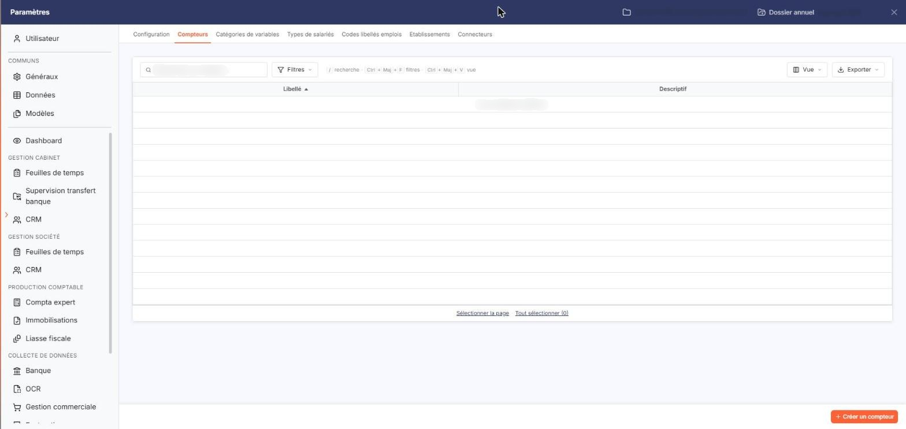
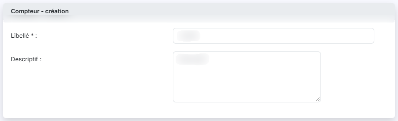

# Compteurs


**Où le trouver :** Panneau **Paramètres** › **Transfert paie** › **Compteurs**



**En bref** — Cet écran permet de déclarer et de nommer les compteurs de la société, des cumuls auxquels vous rattachez des colonnes de variables de paie ; il ne porte aucune valeur.

* Pour créer un compteur : bouton \[Créer un compteur], saisissez le « Libellé » (25 caractères au plus), puis bouton \[Enregistrer].
* Pour supprimer des compteurs : sélectionnez-les, puis bouton \[Supprimer] du bandeau de sélection.


Cette option permet de constituer la liste des compteurs de la société. Un compteur est un cumul : sur la fiche d'une variable de paie, vous rattachez une colonne de la variable à un compteur, et le logiciel présente ensuite le total de ce compteur dans la saisie et dans les éditions de la période. Cette option ne sert qu'à déclarer les compteurs et à les nommer : elle ne porte aucune valeur. Elle s'ouvre par Paramètres > Transfert paie > Compteurs.

<figure><figcaption>
Écran « Compteurs » de la nouvelle interface
</figcaption></figure>

Le logiciel présente la liste des compteurs déjà créés, sur deux colonnes :

| Champ          | Ce qu'il faut savoir                                                                        |
| -------------- | ------------------------------------------------------------------------------------------- |
| **Libellé**    | Le nom du compteur. La liste est triée sur cette colonne par ordre croissant à l'ouverture. |
| **Descriptif** | Le texte libre que vous avez porté sur le compteur.                                         |

Au-dessus de la liste, une barre porte le champ " Rechercher un compteur… " et les boutons \[Filtres], \[Vue] et \[Exporter] ; le bouton \[Vue] ouvre la personnalisation des colonnes. Sous la liste, les liens " Sélectionner la page " et " Tout sélectionner " (suivi du nombre de lignes) permettent de sélectionner les lignes de la page en cours ou celles de toutes les pages.

Tant qu'aucun compteur n'a été créé, la liste affiche la mention " Aucun élément à afficher. ".

## Bouton \[Créer un compteur]

<figure><figcaption>
Bouton [Créer un compteur]
</figcaption></figure>

<figure><figcaption>
Rubrique « Compteur - création »
</figcaption></figure>

Situé en bas à droite du panneau, il ouvre la fiche de création d'un compteur, dont la rubrique s'intitule " Compteur - création " :

| Champ                                                   | Ce qu'il faut savoir                                                                                                   |
| ------------------------------------------------------- | ---------------------------------------------------------------------------------------------------------------------- |
| 
<strong>Libellé</strong> <em>Obligatoire</em>
 | 25 caractères au maximum, et différent du libellé des compteurs déjà créés.                                            |
| **Descriptif**                                          | 1 024 caractères au maximum. Cette zone accepte plusieurs lignes et vous permet de préciser ce que le compteur cumule. |

bouton **\[Enregistrer]** : il enregistre le nouveau compteur.

**Chevron " Retour "**, à gauche de la barre d'onglets du panneau : il vous ramène à la liste sans rien enregistrer.

## Bouton \[Supprimer]

Il apparaît dans le bandeau de sélection, une fois un compteur sélectionné dans la liste, et supprime les compteurs sélectionnés.

Ces deux boutons n'apparaissent que si votre profil vous autorise respectivement à créer et à supprimer un compteur.
