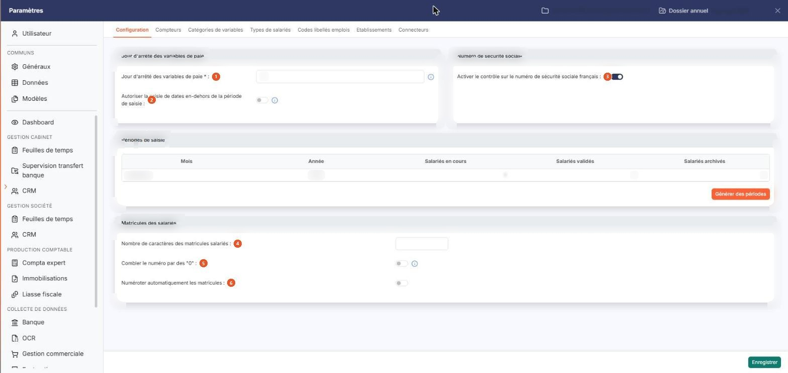
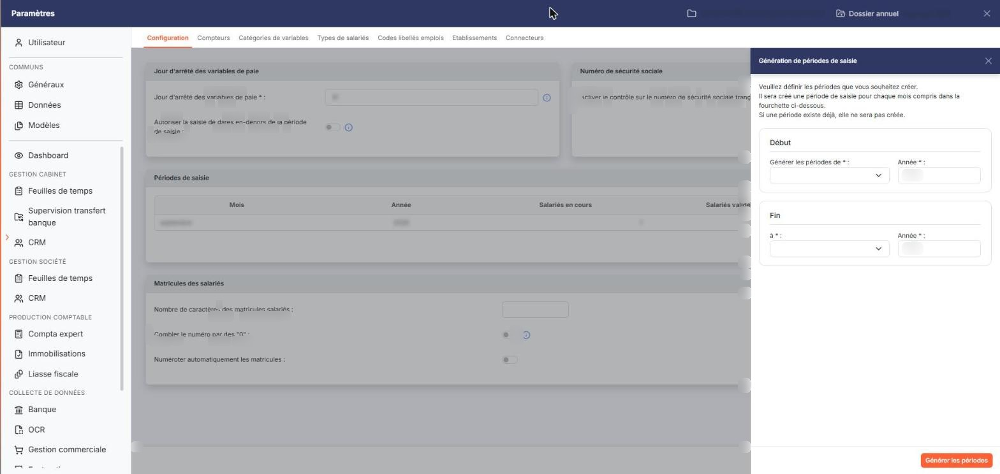

# Configuration


**Où le trouver :** Panneau **Paramètres** › **Transfert paie** › **Configuration**



**En bref** — Cet écran rassemble les paramètres du module pour la société (jour d'arrêté, numéro de sécurité sociale, matricules) ; c'est ici que vous créez les périodes de saisie.

* Pour créer des périodes de saisie : bouton \[Générer des périodes], indiquez les mois et années de début et de fin, puis bouton \[Générer les périodes].
* Pour fixer le jour d'arrêté : renseignez « Jour d'arrêté des variables de paie » (31 pour gérer les variables au mois le mois), puis bouton \[Enregistrer].
* Pour numéroter automatiquement les matricules : activez « Numéroter automatiquement les matricules », indiquez le « Prochain numéro », puis bouton \[Enregistrer].


Cette option rassemble les paramètres du module pour la société gérée, et c'est ici que vous créez les périodes de saisie sur lesquelles tout le module travaille. Elle présente quatre rubriques, et un seul bouton **\[Enregistrer]** qui vaut pour l'ensemble de l'écran. Elle s'ouvre par Paramètres > Transfert paie > Configuration.

<figure><figcaption>
Écran « Configuration » de la nouvelle interface
</figcaption></figure>

Il n'y a pas de bouton de retour : pour quitter l'écran sans enregistrer, passez à un autre onglet du panneau Paramètres ou fermez le panneau.

**La période de saisie**

C'est la notion centrale du module : toute saisie, toute validation et toute édition portent sur une période de saisie, et rien ne peut être saisi tant qu'aucune période n'existe.

Une période de saisie est un **mois** et une **année**, bornés par deux dates que le logiciel calcule lui-même à partir du **jour d'arrêté des variables de paie** de la première rubrique : elle commence le lendemain du jour d'arrêté du mois précédent et se termine le jour d'arrêté du mois considéré. Avec un jour d'arrêté au 31, elle correspond donc au mois entier, du premier au dernier jour ; c'est ce que présentent les autres écrans du module sous la forme « du 01/09/2026 au 30/09/2026 ».

Les périodes ne se créent qu'ici, par le bouton **\[Générer des périodes]** décrit plus bas. Elles ne se modifient ni ne se suppriment depuis cet écran.

## Rubrique « Jour d'arrêté des variables de paie »

| Champ                                                                                  | Ce qu'il faut savoir                                                                                                                                                                                                                                                                                                                                                            |
| -------------------------------------------------------------------------------------- | ------------------------------------------------------------------------------------------------------------------------------------------------------------------------------------------------------------------------------------------------------------------------------------------------------------------------------------------------------------------------------- |
| 
1. <strong>Jour d'arrêté des variables de paie</strong> <em>Obligatoire</em>
 | 
Compris entre 1 et 31. Il définit le jour du mois auquel les variables de paie sont arrêtées : en saisie, le logiciel contrôle qu'aucun élément n'est postérieur à ce jour pour un mois donné. Si vous souhaitez gérer les variables au mois le mois, saisissez 31. C'est également ce jour qui fixe les bornes de chaque période de saisie, comme indiqué plus haut.
 |
| 2. **Autoriser la saisie de dates en-dehors de la période de saisie**                  | Interrupteur, désactivé par défaut. Si vous l'activez, il devient possible de saisir des dates non comprises dans la période relative à la saisie en cours.                                                                                                                                                                                                                     |

Ce paramètre se fige dès qu'une saisie a été validée : l'interrupteur passe alors en lecture seule et son infobulle d'information disparaît. Réglez-le donc avant de commencer vos saisies.

## Rubrique « Numéro de sécurité sociale »

**Activer le contrôle sur le numéro de sécurité sociale français** : interrupteur, activé par défaut. Il commande le contrôle du numéro de sécurité sociale porté sur la fiche d'un salarié. Désactivez-le si vous gérez des salariés dont le numéro n'est pas un numéro français.

## Rubrique « Périodes de saisie »

<figure><figcaption>
Bouton [Générer des périodes]
</figcaption></figure>

Le logiciel présente ici les périodes déjà créées, dans un tableau de cinq colonnes :

**Mois** et **Année :** le mois et l'année de la période.

| Champ                 | Ce qu'il faut savoir                                                         |
| --------------------- | ---------------------------------------------------------------------------- |
| **Salariés en cours** | Le nombre de salariés pour lesquels des données sont saisies sur la période. |
| **Salariés validés**  | Le nombre de salariés dont la saisie a été validée.                          |
| **Salariés archivés** | Le nombre de salariés dont la saisie a été archivée.                         |

Ce tableau est présenté pour information : ses colonnes ne se trient pas, ses lignes ne s'ouvrent pas, et il n'existe aucune commande pour corriger ou retirer une période.

bouton **\[Générer des périodes]**

Il ouvre, à droite de l'écran, le tiroir « Génération de périodes de saisie », par lequel vous créez vos périodes.

Vous y indiquez un mois et une année de début, puis un mois et une année de fin ; les quatre zones sont obligatoires. Les deux mois s'ouvrent à vide, tandis que les deux années arrivent déjà renseignées avec l'année en cours. Le logiciel crée **une période par mois compris dans cette fourchette**. Si une période existe déjà, elle n'est pas recréée : vous pouvez donc relancer la génération sur une fourchette qui recouvre des périodes existantes sans créer de doublon.

La fourchette ne peut pas dépasser **deux ans** : au-delà, le logiciel refuse la génération et vous en avertit. Cette limite vous évite de créer par erreur des dizaines de périodes à la suite d'une faute de frappe sur une année.

Le logiciel refuse également une fourchette à l'envers, dont le mois de début serait postérieur au mois de fin, et vous invite alors à choisir une date de début antérieure à la date de fin.


Attention : les deux zones d'année portent le même libellé **Année \* :**. C'est leur position qui les distingue, chacune étant placée à droite du mois auquel elle se rapporte, l'année de début en premier.


bouton **\[Générer les périodes]**, en bas du tiroir : il lance la création.

**Croix de fermeture**, dans l'en-tête du tiroir : elle le ferme sans rien créer. Le tiroir n'a pas de bouton \[Annuler].

## Rubrique « Matricules des salariés »

Cette rubrique commande la façon dont les matricules sont attribués sur la fiche d'un salarié.

| Champ                                               | Ce qu'il faut savoir                                                                                                                                                                         |
| --------------------------------------------------- | -------------------------------------------------------------------------------------------------------------------------------------------------------------------------------------------- |
| 4. **Nombre de caractères des matricules salariés** | Compris entre 1 et 30. C'est la longueur attendue d'un matricule.                                                                                                                            |
| 5. **Combler le numéro par des "0"**                | Interrupteur, désactivé par défaut. Si vous l'activez, le logiciel insère des « 0 » en préfixe du numéro saisi ou renseigné, de façon à atteindre le nombre de caractères indiqué ci-dessus. |
| 6. **Numéroter automatiquement les matricules**     | Interrupteur, désactivé par défaut. Activez-le pour que le logiciel propose lui-même le matricule à la création d'un salarié.                                                                |
| **Prochain numéro**                                 | Cette zone n'apparaît que lorsque l'interrupteur précédent est activé. Vous y indiquez le numéro à attribuer au prochain salarié créé ; le logiciel l'incrémente ensuite de lui-même.        |

bouton **\[Enregistrer]**

Situé en bas à droite du panneau, il enregistre les quatre rubriques en une seule fois. La génération de périodes, elle, ne passe pas par ce bouton : elle est appliquée depuis son propre tiroir.
